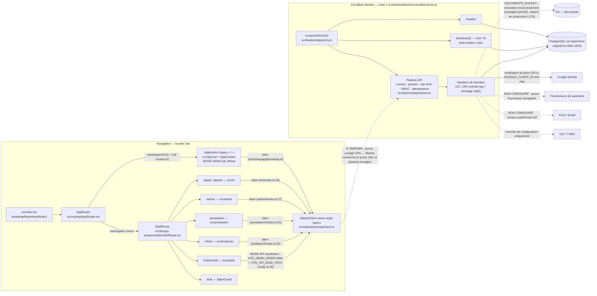

# Cartographie globale — LE LABEUR PRE-ARENA

> **Livrable A — Index et vue d'ensemble.** Analyse documentaire uniquement : aucun fichier applicatif, backend, API, migration,
> permission, route ou règle métier n'a été modifié. Chaque affirmation renvoie à un fichier (et, quand c'est utile, à une ligne ou
> un symbole) du code analysé. Ce qui n'a pas pu être vérifié est marqué **À VÉRIFIER** ou **NON VÉRIFIÉ**.

## 1. Version analysée

| Élément | Valeur vérifiée |
|---|---|
| Dépôt | `mdgejc14-hash/LE-LABEUR-PRE-ARENA` |
| Checkpoint demandé | branche `arena/9682849e-le-labeur-pre-arena`, PR #71 (PUB-AUTH-2), ouverte, non fusionnée |
| Commit analysé (HEAD) | `c759c0f8453b9ff81a2a4cfde9bcf12a50e504a3` — identique à la tête distante de `arena/9682849e-le-labeur-pre-arena` et au `headRefOid` de la PR #71 (`gh pr view 71`) |
| Branche de travail imposée par Arena | `arena/3da9ab2f-le-labeur-pre-arena`, créée à partir de `c759c0f` (voir H §4) |
| Historique | 71 commits linéaires (`git log --graph`, après `git fetch --unshallow`) |
| Date d'analyse | 2026-10-13 |
| État de l'arbre au départ | propre (`git status` vide) |

La chaîne de checkpoints #47 → #71 et l'état réel des PR sont détaillés dans [`H-integration-git-pr.md`](H-integration-git-pr.md).
**`main` n'est pas consolidée** : `main` (`8fd1126`) n'est pas un ancêtre de HEAD (merge-base `9ee5029`, 2 commits propres à `main`).

## 2. Architecture en une page

Voir le diagramme [01 — architecture générale](diagrammes/01-architecture-generale.mmd).

<!-- DIAGRAMME:01-architecture-generale -->
_Source : [`diagrammes/01-architecture-generale.mmd`](diagrammes/01-architecture-generale.mmd)_

<!-- /DIAGRAMME -->

* **Frontend** (Vite + React, `src/main.tsx` → `src/routing/AppRouter.tsx`). Deux applications cohabitent :
  * l'**application legacy** servie sur `/` et tout chemin hors namespace (`src/App.tsx`, `AppContext`, MODE DEMO par défaut) ;
  * les **espaces Master Design** chargés par `ShellRoute` (`src/design-system/shells/ShellRoute.tsx`) : Public/Auth (routes exactes de
    `PUBLIC_SCREENS`), `/client` (Employeur), `/prestataire` (Candidat), `/admin`, `/appel` + `/appels` (RTC), `/etat` (SYS), `/fondation` (démo).
  * Chaque famille suit la même chaîne : `screenMap.ts` → `registry.tsx` → `UnitBoundary.tsx` → composant `screens/*.tsx` → `hooks.ts` →
    `api.ts` → `HttpApiClient` (`src/repositories/apiClient.ts`, préfixe same-origin `/api/v1`, en-tête `Idempotency-Key`).
  * **Aucune famille n'appelle l'API par défaut** : le client n'est créé que si `VITE_DEMO_MODE=false` **et** `VITE_API_BASE_PATH` est un
    chemin same-origin (`src/repositories/mode.ts:25-35`, `src/employer/hooks.ts:24`, idem PRE/ADM/RTC). Sinon `UnitBoundary` affiche
    « Source de données non configurée ».
* **Backend** : un Worker Cloudflare (`wrangler.toml` → `src/backend/worker/cloudflareEntry.ts`) compose l'API avec
  `composeWorker()` (`src/backend/api/entry.ts`). Le pipeline (`src/backend/api/worker.ts:140-196`) applique dans l'ordre : résolution du
  contrat (404/405), session (401), seau de débit auth/webhook (429), contrôle rôle/permission (403), autres seaux (429), clé d'idempotence
  (400), puis handler (**501 si aucun handler n'est installé**).
* **Données** : PostgreSQL (Hyperdrive) avec 18 migrations (`migrations/0001…0018`), outbox/jobs en tables (`automation_outbox`,
  `automation_jobs`), cron `*/5` (`wrangler.toml`), stockage objet R2 pour les documents (binding `DOCUMENTS_BUCKET` déclaré
  uniquement pour le simulateur local, `wrangler.toml:83-85` ; **commenté/absent du profil `production`**, `wrangler.toml:176` ; de même
  Hyperdrive : ID placeholder en local `:65-67`, commenté en production `:161`).
* **Services externes** : Google Identity (vérification du jeton GSI), fournisseurs de paiement (**aucun enregistré**), push/email
  (**canaux null**), ICE/TURN (**override de configuration uniquement**). Détails : [E §5](E-donnees-traitements.md#5-interactions-externes-et-services-absents--non-configurés).

## 3. Profils, familles et domaines couverts

| Profil | Rôle serveur | Namespace | Famille de fiches | Garde client (affichage) | Garde serveur |
|---|---|---|---|---|---|
| Public / Auth | aucun | routes exactes `PUBLIC_SCREENS` | PUB (10) | — | routes `authentication: 'public'` |
| Employeur (« Client ») | `EMPLOYER` | `/client` | EMP (60) | rôle EMPLOYER et compte non BLOCKED (`src/employer/hooks.ts`) | `roles: ['EMPLOYER']`, portée `self`/`owner` |
| Candidat (« Prestataire ») | `CANDIDATE` | `/prestataire` | PRE (52) | rôle CANDIDATE (`src/prestataire/hooks.ts:125`) | `roles: ['CANDIDATE']`, portée `self`/`owner` |
| ADMIN | `ADMIN` | `/admin` | ADM (63) | rôle ADMIN (`src/admin/hooks.ts:128`), aucun filtrage par permission côté client | portée `admin` + 24 permissions (`migrations/0002_role_permissions_seed.sql`) |
| Temps réel | `EMPLOYER` ou `CANDIDATE` | `/appel`, `/appels` | RTC (8) | rôle EMPLOYER ou CANDIDATE (`src/rtc/hooks.ts:128`) | `roles: ['EMPLOYER','CANDIDATE']` + contrat ACTIVE |
| Système | — | `/etat` | SYS (15) | — | — |
| Finance transversale | — | aucune route | FIN (3) | — | — · **BLOQUÉ_EN_ATTENTE_DÉCISION** |

Domaines serveur examinés : identité/session, offres, candidatures, propositions, contrats (+ post-contrat), qualification & matching,
paiements (cycle, déclarations, rapprochement externe, webhooks), confirmation de salaire (OTP), litiges (claims), remplacements,
réputation, documents (R2), notifications, WebRTC, automatisation (outbox, jobs, cron), sécurité transversale (rate-limit, idempotence,
anti-IDOR). **Domaines non examinés en profondeur** : application legacy `src/screens/*` (cartographiée au niveau de son client API
seulement, voir C §5), campagnes de charge (`docs/P0-LOAD-TESTS-*`), géographie administrative.

## 4. Inventaires réels et explication des écarts

Aucun chiffre n'a été ajusté pour faire coïncider des inventaires de définitions différentes.

| Inventaire | Définition | Valeur | Source |
|---|---|---|---|
| États de design | codes de fiche du Master Design | **211** (PUB 10 · EMP 60 · PRE 52 · ADM 63 · RTC 8 · SYS 15 · FIN 3) | `design/llab/content/*.py` via `llab.content.load_all()` |
| Écrans canoniques | regroupement d'états par `canon` | **177** (PUB 10 · EMP 44 · PRE 38 · ADM 59 · RTC 8 · SYS 15 · FIN 3) | idem, `design/README.md` |
| Unités de production | regroupements de fabrication | **120** (PUB 10 · EMP 32 · PRE 26 · ADM 34 · RTC 5 · SYS 10 · FIN 3) | `design/llab/units.py` → `src/design-system/generated/productionUnits.ts` |
| Routes de fiche | routes portées par les unités | **208** = 211 − 3 fiches FIN sans route | `PRODUCTION_UNITS[].routes` |
| Fiches avec composant enregistré | registres de famille | **183** (EMP 60 · PRE 52 · ADM 63 · RTC 8) + PUB 10 via `PublicPage` + SYS 15 via `StateGuard` = **208** | `src/*/registry.tsx`, `src/public/PublicPage.tsx:366`, `stateGuardCatalog.ts` |
| Composants distincts | fonctions React distinctes derrière les fiches | EMP 43 · PRE 28 · ADM 63 · RTC 8 · PUB 1 · SYS 1 | `donnees/ecrans.json` |
| Contrats d'API | `API_ROUTE_CONTRACTS` | **160** | `src/backend/api/routeContracts.ts` |
| Handlers installés | sonde dynamique `composeWorker` | fermé **0** · mémoire **29** (+49 non sondés, acteur ADMIN non provisionnable) · PostgreSQL **106** · PostgreSQL + stockage objet **121** | `outils/cartographie.py`, [C2](C2-contrats-api.md) |
| Handlers (analyse statique) | clés de contrat dans les fabriques de handlers | **121** — identique à la sonde la plus complète (écart : 0) | idem |
| Contrats appelés par le frontend | analyse des composants et clients | écrans de famille **92** · Public/Auth **3** · client legacy **97** (dont 45 uniquement legacy) · union **140** · **20 sans aucun appelant** (dont 17 avec handler, C §5) | `donnees/contrats-api.json`, `donnees/inventaire.json` |
| Statut d'intégration code | `integrationStatus()` | 117 `PARTIEL` · 3 `NON_INTEGRE` (FIN) · `INTEGRATED_UNIT_IDS = []` | `src/routing/integration.ts` |

**Explication des écarts.**
* 211 → 177 : plusieurs états partagent un écran canonique (variantes : vide, erreur, étapes de wizard…).
* 177 → 120 : `units.py` regroupe des canons en une unité de fabrication (ex. EMP-06 regroupe les 4 étapes du wizard EMP-06…EMP-09).
  La docstring de `design/llab/units.py` annonce « 176 » canons et un commentaire ADM annonce « 33 unités » : les valeurs calculées sont
  177 et 34 (`python3 -m llab.units` et `validate()` → aucune erreur). **Incohérence documentaire du design, non corrigée.**
* 211 → 208 routes : les 3 fiches FIN n'ont aucune route (blocage propriétaire).
* PUB-01 a pour route canonique `/` (Master) mais `/` est occupée par le legacy ; la fiche est servie sur `/ouverture`
  (`src/public/catalog.ts`).
* Aucun inventaire « showroom » n'est versionné : `design/README.md` cite `le-labeur-screens.csv` (sortie de `python -m llab.run`),
  absent du dépôt. Le seul espace de démonstration routé est `/fondation` (`FOUNDATION_DEMO_PAGES = ['public']`, `src/routing/routes.ts`).
* 183 fiches de famille ne reposent que sur 143 composants (EMP 43, PRE 28) : plusieurs fiches partagent un composant qui choisit son
  rendu selon le chemin (ex. `Employer52ClaimState` pour EMP-52…55, `src/employer/screens/claims.tsx:377-379`).

## 5. Index des livrables

| Livrable | Fichier | Contenu |
|---|---|---|
| A | `00-INDEX.md` | ce document |
| B | [`B-parcours-fonctionnels.md`](B-parcours-fonctionnels.md) | 9 parcours, transitions et points d'arrêt |
| C | [`C-cartographie-technique.md`](C-cartographie-technique.md) | chaîne page → … → données, par domaine ; algorithme de matching tracé |
| C2 | [`C2-contrats-api.md`](C2-contrats-api.md) | **généré** — 160 contrats, handler fichier:ligne, sonde, écrans, tests |
| D | [`D0-methode-matrice.md`](D0-methode-matrice.md) + [`D-matrice-ecrans-api.md`](D-matrice-ecrans-api.md) | méthode/légende + matrice **générée** des 211 fiches (148 RACCORDÉ_PARTIEL · 42 FRONTEND_PARTIEL · 3 NON_IMPLÉMENTÉ · 15 ÉTAT_FRONTEND · 3 BLOQUÉ_EN_ATTENTE_DÉCISION) |
| E | [`E-donnees-traitements.md`](E-donnees-traitements.md) | entités, tables, migrations, états, permissions, asynchrone, audit, idempotence, rate-limit, webhooks, externes |
| F | [`F-erreurs-cas-limites.md`](F-erreurs-cas-limites.md) | cas d'erreur par parcours ; cas non traités → questions |
| G | [`G-registre-ecarts.md`](G-registre-ecarts.md) | registre consolidé et dédupliqué des écarts |
| H | [`H-integration-git-pr.md`](H-integration-git-pr.md) | matrice Git/PR #47–#71 |
| I | [`I-decisions-proprietaire.md`](I-decisions-proprietaire.md) | registre des décisions propriétaire (dont FIN) |
| Diagrammes | [`diagrammes/README.md`](diagrammes/README.md) | index des 12 diagrammes Mermaid (11 demandés + 12 remplacements/réputation) et exports SVG `diagrammes/svg/` |
| Données | `donnees/*.json` | inventaires bruts générés (écrans, contrats, clients API, sonde) |
| Outils | [`outils/README.md`](outils/README.md) | `cartographie.py` (régénération reproductible) · `verifier_liens.py` (cohérence des références) |

## 6. Méthodes et commandes

| Méthode | Commande / procédé | Résultat |
|---|---|---|
| État Git | `git status`, `git rev-parse HEAD`, `git merge-base --is-ancestor`, `git ls-remote origin`, `git fetch --unshallow` | voir H |
| État des PR | `gh pr list --state all --limit 100 --json …`, `gh pr view` | #1–#71 ouvertes sauf #45 (fermée non fusionnée) ; aucune fusionnée |
| Contrôles design (sans modification) | `python3 -m llab.units` + `validate()` ; `python3 scripts/design/generate-*.py --check` (6 scripts) | tous en succès (exit 0) ; `__pycache__` supprimés ensuite |
| Installation | `npm install --no-audit --no-fund --legacy-peer-deps` | succès ; **sans `--legacy-peer-deps` : échec ERESOLVE** (G-INF-07) |
| Tests | `npm test` (`tsx scripts/run-tests.ts`) | **1863/1863 PASS, 0 FAIL**, 48 suites |
| Typage | `npm run lint` (`tsc --noEmit`) | exit 0 |
| Navigateur | `npm run verify:public-ui`, `verify:employer-ui`, `verify:admin-ui` ; `npm run verify:postgres` | voir §7 |
| Build | `npm run build` avant/après l'ajout de ce dossier | CSS identiques (MD5) : ce dossier n'altère pas le bundle (Tailwind scanne `docs/`, aucun `@source` restrictif) |
| Extraction statique | `outils/cartographie.py` : regex + appariement d'accolades sur fabriques de handlers, `api.ts`, composants, hooks, liens `href`/`navigate`, tests | `donnees/*.json`, C2, D |
| Sonde dynamique | `composeWorker` réel en 4 compositions ; appel de chacun des 160 contrats avec un acteur satisfaisant la garde ; « handler atteint » = toute réponse ≠ 501 `NOT_IMPLEMENTED` | statique = dynamique (121) |
| Lecture | code source, migrations 0001–0018, `LE_LABEUR_CONTINUITY_CHECKPOINT.md`, `docs/*.md` | — |

## 7. Résultats des vérifications navigateur

| Script | Résultat | Ce qui est établi |
|---|---|---|
| `npm run verify:public-ui` | exit 0 — 29 PASS | parcours Public/Auth sur fixtures HTTP locales (Chromium `@sparticuz/chromium`) |
| `npm run verify:employer-ui` | exit 0 — 8 PASS | écrans EMP sur fixtures HTTP locales |
| `npm run verify:admin-ui` | **1ʳᵉ exécution : exit 1** (43 PASS puis échec ADM-38 « état serveur non relu après révocation », `scripts/verify-admin-ui.ts:2528`) ; **2ᵉ exécution : exit 0 — 56/56 PASS** | écrans ADMIN ; échec non reproduit → contrôle **non déterministe** (G-TST-01), non corrigé |
| `npm run verify:postgres` | exit 0 — 28/28 PASS | Worker/API → PostgreSQL (PGlite) dont révocation de session au logout ; « Cloudflare réel : NON testé » |

Non exécutés : `verify:cloudflare`, `verify:workerd` (exigent des ressources/identifiants Cloudflare absents de la session).

## 8. Vérifications exécutées

Toutes les commandes ont été exécutées sur `c759c0f` + ce dossier, sans modifier leur code ni leurs résultats.

| Contrôle | Commande | Résultat |
|---|---|---|
| Modèle de design | `llab.content.load_all()` + `llab.model.validate()` + `llab.run.unit_analyses()` | 211 états · 177 canons · 120 unités (PUB 10 · EMP 32 · PRE 26 · ADM 34 · RTC 5 · SYS 10 · FIN 3) · 0 violation · 0 clé orpheline |
| Catalogues générés | `python3 scripts/design/generate-admin-catalog.py --check`, idem `generate-employer-catalog.py`, `generate-frontend-tokens.py`, `generate-prestataire-catalog.py`, `generate-public-catalog.py`, `generate-rtc-catalog.py` | 6/6 exit 0 (catalogues TypeScript conformes au design) |
| Tests | `npm test` | **1863/1863 PASS, 0 FAIL** (48 suites) — exécuté au début et à la fin |
| Typage | `npm run lint` (`tsc --noEmit`) | exit 0 |
| Build | `npm run build` | exit 0 ; avertissement chunk > 500 kB (G-INF-08) |
| Neutralité du dossier | build avec et sans `docs/architecture/` | CSS identiques : `ShellRoute-*.css` `53a1d750…`, `index-*.css` `5aa05180…` |
| Navigateur / PostgreSQL | voir §7 | 3 scripts verts ; `verify:admin-ui` vert à la 2ᵉ exécution |
| Sonde des handlers | `outils/cartographie.py` | 160 contrats ; handlers atteints : fermé 0 · mémoire 29 · PostgreSQL 106 · PostgreSQL + stockage objet 121 ; statique = dynamique (0 écart) ; 0 chemin frontend sans contrat ; 0 appel legacy sans contrat ; 0 écart route ≠ fiche ; 6 clés de rate limit orphelines |
| Références | `outils/verifier_liens.py` | 925 références `fichier:ligne` vérifiées · 0 fichier/ligne/lien invalide · 0 ambiguïté · 7 notations `domaine.x` hors contrats, toutes volontaires (6 clés de rate limit orphelines citées comme écart G-SEC-03, 1 nom de colonne `proposals.conversation_id`) |
| Échantillon sémantique | vérification que 34 lignes d'appel citées dans B contiennent bien l'appel attendu (`sed` + `grep`) | 34/34 conformes |
| Diagrammes | `mermaid.parse()` + `mermaid.render()` (Mermaid 11, Chromium) | 12/12 valides, exportés en SVG |
| Périmètre | `git status --short` | seul `docs/architecture/` ajouté ; `__pycache__` du design supprimés |

## 9 bis. Conclusions principales (détail : G et I)

1. **Aucun parcours métier complet n'est exécutable de bout en bout depuis les espaces Master Design** : la chaîne d'embauche s'arrête
   entre la présélection et le contrat actif (`proposals.*`/`contracts.create` non appelés, `contracts.activate` sans appelant —
   G-FE-03, G-FE-04), ce qui bloque en aval salaires, litiges d'exécution et RTC.
2. **La configuration versionnée produit une API fermée** (`GOOGLE_CLIENT_ID` vide ; production sans Hyperdrive ni R2) et le frontend
   est en MODE DEMO par défaut (G-INF-01…03, G-FE-08).
3. **39 contrats sans handler**, sans tables correspondantes (messagerie, appels, incidents, ressources, plannings, favoris) et lecture
   candidat des candidatures absente (G-BE-01, G-BE-02).
4. **Inscription, OTP, récupération et consentements absents** côté serveur (G-BE-03, G-SEC-04, G-LEG-02).
5. **FIN reste BLOQUÉ_EN_ATTENTE_DÉCISION** : trois modèles financiers incompatibles (backend 25 % du premier mois, Master frais ajoutés,
   exemple public), aucune décision prise ici (I-FIN-01…06).
6. **Aucune PR #1–#71 n'est fusionnée** ; la pile #48→#71 est linéaire, #47 est hors lignée, `main` n'est pas consolidée (H).

## 9. Limites de cette cartographie

* **Analyse statique par motifs** : un appel d'API construit dynamiquement (nom de méthode calculé, chemin assemblé hors littéral) ne
  serait pas détecté. Contre-mesures : la sonde dynamique confirme les handlers ; les 0 chemins frontend sans contrat et les 0 écarts
  statique/dynamique sont des contrôles croisés, pas des preuves d'exhaustivité.
* **« Handler atteint » ≠ opération réussie** : la sonde envoie un corps vide `{}` ; elle prouve l'installation du handler (réponses
  400/404/422 métier) et non le succès fonctionnel. Le succès fonctionnel est établi par les tests cités (1863 PASS).
* **Aucun environnement Cloudflare réel** n'a été sollicité (Hyperdrive, R2, Queue, cron réel, Google réel, TURN réel) : tout ce qui en
  dépend est **NON VÉRIFIÉ** en conditions réelles.
* **Branches non analysées en contenu** : `main` (2 commits « Add files via upload » ajoutant `code/*`), les 214 refs distantes autres
  que celles des PR #47–#71 et de leurs bases.
* Le parcours legacy (`src/screens/*`, `AppContext`) n'est cartographié qu'au niveau de son client API (`src/repositories/apiRepository.ts`) ;
  son comportement en MODE API (seul appelant de `proposals.create/respond` et `contracts.create`) est **NON VÉRIFIÉ**.
* `docs/ARCHITECTURE_REVERSE_ENGINEERING.md` (commit `ca99324`) précède les espaces Master Design ; il n'a pas été modifié et est
  remplacé, pour l'usage, par ce dossier (G-DOC-01).
* `verifier_liens.py` contrôle l'existence des fichiers et des lignes citées, pas leur contenu ; le contenu a été contrôlé par
  échantillonnage. Les tables générées (C2, D) héritent des limites de l'analyse statique décrites ci-dessus.
* Aucune validation par le propriétaire des statuts métier : la cartographie décrit le code, pas l'intention.
