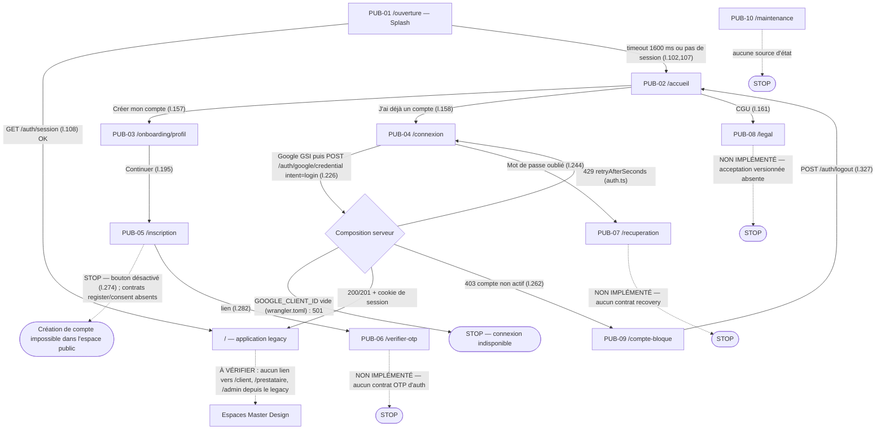
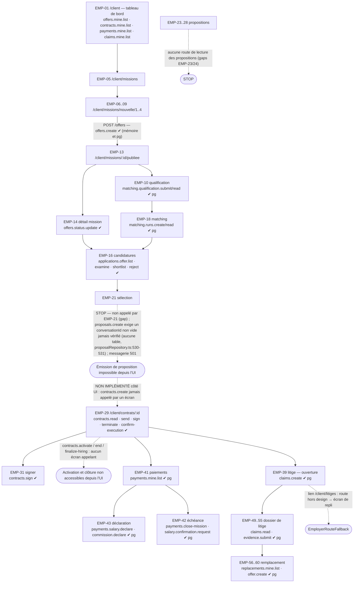
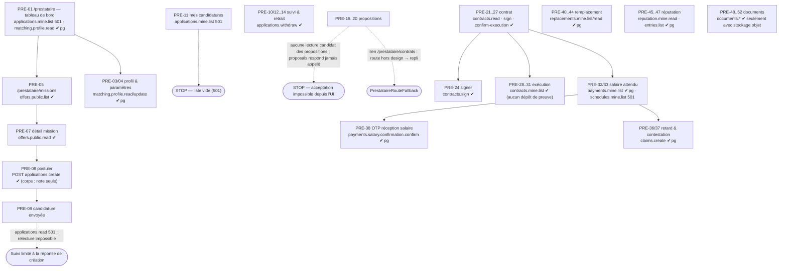
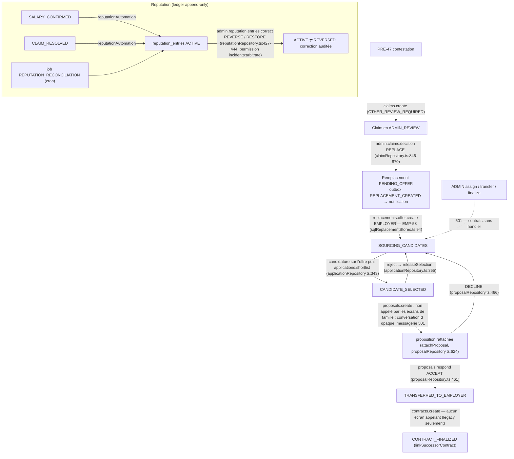
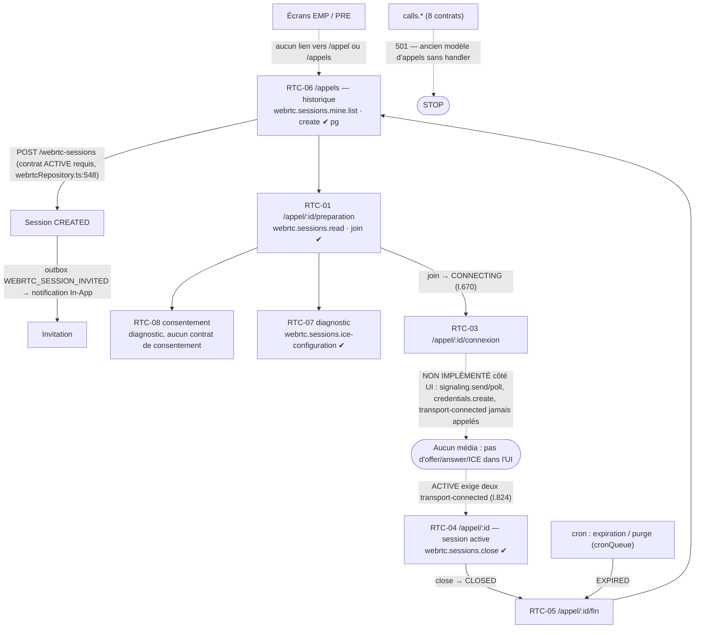
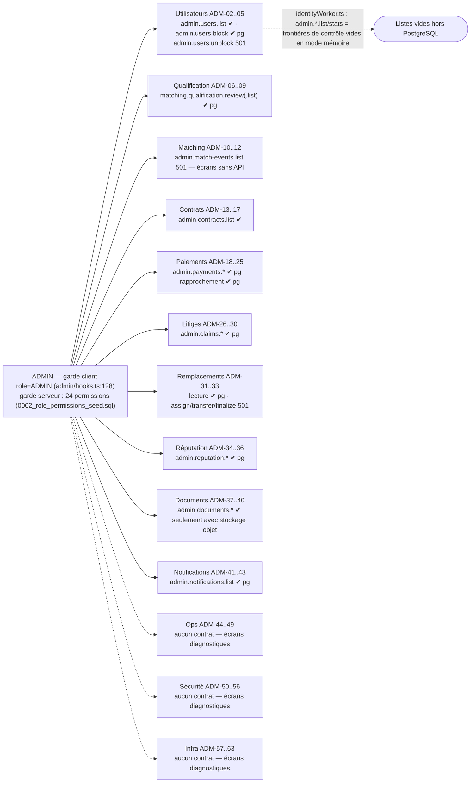
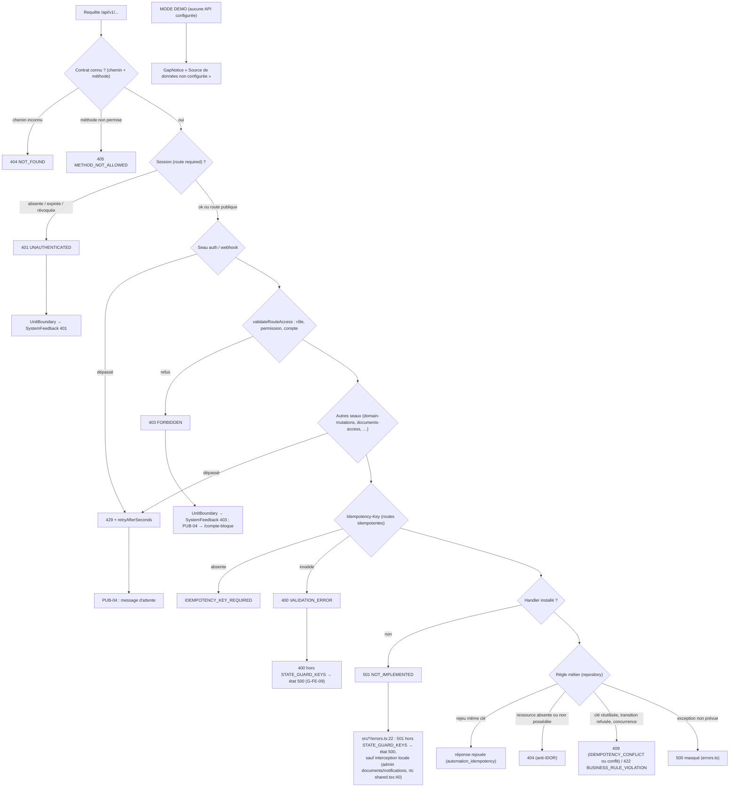

# B — Cartes des parcours fonctionnels

> Chaque transition indique : **page de départ → déclencheur réel → route/API → résultat attendu d'après le code → destination**.
> Les déclencheurs sont cités par fichier:ligne. « ✔ » = handler installé (sonde, composition indiquée) ; « 501 » = contrat sans handler.
> **Précondition commune à tous les parcours connectés** : le frontend n'appelle l'API qu'en MODE API (`VITE_DEMO_MODE=false` et
> `VITE_API_BASE_PATH` same-origin, `src/repositories/mode.ts:25-35`). Sinon chaque écran de famille affiche
> « Source de données non configurée » (`UnitBoundary.tsx`) et **aucune transition métier n'est possible**.
> **Précondition serveur** : avec `wrangler.toml` tel que versionné (`GOOGLE_CLIENT_ID = ""`), `composeWorker` produit la composition
> fermée : 149 routes authentifiées → 401, 11 routes publiques → 501 (sonde « closed »). Les parcours ci-dessous décrivent donc ce que le
> code permet **une fois** Google, PostgreSQL et (pour les documents) le stockage objet configurés.

Sommaire : [1 Public](#1-public--découverte) · [2 Auth](#2-inscription-connexion-authentification-récupération-consentements) ·
[3 Employeur](#3-employeur) · [4 Candidat](#4-candidat--prestataire) · [5 Contrats/paiements/salaires/litiges](#5-contrats-paiements-salaires-preuves-litiges-réclamations) ·
[6 Remplacements & réputation](#6-remplacements-et-réputation) · [7 RTC](#7-temps-réel-rtc) · [8 ADMIN](#8-admin) · [9 États système](#9-états-système)

---

## 1. Public / découverte

<!-- DIAGRAMME:02-public-auth -->
_Source : [`diagrammes/02-public-auth.mmd`](diagrammes/02-public-auth.mmd)_

<!-- /DIAGRAMME -->

| # | Départ | Déclencheur réel | Route / API | Résultat attendu (code) | Destination |
|---|---|---|---|---|---|
| 1.1 | `/ouverture` (PUB-01) | montage, `useEffect` (`PublicPage.tsx:100-110`) | `GET /api/v1/auth/session` (si MODE API) | session confirmée → `destination = '/'` ; sinon/timeout 1600 ms → `/accueil` ; hors ligne → état `offline` | `/` (legacy) ou `/accueil` |
| 1.2 | `/accueil` (PUB-02) | bouton « Créer mon compte » (`PublicPage.tsx:157`) | — | navigation client | `/onboarding/profil` |
| 1.3 | `/accueil` | « J'ai déjà un compte » (`:158`), lien « Se connecter » (`:161`) | — | navigation | `/connexion` |
| 1.4 | `/accueil` | lien CGU (`:161`) | — | navigation | `/legal` |
| 1.5 | toute page PUB sauf PUB-01 | liens de sortie (`:54-57`) | — | navigation | `/accueil`, `/connexion`, `/legal`, `/` |
| 1.6 | `/accueil` | lecture | aucune API (`GET /public/story`, `/public/stats` absents — `src/public/gaps.ts`) | contenu statique ; **exemple de prix FIN codé en dur** « 250 000 F / Frais SaaS 25 000 F / 275 000 F » (`PublicPage.tsx:150-153`) | — |

**Points d'arrêt.** Aucune donnée publique serveur (récit, statistiques) ; PUB-10 `/maintenance` n'a aucune source d'état
(`src/public/gaps.ts`). L'exemple de prix public relève du domaine FIN bloqué (voir I-FIN-02).

## 2. Inscription, connexion, authentification, récupération, consentements

| # | Départ | Déclencheur réel | Route / API | Résultat attendu (code) | Destination |
|---|---|---|---|---|---|
| 2.1 | `/onboarding/profil` (PUB-03) | choix du profil (mémorisé navigateur) puis « Continuer » (`:187-195`) | aucune (`POST /onboarding/role` absent) | rôle seulement mémorisé localement | `/inscription` |
| 2.2 | `/inscription` (PUB-05) | « Créer mon compte » **désactivé** (`:274`) | aucune | **ARRÊT** — `PUBLIC_AUTH_GAPS['PUB-05']` : register/consent absents ; la route Google `intent=register` existe mais « peut créer un compte actif sans vérification du téléphone ni preuve de consentement » | — |
| 2.3 | `/connexion` (PUB-04) | « Continuer avec Google » (`:243`) → `triggerGoogleSignInPrompt` → `auth.google(credential, role, 'login')` (`:226`) | `POST /api/v1/auth/google/credential` puis `GET /api/v1/auth/session` (`auth.ts:16-21`) | 200/201 + cookie de session (`identityWorker.ts:134`) | `/` legacy (`:227`) |
| 2.4 | `/connexion` | idem, composition fermée | idem | **501** (route publique sans handler) → message d'échec | reste sur `/connexion` — **ARRÊT** en configuration versionnée |
| 2.5 | `/connexion` | idem, compte non actif | idem | **403** → lien vers `/compte-bloque` (`:262`) | `/compte-bloque` |
| 2.6 | `/connexion` | idem, seau `auth` (60) dépassé | idem | **429** + `details.retryAfterSeconds` (`src/public/auth.ts`) | reste sur `/connexion` |
| 2.7 | `/connexion` | timeout 30 s (`:217-220`) | — | `LOGIN_TIMEOUT_FAILURE` | reste |
| 2.8 | `/compte-bloque` (PUB-09) | montage (`useSessionProbe`, `:96`) ; « Se déconnecter » (`:327`) | `GET /auth/session` ; `POST /auth/logout` | verdict affiché sans motif (aucun contrat de motif) ; logout → `/accueil` | `/accueil` |
| 2.9 | `/connexion` | « Mot de passe oublié » (`:244`) | — | navigation | `/recuperation` |
| 2.10 | `/recuperation` (PUB-07) | bouton désactivé (`:288`) | aucune (recovery absent) | **ARRÊT — NON IMPLÉMENTÉ** | — |
| 2.11 | `/verifier-otp` (PUB-06) | bouton désactivé (`:282`) | aucune (OTP d'auth absent ; l'OTP existant est réservé au salaire) | **ARRÊT — NON IMPLÉMENTÉ** | — |
| 2.12 | `/legal` (PUB-08) | « Accepter la version en vigueur » désactivé (`:295`) | aucune (`POST /legal/consent` absent) | **ARRÊT — consentement non enregistrable** | — |
| 2.13 | `/` legacy après connexion | — | — | **aucun lien vers `/client`, `/prestataire`, `/admin`** (recherche des littéraux dans `src/App.tsx`, `src/screens`, `src/context`, `src/components`) | **transition cassée** vers les espaces Master Design (G-FE-01) |

## 3. Employeur

<!-- DIAGRAMME:03-employeur -->
_Source : [`diagrammes/03-employeur.mmd`](diagrammes/03-employeur.mmd)_

<!-- /DIAGRAMME -->

| # | Départ | Déclencheur réel | Route / API (contrat) | Résultat attendu | Destination |
|---|---|---|---|---|---|
| 3.1 | `/client` (EMP-01) | montage (composant `src/employer/screens/overview.tsx:76`) | `offers.mine.list`, `contracts.mine.list`, `payments.mine.list`, `claims.mine.list`, `applications.offer.list` | listes (paiements/litiges : PostgreSQL uniquement, sinon 501) | `/client/missions/:id`, `/client/missions/nouvelle/1`, `/client/paiements` |
| 3.2 | profil `/client/profil` (EMP-03), paramètres (EMP-04) | — | EMP-03 : `contracts.mine.list`, `claims.mine.list` ; EMP-04 : aucune API | `users.me.update` (501) n'est pas appelé : **profil non modifiable** | — |
| 3.3 | `/client/missions/nouvelle/1..4` (EMP-06…09) | soumission du wizard (`src/employer/screens/offers.tsx:171`) | `POST /offers` — `offers.create` ✔ (mémoire et PostgreSQL) | 201 offre `ACTIVE` | `/client/missions/:id/publiee` |
| 3.4 | EMP-10 `/client/missions/:id/qualification` | « Soumettre » (`src/employer/screens/offers.tsx:515`) | `matching.qualification.submit` ✔ pg | décision `ELIGIBLE_FOR_INDEPENDENT` / revue / `BLOCKED` (`qualification.ts:137`) | `/client/missions/:id/matching` |
| 3.5 | EMP-14 détail mission | pause/reprise/annulation (`src/employer/screens/offers.tsx:749,757,839`) | `offers.status.update` ✔ | `ACTIVE ⇄ PAUSED`, `→ CANCELLED` | même écran |
| 3.6 | EMP-18 matching | « Lancer » (`src/employer/screens/selection.tsx:292`) | `matching.runs.create` ✔ pg | exige offre `ACTIVE` + qualification non `BLOCKED`/`HUMAN_REVIEW_REQUIRED` (`matchingRepository.ts:405-420`) ; classement 60/30/10 sur ≤ 200 profils `ACTIVE` (voir C §6) ; **aucun consentement candidat vérifié** (aucune colonne ni contrôle — `sqlMatchingStores.ts:254-262`) | `/client/missions/:id/matching/explication`, `/candidatures` |
| 3.7 | EMP-16 candidatures | examiner/présélectionner/écarter (`src/employer/screens/selection.tsx:142`) | `applications.examine/shortlist/reject` ✔ | `PENDING→REVIEW→SHORTLISTED`, `→REJECTED` | même écran |
| 3.8 | EMP-21 sélection | — | **aucun appel `proposals.create`** | **ARRÊT** : l'écran déclare le gap (messagerie 501). Le handler exige seulement un `conversationId` non vide, **jamais vérifié** contre une table (aucune table de conversations ; `proposalRepository.ts:530-531`, colonne `proposals.conversation_id TEXT NOT NULL` sans FK, `0004_proposals.sql:23`) — voir I-DEC-05 | — |
| 3.9 | EMP-23…28 propositions | montage | `contracts.mine.list` seulement | **ARRÊT** : aucune route de lecture de proposition côté employeur (gaps EMP-23/24) | `/client/contrats/:id` |
| 3.10 | — | — | `contracts.create` **jamais appelé** par un écran de famille (seulement client legacy) | **ARRÊT** : création du contrat impossible depuis l'espace `/client` | — |
| 3.11 | EMP-29 contrat | « Envoyer » (`src/employer/screens/contracts.tsx:239`) | `contracts.send` ✔ | `DRAFT → SIGNATURE` | même écran |
| 3.12 | EMP-29 / EMP-31 | « Signer » (`src/employer/screens/contracts.tsx:244,429`) | `contracts.sign` ✔ | drapeau `employerSigned` | `/client/contrats/:id` |
| 3.13 | — | — | `contracts.activate` **jamais appelé** (aucun client frontend) | **ARRÊT** : un contrat doublement signé ne devient jamais `ACTIVE` depuis l'UI → pas d'échéancier, pas de salaire, pas de RTC (G-FE-03) | — |
| 3.14 | EMP-29 | « Confirmer l'exécution » (`:253`), « Résilier » (`:262`) | `contracts.confirm-execution`, `contracts.terminate` ✔ | `terminate` exige `ACTIVE` (`CONTRACT_TRANSITION_RULES`) → inatteignable tant que 3.13 bloque | — |
| 3.15 | EMP-37/38 exécution | montage | `contracts.mine.list` | aucune validation de preuve (gap) | — |
| 3.16 | paiements, litiges, remplacements | voir §5 et §6 | | | |

**Arrêts explicites** : 3.8, 3.9, 3.10, 3.13 (chaîne d'embauche interrompue entre présélection et contrat actif).

## 4. Candidat / Prestataire

<!-- DIAGRAMME:04-candidat -->
_Source : [`diagrammes/04-candidat.mmd`](diagrammes/04-candidat.mmd)_

<!-- /DIAGRAMME -->

| # | Départ | Déclencheur réel | Route / API (contrat) | Résultat attendu | Destination |
|---|---|---|---|---|---|
| 4.1 | `/prestataire` (PRE-01) | montage (composant `src/prestataire/screens/overview.tsx:98`) | `applications.mine.list` **501**, `contracts.mine.list`, `payments.mine.list`, `claims.mine.list`, `matching.profile.read` | bloc candidatures en erreur/vides ; profil de matching lu (pg) | — |
| 4.2 | PRE-01/PRE-04 | disponibilité (`src/prestataire/screens/overview.tsx:145,450`) | `matching.profile.update` ✔ pg | `AVAILABLE/LIMITED/UNAVAILABLE` ; la création du profil suffit à entrer dans le bassin de matching (pas de consentement explicite) | même écran |
| 4.3 | `/prestataire/missions` (PRE-05/06) | montage | `offers.public.list` ✔ | offres `ACTIVE` | `/prestataire/missions/:id` |
| 4.4 | PRE-07 | « Postuler » | `offers.public.read` ✔ | — | `/prestataire/missions/:id/postuler` |
| 4.5 | PRE-08 | envoi (`src/prestataire/screens/applications.tsx:171`) | `POST /offers/:id/applications` — `applications.create` ✔ (corps `{note?}` seulement) | 201 candidature `PENDING` | `/prestataire/candidatures/envoyee` |
| 4.6 | PRE-09…15 suivi | montage | `applications.read` **501**, `applications.mine.list` **501** | **ARRÊT partiel** : liste et relecture impossibles ; retrait possible si l'id est connu | — |
| 4.7 | PRE-10/12/14 | « Retirer » (`src/prestataire/screens/applications.tsx:285,364,529`) | `applications.withdraw` ✔ | `→ WITHDRAWN` | — |
| 4.8 | PRE-16…20 propositions | montage | `contracts.mine.list` seulement | **ARRÊT** : aucune lecture candidat des propositions ; `proposals.respond` jamais appelé par un écran (gap PRE-16/17) | `/prestataire/contrats` → **écran de repli** (route hors design) |
| 4.9 | PRE-21/24 contrat | « Signer » (`src/prestataire/screens/contracts.tsx:247,349`) | `contracts.sign` ✔ | drapeau `employeeSigned` (aucun corps, aucun consentement structuré) | `/prestataire/contrats/:id` |
| 4.10 | PRE-21 | « Confirmer l'exécution » (`src/prestataire/screens/contracts.tsx:185`) | `contracts.confirm-execution` ✔ | — | — |
| 4.11 | PRE-28…31 exécution | montage | `contracts.mine.list` | aucun dépôt de preuve d'exécution (gaps) | `/prestataire/documents`, `/prestataire/evidence/nouvelle` |
| 4.12 | PRE-48/49 documents | dépôt (`src/prestataire/screens/documents.tsx:181-191,363-368`) | `documents.upload-grant` / `documents.versions.create` puis `POST` sur l'URL du grant (`documents.versions.content.upload`) | ✔ **uniquement** si stockage objet configuré ; sinon 501 | `/prestataire/documents/:id/historique` |
| 4.13 | salaire, litiges, remplacement, réputation | voir §5 et §6 | | | |

## 5. Contrats, paiements, salaires, preuves, litiges, réclamations

<!-- DIAGRAMME:05-contrat-salaire-paiement-litige -->
_Source : [`diagrammes/05-contrat-salaire-paiement-litige.mmd`](diagrammes/05-contrat-salaire-paiement-litige.mmd)_

```mermaid
%% 05 — Cycle contrat → échéances → déclaration → vérification → salaire → litige (états réels du code).
flowchart LR
  subgraph PROP["Proposition (proposalTransitions.ts)"]
    PS["SENT"] -->|"ACCEPT (CANDIDATE)"| PA["ACCEPTED"]
    PS -->|"DECLINE (CANDIDATE)"| PD["DECLINED"]
    PS -->|"expire (EMPLOYER)"| PE["EXPIRED"]
  end
  subgraph CT["Contrat (contractTransitions.ts)"]
    CD["DRAFT"] -->|"SEND (EMPLOYER)"| CS["SIGNATURE"]
    CS -->|"sign ×2 puis contracts.activate (EMPLOYER) — aucun écran appelant"| CA["ACTIVE"]
    CA -->|"END"| CC["COMPLETED"]
    CA -->|"TERMINATE"| CTm["TERMINATED"]
  end
  PA -->|"contracts.create (contractRepository.ts) — commissionPercentage 25 (l.734)"| CD
  CA -->|"outbox CONTRACT_ACTIVATED → contractActivation.ts : échéancier"| PAY
  subgraph PAY["Paiement (paymentLifecycle.ts)"]
    S1["SCHEDULED"] -->|"MARK_DUE (SYSTEM, cron)"| S2["DUE"]
    S2 -->|"DECLARE_PAYMENT (EMPLOYER)"| S3["PENDING_VERIFICATION"]
    S3 -->|"VERIFY (ADMIN)"| S4["VERIFIED"]
    S3 -->|"REJECT (ADMIN)"| S6["REJECTED"]
    S6 -->|"nouvelle déclaration"| S3
    S4 -->|"CONFIRM_PAID (ADMIN) ou webhook fournisseur"| S5["PAID"]
  end
  S5 -->|"payments.salary.confirmation.request (EMPLOYER)"| OTP["salary_confirmations — OTP"]
  OTP -->|"payments.salary.confirmation.confirm (CANDIDATE)"| CONF["SALARY_CONFIRMED → réputation"]
  WH["Webhook fournisseur<br/>webhooks.payment-provider"] -.->|"NON CONFIGURÉ : aucun fournisseur enregistré"| S5
  subgraph CL["Claim (claimRepository.ts)"]
    O["OPEN (create l.624)"] -->|"requestEvidence ADMIN (l.805)"| ER["EVIDENCE_REQUESTED"]
    ER -->|"submitEvidence partie (l.688)"| UR["UNDER_REVIEW"]
    O -->|"review ADMIN (l.746)"| AR["ADMIN_REVIEW"]
    UR -->|"review ADMIN (l.746)"| AR
    AR -->|"decide ADMIN (l.885)"| RS["RESOLVED / REJECTED"]
    CLO["CLOSED — déclaré (disputes/records.ts:18), aucune transition trouvée : À VÉRIFIER"]
  end
  CA -->|"claims.create (CONTRACT_INCIDENT)"| O
  S2 -->|"claims.create (SALARY_NOT_RECEIVED / PAYMENT_DISPUTE)"| O
  AR -->|"decide REPLACE (claimRepository.ts:846)"| REP["replacements PENDING_OFFER"]
  FIN["FIN-01..03 — triplet, frais, exports"] -.->|"BLOQUÉ_EN_ATTENTE_DÉCISION"| PAY
```

<!-- /DIAGRAMME -->

| # | Départ | Déclencheur réel | Route / API (contrat) | Résultat attendu | Destination |
|---|---|---|---|---|---|
| 5.1 | contrat `ACTIVE` | `contracts.activate` (aucun écran) | outbox `CONTRACT_ACTIVATED` (`contractRepository.ts:518-566`) → `contractActivation.ts` | échéancier salaire + commission (`commissionPercentage` 25, `contractRepository.ts:734`) | — |
| 5.2 | cron `*/5` | `scheduled()` (`cloudflareEntry.ts`) | jobs `automation_jobs` | `SCHEDULED → DUE` (MARK_DUE, SYSTEM) ; rappels `SALARY_DUE_REMINDER`, `…_OVERDUE_J3_…` | — |
| 5.3 | EMP-41 `/client/paiements` | montage | `payments.mine.list` ✔ pg | échéances | `/client/paiements/:id`, `/declaration`, `/plan`, `/historique` |
| 5.4 | EMP-43 déclaration | « Déclarer » (`src/employer/screens/payments.tsx:354`) | `payments.salary.declare` / `payments.commission.declare` ✔ pg | `DUE|REJECTED → PENDING_VERIFICATION` | `/client/paiements/:id` |
| 5.5 | ADM-18/21 | approuver/rejeter/confirmer | `admin.payments.approve/reject/confirm` ✔ pg (`payments:approve`, `payments:reject`) | `→ VERIFIED` / `→ REJECTED` / `VERIFIED → PAID` | — |
| 5.6 | fournisseur externe | webhook | `webhooks.payment-provider(.root)` ✔ pg (routes publiques, HMAC) | **NON CONFIGURÉ** : aucun fournisseur enregistré → 401 au niveau handler (`paymentRepository.ts:2871-2908`) | — |
| 5.7 | ADM-19 rapprochement | relance/décision | `admin.payment-reconciliation.*` ✔ pg | revue/correction des écarts | — |
| 5.8 | EMP-42 | « Demander la confirmation » (`src/employer/screens/payments.tsx:287`) | `payments.salary.confirmation.request` ✔ pg | OTP émis (`salary_confirmations`), événement `SALARY_CONFIRMATION_REQUESTED` | — |
| 5.9 | PRE-38 OTP | saisie OTP + nonce (`src/prestataire/screens/salary.tsx:519`) | `payments.salary.confirmation.confirm` ✔ pg (seau `salary-otp` 40) | `SALARY_CONFIRMED` → réputation | `/prestataire/salaire/:id/recu` |
| 5.10 | EMP-42 | « Clôturer la mission » (`src/employer/screens/payments.tsx:295`) | `payments.close-mission` ✔ pg | clôture des échéances de fin | — |
| 5.11 | EMP-39 / EMP-48 / PRE-36 | ouverture (`src/employer/screens/claims.tsx:139`, `src/employer/screens/payments.tsx:615`, `src/prestataire/screens/salary.tsx:385`) | `claims.create` ✔ pg | `OPEN` ; `CONTRACT_INCIDENT` exige contrat `ACTIVE|SUSPENDED` (`claimRepository.ts:584`) | `/client/litiges/:id` ou **`/client/litiges` → écran de repli** |
| 5.12 | EMP-49/50 | dépôt de preuve (`src/employer/screens/claims.tsx:309`) | `claims.evidence.submit` ✔ pg | `EVIDENCE_REQUESTED → UNDER_REVIEW` | — |
| 5.13 | ADM-27…29 | revue / demande de pièce / décision | `admin.claims.review/evidence.request/decision` ✔ pg | `ADMIN_REVIEW`, `EVIDENCE_REQUESTED`, `RESOLVED/REJECTED`, ou `REPLACE` → remplacement | — |
| 5.14 | FIN-01…03 | — | aucune route | **BLOQUÉ_EN_ATTENTE_DÉCISION** | — |

**Arrêts** : 5.1 (activation sans UI), 5.6 (aucun fournisseur), 5.14 (FIN). `payments.advance-month` et `contracts.monthly-action` :
le premier a un handler sans appelant frontend, le second est sans handler (501).

## 6. Remplacements et réputation

<!-- DIAGRAMME:12-remplacement-reputation -->
_Source : [`diagrammes/12-remplacement-reputation.mmd`](diagrammes/12-remplacement-reputation.mmd)_

<!-- /DIAGRAMME -->

| # | Départ | Déclencheur réel | Route / API (contrat) | Résultat attendu | Destination |
|---|---|---|---|---|---|
| 6.1 | ADM-29 | décision `REPLACE` | `admin.claims.decision` ✔ pg | remplacement `PENDING_OFFER` (`claimRepository.ts:846-870`), `REPLACEMENT_CREATED` | — |
| 6.2 | EMP-56…58 | « Publier l'offre de remplacement » | `replacements.offer.create` ✔ pg | `SOURCING_CANDIDATES` | `/client/missions/:id/candidatures` |
| 6.3 | EMP-16 | présélection sur l'offre de remplacement | `applications.shortlist` ✔ | `CANDIDATE_SELECTED` (`applicationRepository.ts:343`) | — |
| 6.4 | — | proposition / acceptation | `proposals.create` / `proposals.respond` (aucun écran de famille) | **ARRÊT** (mêmes causes que 3.8 / 4.8) | — |
| 6.5 | ADM-31…33 | — | lecture ✔ pg ; `admin.replacements.assign/transfer/finalize` **501** | supervision en lecture seule | — |
| 6.6 | PRE-40…44 | montage | `replacements.mine.list/read` ✔ pg | dossier lisible | — |
| 6.7 | PRE-45/46 | montage | `reputation.mine.read`, `reputation.mine.entries.list` ✔ pg | ledger, explications versionnées | `/prestataire/reputation/ledger` |
| 6.8 | PRE-47 | contestation (`src/prestataire/screens/reputation.tsx:259`) | `claims.create` (`OTHER_REVIEW_REQUIRED`) ✔ pg | contestation traitée comme claim | — |
| 6.9 | ADM-34 | correction | `admin.reputation.entries.correct` ✔ pg | `ACTIVE ⇄ REVERSED` (`reputationRepository.ts:427-444`) | — |

## 7. Temps réel (RTC)

<!-- DIAGRAMME:06-rtc -->
_Source : [`diagrammes/06-rtc.mmd`](diagrammes/06-rtc.mmd)_

<!-- /DIAGRAMME -->

| # | Départ | Déclencheur réel | Route / API (contrat) | Résultat attendu | Destination |
|---|---|---|---|---|---|
| 7.1 | EMP/PRE | — | — | **aucun lien vers `/appel` ou `/appels`** depuis les familles EMP/PRE | entrée par URL uniquement |
| 7.2 | `/appels` (RTC-06) | « Créer » avec référence de contrat (`history.tsx:232`) | `webrtc.sessions.create` ✔ pg | exige contrat `ACTIVE` et deux parties actives (`webrtcRepository.ts:548-554`) → inatteignable tant que 3.13 bloque | `/appel/:id/preparation` |
| 7.3 | RTC-01 / RTC-02 | « Rejoindre » (`preCall.tsx:93`, `invitation.tsx:91`) | `webrtc.sessions.join` ✔ pg | `CREATED → CONNECTING` (`webrtcRepository.ts:670`) | `/appel/:id/connexion` |
| 7.4 | RTC-07 | montage | `webrtc.sessions.ice-configuration` ✔ pg | diagnostic sans secret ; TURN seulement si override | — |
| 7.5 | RTC-03 → RTC-04 | — | `signaling.send/poll`, `credentials.create`, `transport-connected` **jamais appelés** | **ARRÊT** : aucun échange média ; `ACTIVE` exige deux `transport-connected` (`webrtcRepository.ts:824`) | — |
| 7.6 | RTC-04 | « Raccrocher » (`active.tsx:87`) | `webrtc.sessions.close` ✔ pg | `→ CLOSED` | `/appel/:id/fin` |
| 7.7 | RTC-08 | — | aucune API de consentement | écran diagnostique | — |

## 8. ADMIN

<!-- DIAGRAMME:07-admin -->
_Source : [`diagrammes/07-admin.mmd`](diagrammes/07-admin.mmd)_

<!-- /DIAGRAMME -->

| Sous-domaine | Fiches | Contrats réellement appelés | Statut | Arrêt / limite |
|---|---|---|---|---|
| Utilisateurs | ADM-02…05 | `admin.users.list` ✔ ; `admin.users.block` ✔ pg (`entry.ts:1088-1131`, `adminSecurityHandlers`) | partiel | `admin.users.unblock` 501 ; pas de lecture unitaire (ADM-03 relit la liste) ; ADM-05 sans API |
| Qualification | ADM-06…09 | `matching.qualification.review(.list)` ✔ pg | partiel | ADM-09 sans API |
| Matching | ADM-10…12 | ADM-12 : `review.list` | diagnostique | `admin.match-events.list` 501 ; aucun run listable côté ADMIN |
| Contrats | ADM-13…17 | `admin.contracts.list`, `admin.claims.list` | lecture | aucune action ADMIN sur contrat (gap ADM-14/16) |
| Paiements & salaires | ADM-18…25 | `admin.payments.*`, rapprochement ✔ pg ; `payments.read` (route de portée `owner` dont le handler admet ADMIN avec `payments:read:any`, commentaire `src/admin/api.ts:492-494`) | partiel | ADM-20/22/24/25 sans API ; `admin.payments.reconcile`, `batches.create` sans appelant |
| Litiges | ADM-26…30 | `admin.claims.*` ✔ pg | partiel | `restriction.apply/release` sans appelant |
| Remplacements | ADM-31…33 | lecture ✔ pg | lecture seule | assign/transfer/finalize 501 |
| Réputation | ADM-34…36 | `admin.reputation.*` ✔ pg | partiel | ADM-35/36 sans API |
| Documents | ADM-37…40 | `admin.documents.*`, `documents.versions.integrity.verify` ✔ avec stockage objet | partiel | ADM-39/40 sans API |
| Notifications | ADM-41…43 | `admin.notifications.list` ✔ pg | partiel | ADM-42/43 sans API |
| Ops / Sécurité / Infra | ADM-44…63 | **aucun** | 20 écrans diagnostiques (FRONTEND_PARTIEL) | aucun contrat ops/sécurité/infra |

`identityWorker.ts:139-152` installe pour `admin.offers/applications/contracts/payments/incidents/replacements/audit.list` des
**frontières de contrôle** (`adminControl`) et pour `admin.stats.read` une réponse `persistence: 'not-configured'` ; les compositions
PostgreSQL les remplacent par les handlers de domaine lorsqu'ils existent (`...options.handlers`, `:153`).

## 9. États système

<!-- DIAGRAMME:10-erreurs-blocages -->
_Source : [`diagrammes/10-erreurs-blocages.mmd`](diagrammes/10-erreurs-blocages.mmd)_

<!-- /DIAGRAMME -->

| État | Fiche SYS / écran | Déclenchement réel | Source |
|---|---|---|---|
| Accès refusé (401/403) | SYS (StateGuard) + `SystemFeedback` | `UnitBoundary` sur erreur API 401/403 ; garde client de rôle | `src/*/UnitBoundary.tsx`, `src/public/SystemFeedback.tsx` |
| Compte bloqué | PUB-09 | 403 au login (`PublicPage.tsx:262`) ; garde EMP « rôle EMPLOYER et non BLOCKED » (`src/employer/hooks.ts:125`) | `PublicPage.tsx`, `src/employer/hooks.ts` |
| Indisponible / erreur | SYS / `SystemFeedback` | erreur réseau ou 5xx dans `UnitBoundary` ; `/healthz` 503 si la persistance configurée est injoignable (`health.ts:112-114`) | `UnitBoundary.tsx`, `health.ts` |
| Maintenance | PUB-10 | **aucune source** (route statique) | `src/public/gaps.ts` |
| Route inconnue | SYS 404 | `resolveRoute` sans unité → `SystemState state="404"` (`ShellRoute.tsx:275`) | `src/routing/resolveRoute.ts` |
| Chemin rattaché à une unité mais hors design | écran de repli honnête | `EmployerRouteFallback` / `PrestataireRouteFallback` / `RtcRouteFallback` / `AdminRouteFallback` | `ShellRoute.tsx:196,232,241,266` |
| Source non configurée | GapNotice | MODE DEMO (aucune API) | `UnitBoundary.tsx` |
| Récupération | — | « Réessayer » (`retry={resource.reload}`) dans les composants | ex. `src/employer/screens/claims.tsx:73,193` |

Les 15 fiches SYS (`/etat/*`) sont des écrans d'état rendus par le shell SYSTEM ; elles sont consultables directement mais **ne sont
pas la cible de redirections automatiques** : les erreurs sont rendues sur place par `SystemFeedback` (vérifié dans `UnitBoundary.tsx`
et `ShellRoute.tsx` ; aucune navigation vers `/etat/*` trouvée dans les familles — **À VÉRIFIER** pour d'éventuels liens dynamiques).
