# C — Cartographie technique

> Chaîne visée : **page ↔ composant ↔ route ↔ garde/permission ↔ client API ↔ contrat ↔ handler ↔ service ↔ repository ↔
> table/stockage/externe ↔ événement/job/cron/webhook ↔ tests.**
> Le détail **par contrat** (160 lignes : garde, handler, sonde à quatre compositions, seau de rate limit, tests, écrans appelants)
> est généré dans [`C2-contrats-api.md`](C2-contrats-api.md) ; le détail **par écran** dans [`D-matrice-ecrans-api.md`](D-matrice-ecrans-api.md).
> Ce document décrit les couches, les règles de liaison et les chaînes transverses.

<!-- DIAGRAMME:08-chaine-frontend-donnees -->
_Source : [`diagrammes/08-chaine-frontend-donnees.mmd`](diagrammes/08-chaine-frontend-donnees.mmd)_

```mermaid
%% 08 — Chaîne type frontend → API → handler → service → données (exemple vérifié : EMP-29 signature de contrat).
flowchart LR
  R["Route /client/contrats/:id<br/>resolveRoute → EMP-29"] --> SM["screenMap.ts<br/>resolveEmployerScreen"]
  SM --> REG["registry.tsx<br/>EMPLOYER_SCREEN_COMPONENTS['EMP-29']"]
  REG --> UB["UnitBoundary<br/>garde client EMPLOYER non BLOQUÉ"]
  UB --> CMP["Employer29ContractFolio<br/>src/employer/screens/contracts.tsx:298"]
  CMP --> HK["useEmployerResource / mutation<br/>src/employer/hooks.ts"]
  HK --> API["EmployerApi.signContract<br/>src/employer/api.ts"]
  API -->|"POST /api/v1/contracts/:id/sign + Idempotency-Key"| WK["worker.ts : contrat contracts.sign<br/>session · rôle · idempotence"]
  WK --> HD["createContractApiHandlers<br/>contractRepository.ts:1439"]
  HD --> REPO["signContract<br/>contractRepository.ts:837"]
  REPO --> ST["sqlCoreStores — contracts"]
  ST --> DB[("contracts (drapeaux employerSigned / employeeSigned)")]
  REPO -.->|"aucun événement : seul CONTRACT_ACTIVATED est écrit dans l'outbox (contractRepository.ts:518-566)"| OB["Outbox"]
  OB -.->|"CONTRACT_SIGNED listé dans NOTIFICATION_AUTOMATION_EVENT_TYPES mais jamais émis"| NT["notifications"]
  T1["Tests : suite P0-F cycle CONTRAT (31/31 PASS) · employer.test.tsx"] -.-> HD
```

<!-- /DIAGRAMME -->

## 1. Couches et fichiers

| Couche | Fichiers / symboles | Rôle vérifié |
|---|---|---|
| Entrée SPA | `src/main.tsx:7-10` (`bootstrapRepositoryMode`, `AppRouter`) → `src/routing/AppRouter.tsx:28` (aucun espace de noms → `App` legacy) → `ShellRoute` chargé à la demande (l.14) | `ShellRoute.tsx` `Content()` (l.160-275) aiguille : `public`, `fondation`, `etat`, `client`, `prestataire`, `admin`, `appel(s)` |
| Résolution de route | `src/routing/routes.ts` (208 routes), `resolveRoute.ts`, `integration.ts` | chemin → unité de production / écran ; `INTEGRATED_UNIT_IDS = []` |
| Registres d'écran | `src/{employer,prestataire,admin,rtc}/registry.tsx` (`EMPLOYER_SCREEN_COMPONENTS` l.63, `PRESTATAIRE_…` l.49, `ADMIN_…` l.174, `RTC_…` l.24) | code de fiche → composant chargé paresseusement |
| Table route→fiche | `src/*/screenMap.ts` (`resolve*Screen`, `unitForScreen`) | une route de fiche → un code ; hors fiche → écran de repli (`ShellRoute.tsx:196,232,241,266`) |
| Garde client | `src/*/hooks.ts` (ex. `src/employer/hooks.ts:125` rôle EMPLOYER non BLOCKED), `src/*/UnitBoundary.tsx` | **affichage seulement** ; la décision d'accès réelle est serveur |
| Client API | `src/*/api.ts` (classes sur `HttpApiClient`, `src/repositories/apiClient.ts:32`) | `credentials: 'include'` (l.74), en-tête `Idempotency-Key` (l.68) ; base same-origin `VITE_API_BASE_PATH` |
| Mode | `src/repositories/mode.ts:25-35` | DEMO par défaut ; API seulement si explicitement configuré |
| Contrats | `src/backend/api/routeContracts.ts` (`API_ROUTE_CONTRACTS`, 160) | clé, méthode, chemin, authentification, portée (`public/self/owner/admin`), rôles, permission, idempotence, audit |
| Pipeline | `src/backend/api/worker.ts:140-196` (`createApiWorker`) | voir §2 |
| Sécurité | `src/backend/api/security.ts` | seaux de rate limit (l.113-119), mapping clé→seau, contrôle anti-falsification |
| Composition | `src/backend/api/entry.ts:413` (`composeWorker`) | choisit `closed` / `memory` / `postgres` et installe les handlers disponibles |
| Entrée Cloudflare | `src/backend/worker/cloudflareEntry.ts` (`main` de `wrangler.toml:29`) | `fetch` (pool `pg` par requête via Hyperdrive), `scheduled` (cron), `/healthz` |
| Handlers / services | `src/backend/{repositories,disputes,documents,matching,notifications,payments,replacements,reputation,webrtc}/*` | voir §3 |
| Stores SQL | `src/backend/persistence/sql*Stores.ts` | requêtes paramétrées sur les tables des migrations |
| Schéma | `migrations/0001…0018` | 40 tables (voir E §1) |
| Legacy | `src/App.tsx`, `src/screens/*`, `src/repositories/apiRepository.ts`, `apiAppAdapter` | application historique, destination post-connexion `/` |

## 2. Pipeline d'une requête API (ordre réel, `src/backend/api/worker.ts:140-196`)

| Étape | Contrôle | Code d'échec |
|---|---|---|
| 1 | recherche du contrat (méthode + chemin) | 404 `NOT_FOUND` / 405 |
| 2 | authentification (`authenticate` → session cookie, `identityWorker.ts:125`) si `authentication: 'required'` | 401 |
| 3 | seaux `auth` / `webhook` (avant contrôle d'accès) | 429 + `retryAfterSeconds` |
| 4 | contrôle d'accès : rôle, portée, permission (`role_permissions`, seed `0002`) | 403 |
| 5 | autres seaux (`domain-mutations`, `salary-otp`, `webrtc-signaling`, `documents-access`, `reconciliation-sensitive`) | 429 |
| 6 | refus d'un paramètre « self » falsifié | 403 |
| 7 | clé d'idempotence exigée si `idempotency: true` | 400 |
| 8 | présence du handler | **501 `NOT_IMPLEMENTED`** |
| 9 | handler : validation, règles, transaction | 400/404/409 (`IDEMPOTENCY_CONFLICT`)/422 (`BUSINESS_RULE_VIOLATION`)/503/500 |

Le limiteur est **en mémoire par isolat** (`security.ts:189-198`) : il n'est pas partagé entre isolats Workers.
**Six clés du mapping de seaux ne correspondent à aucun contrat** (`rateLimitOrphans` dans `donnees/inventaire.json`) :
`auth.google.login`, `documents.signed-download-url.create`, `documents.upload-grants.create`, `payments.reconcile`,
`payments.salary.confirm`, `webrtc.sessions.credentials.issue` → les contrats réels homonymes ne reçoivent pas le seau prévu (G-SEC-03).

## 3. Compositions et handlers (sonde dynamique)

`composeWorker` (`entry.ts:413`) installe les handlers selon l'environnement. La sonde (`outils/cartographie.py`) compose réellement
le Worker dans quatre configurations et appelle les 160 contrats avec un acteur qui satisfait la garde :

| Composition | Condition | Contrats dont le handler est atteint |
|---|---|---|
| `closed` | `GOOGLE_CLIENT_ID` vide (cas de `wrangler.toml`) ou persistance absente | **0** |
| `memory` | Google + persistance mémoire | 29 sondés atteints (+49 non sondés en mémoire : mutations sans store) |
| `postgres` | Google + PostgreSQL (PGlite + migrations dans la sonde) | 106 |
| `postgres` + stockage objet | + `DOCUMENTS_BUCKET` / `objectStorage` | **121** |

Répartition des 121 handlers par fichier (analyse statique = sonde, `staticVsDynamicHandlerMismatch = []`) :

| Fichier handler | Contrats | Domaines |
|---|---|---|
| `src/backend/api/identityWorker.ts` | 12 | auth, me, users.me.read, admin.users.list, frontières `adminControl` |
| `src/backend/api/entry.ts:1088` | 1 | admin.users.block |
| `src/backend/repositories/offerRepository.ts` | 5 | offers |
| `src/backend/repositories/applicationRepository.ts` | 6 | applications (sauf read, mine.list, employer.list) |
| `src/backend/repositories/proposalRepository.ts` | 4 | proposals, admin.proposals |
| `src/backend/repositories/contractRepository.ts` | 11 | contracts, admin.contracts |
| `src/backend/repositories/paymentRepository.ts` | 14 | payments, admin.payments, webhooks |
| `src/backend/payments/salaryConfirmation.ts` | 2 | OTP salaire |
| `src/backend/payments/paymentReconciliationApi.ts` | 5 | rapprochement ADMIN |
| `src/backend/disputes/claimRepository.ts` | 11 | claims, admin.claims |
| `src/backend/replacements/replacementRepository.ts` | 5 | replacements, admin.replacements (lecture) |
| `src/backend/matching/matchingRepository.ts` | 9 | matching |
| `src/backend/reputation/reputationRepository.ts` | 7 | reputation |
| `src/backend/notifications/notificationApi.ts` | 4 | notifications |
| `src/backend/documents/documentRepository.ts` | 15 | documents (stockage objet requis) |
| `src/backend/webrtc/webrtcApi.ts` | 10 | webrtc |
| **aucun** | **39** | `calls.*`, `messages.*`, `incidents.*`, `resources.*`, `schedules.*`, `users.*` (hors me.read), `applications.read/mine.list/employer.list`, `offers.favorites.*`, `contracts.monthly-action`, `admin.replacements.assign/transfer/finalize`, `admin.users.unblock`, `admin.calls/communication-events/match-events/schedules/whatsapp-events/incidents.arbitrate` |

**Aucune table** n'existe pour les conversations, messages, appels (hors WebRTC), incidents, ressources ou favoris (liste des
`CREATE TABLE`, E §1) : les 501 correspondants ne sont pas un simple oubli de câblage.

## 4. Chaîne complète — exemple tracé (ouverture d'un litige par l'employeur)

| Maillon | Référence |
|---|---|
| Page | `/client/litiges/nouveau` (EMP-48) — composant de `src/employer/screens/claims.tsx` |
| Déclencheur | `api!.createClaim(…)` `src/employer/screens/claims.tsx:139` |
| Client API | `EmployerApi.createClaim` `src/employer/api.ts:326` → `POST /api/v1/claims` + `Idempotency-Key` |
| Contrat | `claims.create` `routeContracts.ts:111` — `scope: 'self'`, rôles CANDIDATE/EMPLOYER, idempotent, audité |
| Garde | pipeline §2 ; seau `domain-mutations` (`security.ts:143`) |
| Composition | `createClaimRepository` installé si cycle claims disponible + PostgreSQL (`entry.ts:675-684`) |
| Handler | `createClaimApiHandlers` `'claims.create'` (`claimRepository.ts:1092`) → `create()` (l.567) |
| Règles | `CONTRACT_INCIDENT` exige contrat `ACTIVE|SUSPENDED` (`claimRepository.ts:584`) |
| Store / table | `sqlClaimStores.ts:198` `INSERT INTO claims` — table `claims` (`0011_dispute_claims.sql:11`) |
| Événement | outbox `CLAIM_CREATED` (`claimRepository.ts:634` → `automation_outbox`) |
| Consommateur | `notificationAutomation.ts:48` (type géré) → table `notifications` (canal in-app ; push/email non configurés) |
| Tests | `src/backend/api/claims.test.ts`, `src/employer/*.test.tsx`, `scripts/verify-employer-ui.ts` |
| Arrêt | si aucun contrat `ACTIVE` (G-FE-03) : 422 pour `CONTRACT_INCIDENT` |

Les autres chaînes suivent le même schéma ; elles sont lisibles ligne à ligne dans D (écran → appels → contrat) et C2
(contrat → handler → sonde → tests).

## 5. Chaînes par famille (synthèse)

| Famille | Registre | Client API | Contrats appelés (distincts) | Handlers installés (pg+R2) parmi eux | Écrans sans API |
|---|---|---|---|---|---|
| EMP | `src/employer/registry.tsx` | `src/employer/api.ts` | 34 | 34 | 2 (EMP-04, EMP-26) |
| PRE | `src/prestataire/registry.tsx` | `src/prestataire/api.ts` (dont `uploadDocumentContent` l.392 : URL fournie par le grant — relevé manuel `DYNAMIC_CALLS`) | 30 | 27 (501 : `applications.read`, `applications.mine.list`, `schedules.mine.list`) | 0 — mais PRE-11/PRE-15 n'appellent que des 501 |
| ADM | `src/admin/registry.tsx` | `src/admin/api.ts` | 35 | 35 | 34 |
| RTC | `src/rtc/registry.tsx` | `src/rtc/api.ts` | 6 (`create`, `join`, `read`, `mine.list`, `ice-configuration`, `close`) | 6 | 0 |
| PUB | `src/public/PublicPage.tsx` | `src/public/auth.ts` | 3 (`auth.session`, `auth.google.credential`, `auth.logout`) | 3 (hors composition fermée) | 7 |
| Legacy | `src/App.tsx` | `src/repositories/apiRepository.ts` | 97 (dont 45 appelés **seulement** par le legacy) | — | — |

Couverture frontend des 160 contrats : 92 appelés par des écrans de famille, 3 par PUB, 97 par le legacy ; union 140 ;
**20 contrats sans aucun appelant**, dont 17 avec handler : `contracts.activate`, `contracts.end`, `contracts.finalize-hiring`,
`proposals.expire`, `payments.advance-month`, `admin.payments.reconcile`, `admin.payment-reconciliation.batches.create`,
`admin.claims.restriction.apply/release`, `reputation.mine.reconcile`, `documents.versions.content.download`, `documents.links.list/create`,
`matching.qualification.summary`, `auth.google`, `webhooks.payment-provider(.root)` (les webhooks n'ont pas vocation à être appelés par
l'UI). Les 45 contrats « legacy seulement » incluent `proposals.create/respond` et `contracts.create` : **le chemin d'embauche n'est
câblé que dans l'application legacy**, dont le comportement en MODE API n'a pas été exécuté dans cet audit (**NON VÉRIFIÉ**).

## 6. Algorithme de matching (tel que traçable dans le code)

Source : `src/backend/matching/matchingEngine.ts`, `matchingRepository.ts`, `qualification.ts`, `sqlMatchingStores.ts`.

1. **Préconditions** (`matchingRepository.ts:142-152, 405-424`) : employeur `ACTIVE` propriétaire, offre `ACTIVE`, qualification
   existante et décision ≠ `BLOCKED` (→ 422) et ≠ `HUMAN_REVIEW_REQUIRED` (→ 409) ; clé d'idempotence réservée.
2. **Bassin** : `listActiveCandidates` (`sqlMatchingStores.ts:254-262`) — profils de matching dont l'utilisateur est `CANDIDATE`
   `ACTIVE`, triés par id, **≤ 200** (`MAX_MATCHING_CANDIDATES`, `matchingRepository.ts:35`) ; au-delà → 409, aucun classement partiel.
   Aucun filtre de consentement, de qualification candidat ni de réputation.
3. **Filtre** : `UNAVAILABLE` exclu (`matchingEngine.ts:192`).
4. **Score** (`scoreCandidate`, l.129-155) :
   * compétences : `round(60 × compétences requises couvertes / requises)` après normalisation NFKC/minuscules ; non noté si l'offre n'a pas de compétences ;
   * zone administrative : 30 localité / 25 arrondissement / 20 commune / 10 département (premier niveau égal), non noté si l'offre n'a aucune zone (`ZONE_LEVELS`, l.111-116) ;
   * disponibilité déclarée : 10 `AVAILABLE` / 5 `LIMITED`.
5. **Tri** par `score|skills|location|availability`, `ASC|DESC`, départage `candidateId` ASC (l.195-202).
6. **Instantané** : critères versionnés (`RANKING_RULES_VERSION`, `clientMakesFinalChoice: true`, `automaticAssignment: false`,
   l.165-177) enregistrés dans `matching_runs`. **Aucune affectation automatique** ; aucun état de candidature n'est modifié.

## 7. Événements, jobs, cron, webhooks

| Mécanisme | Implémentation | Producteurs vérifiés | Consommateurs |
|---|---|---|---|
| Outbox | `automation_outbox` (`0006`), statuts `PENDING/PROCESSING/PROCESSED/RETRYABLE/DEAD_LETTER` (`automation/foundation.ts:10`) | `contractRepository.ts:566` (CONTRACT_ACTIVATED), `contractActivation.ts:761,894`, `paymentRepository.ts:765`, `salaryConfirmation.ts:48,100`, `claimRepository.ts:345,918`, `claimAutomation.ts:118`, `paymentReconciliationBatch.ts:445`, `webrtcRepository.ts:593` | `automation/worker.ts:276-300` (moteur + processeurs : activation, notifications, réputation) |
| Jobs | `automation_jobs` (`0006`), échéances `automation_deadlines` (`0007`) | activation (échéancier, rappels `SALARY_DUE_REMINDER`…), claims (échéances), réputation (`REPUTATION_RECONCILIATION`, `reputationAutomation.ts:57`), rapprochement | `automation/worker.ts:348-385` ; job sans handler → erreur journalisée (l.383) |
| Retry | `DEFAULT_MAX_ATTEMPTS = 5`, `DEFAULT_RETRY_DELAY_MS = 30 000`, lot 25, orphelins > 10 min récupérés (`automation/worker.ts:53-65`, index `0017`) | | `DEAD_LETTER` / `FAILED` au-delà |
| Cron | `wrangler.toml:146` `*/5 * * * *` ; `scheduled()` `cloudflareEntry.ts:217`, `SCHEDULED_DRAIN_LIMIT = 25` (l.105) | | inerte sans base |
| Webhook | `webhooks.payment-provider(.root)` (routes publiques, seau `webhook`) → `paymentRepository.ts:2871-2908` (HMAC par fournisseur) | aucun fournisseur enregistré → 401 au handler | — |
| Notifications | `notificationAutomation.ts`, `notificationService.ts`, ports `PUSH`/`EMAIL` (`channels.ts:44-100`) | événements listés `notificationAutomation.ts:48…` | in-app (`notifications`) ; push/email indisponibles (aucun fournisseur) |

## 8. Tests qui établissent un comportement

`npm test` exécute 48 suites (1863 assertions, toutes PASS). Rattachement par contrat : colonne « Tests » de C2 (fichiers qui
citent la clé ou le chemin du contrat) ; par écran : colonne « Test » de D (fichiers qui citent le code de fiche).
Suites backend principales : `src/backend/api/{foundation,offers,applications,applicationDecisions,proposals,contracts,postContract,payments,paymentMissionClose,externalPaymentProvider,claims,replacements,reputation,documents,health,securityAntiFraud}.test.ts`,
`src/backend/matching/matching.test.ts`. Scripts E2E navigateur/PG : `scripts/verify-{public,employer,admin}-ui.ts`, `verify-postgres-e2e.ts`
(résultats : 00-INDEX §8). Un test qui cite une clé prouve au mieux le contrat côté serveur ; il ne prouve pas qu'un écran l'appelle.
