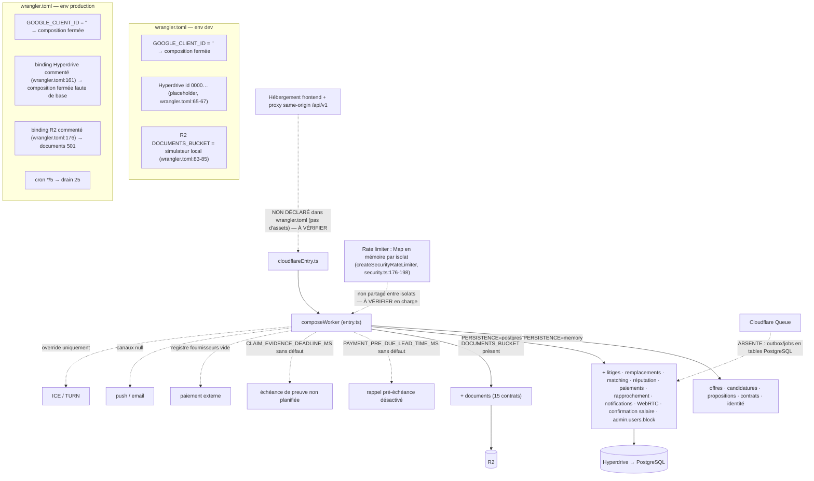

# E — Données et traitements serveur

> Source : `migrations/0001…0018` (schéma), `src/domain/*Transitions.ts`, repositories et stores SQL. Aucun modèle supposé :
> une entité absente du schéma est signalée comme absente.

## 1. Entités, tables et relations (40 tables)

| Migration | Tables créées | Clés étrangères (vers) |
|---|---|---|
| 0001 identité & noyau | `users`, `external_identities`, `sessions`, `permissions`, `role_permissions`, `user_permissions`, `offers`, `applications`, `contracts` | external_identities/sessions/offers→users ; applications→offers, users ; contracts→applications, offers, users, contracts (successeur) |
| 0002 | — (seed : 24 permissions, toutes attribuées au rôle ADMIN) | — |
| 0003 alignement | — (domaines de statut offres/candidatures/contrats, zones administratives, `commission_status`, `commissionPercentage`) | — |
| 0004 | `proposals` | →applications, contracts, offers, proposals, users ; **`conversation_id TEXT NOT NULL` sans FK** (l.23) |
| 0005 | — (cycle de vie contrat, index d'unicité contrat non terminal) | — |
| 0006 automatisation | `automation_outbox`, `automation_jobs`, `automation_idempotency`, `automation_audit_ledger` | — |
| 0007 | `automation_deadlines` | — |
| 0008 paiements | `payments`, `payment_declarations` | payments→contracts |
| 0009 rapprochement | `payment_reconciliation_batches`, `…_batch_items`, `payment_external_settlements`, `payment_reconciliation_reviews`, `…_correction_attempts` | →payments, batches, items, reviews |
| 0010 | `salary_confirmations` | →contracts, payments |
| 0011 litiges | `claims`, `claim_evidence_requests`, `claim_restrictions` | claims→contracts, payments, salary_confirmations, users |
| 0012 | `notifications` | →users |
| 0013 | `replacements` | →applications, claims, contracts, offers, proposals, replacements, users |
| 0014 matching | `candidate_matching_profiles`, `mission_qualifications`, `matching_runs` | →users, offers, qualifications |
| 0015 | `reputation_entries` | →users |
| 0016 documents | `document_retention_policies`, `documents`, `document_versions`, `document_entity_links` | documents→policies, users ; versions→documents |
| 0017 | — (colonnes/index de récupération des orphelins outbox/jobs) | — |
| 0018 WebRTC | `webrtc_sessions`, `webrtc_session_participants`, `webrtc_signaling_messages`, `webrtc_session_credentials` | →contracts, users, sessions WebRTC |

**Absences de schéma vérifiées** (aucun `CREATE TABLE`) : conversations/messages, appels hors WebRTC (`calls.*`), incidents
(`incidents.*`), ressources publiées, favoris, plannings (`schedules.*`), consentements légaux, OTP d'authentification,
inscription/rôle d'onboarding, mot de passe/récupération, profil employeur au-delà de `users`. Les contrats d'API correspondants
répondent 501 (C §3).

## 2. Transitions d'état (code)

| Agrégat | Statuts (schéma) | Transitions implémentées | Source |
|---|---|---|---|
| Utilisateur | `ACTIVE`, `BLOCKED`, `PENDING` | `ACTIVE → BLOCKED` (`admin.users.block`, pg) ; déblocage **501** | `0001:10`, `entry.ts:1088` |
| Offre | `ACTIVE`, `PAUSED`, `FILLED`, `CANCELLED` | création `ACTIVE` ; `ACTIVE ⇄ PAUSED`, `→ CANCELLED` (`offers.status.update`) ; `FILLED` via finalisation d'embauche | `0003:27`, `offerRepository.ts` |
| Candidature | `PENDING`, `REVIEW`, `SHORTLISTED`, `REJECTED`, `WITHDRAWN`, `HIRED`, `CONTRACTED`, `CLOSED_OFFER_FILLED` | examine `PENDING→REVIEW` ; shortlist `PENDING|REVIEW→SHORTLISTED` ; reject/withdraw depuis `PENDING|REVIEW|SHORTLISTED` ; `HIRED → CONTRACTED` par `contracts.finalize-hiring` | `applicationTransitions.ts:96-127`, `contractRepository.ts:1119-1134` |
| Proposition | `DRAFT`, `SENT`, `REVISION_REQUESTED`, `ACCEPTED`, `DECLINED`, `EXPIRED` | création `SENT` ; `SENT → ACCEPTED|DECLINED|EXPIRED` ; `DRAFT`/`REVISION_REQUESTED` sans transition codée | `proposalTransitions.ts:114-143` |
| Contrat | `DRAFT`, `PENDING_EMPLOYER`, `PENDING_EMPLOYEE`, `SIGNATURE`, `ACTIVE`, `SUSPENDED`, `INCIDENT`, `TERMINATED`, `COMPLETED`, `REPLACED` | `SEND DRAFT→SIGNATURE` ; signatures (drapeaux) ; `ACTIVATE SIGNATURE→ACTIVE` (EMPLOYER) ; `END ACTIVE→COMPLETED` ; `TERMINATE ACTIVE→TERMINATED` ; `ACTIVE|SUSPENDED → REPLACED` par décision de litige | `contractTransitions.ts:153-195`, `claimRepository.ts:461-468` |
| | | `PENDING_EMPLOYER`, `PENDING_EMPLOYEE`, `INCIDENT` : **aucune transition trouvée** ; `SUSPENDED` : lu, jamais écrit dans les repositories examinés (À VÉRIFIER) | |
| Paiement | `SCHEDULED`, `DUE`, `PENDING_VERIFICATION`, `VERIFIED`, `PAID`, `REJECTED` | job `MARK_DUE` ; déclaration `DUE|REJECTED → PENDING_VERIFICATION` ; approve `→ VERIFIED` ; reject `→ REJECTED` ; confirm `VERIFIED → PAID` ; webhook fournisseur | `0008:75`, `paymentLifecycle.ts`, `paymentRepository.ts` |
| Confirmation de salaire | OTP + nonce | request → confirm (`SALARY_CONFIRMED`) | `0010`, `salaryConfirmation.ts:48,100` |
| Litige | `OPEN`, `EVIDENCE_REQUESTED`, `UNDER_REVIEW`, `ADMIN_REVIEW`, `RESOLVED`, `REJECTED`, `CLOSED` | `OPEN`; `→ EVIDENCE_REQUESTED` (`claimRepository.ts:805`) ; `→ UNDER_REVIEW` (l.688) ; `→ ADMIN_REVIEW` (l.746) ; `→ RESOLVED|REJECTED` (l.885-900) ; **`CLOSED` sans transition** | `0011:23` |
| Restriction | `ACTIVE`, `RELEASED` | apply / release (aucun appelant frontend) | `0011:94`, `claimRepository.ts:1004,1040` |
| Remplacement | `PENDING_OFFER`, `SOURCING_CANDIDATES`, `CANDIDATE_SELECTED`, `TRANSFERRED_TO_EMPLOYER`, `CONTRACT_FINALIZED` | voir diagramme 12 | `0013:21`, `sqlReplacementStores.ts`, `proposalRepository.ts:461-466,624` |
| Qualification | `ELIGIBLE_FOR_INDEPENDENT`, `HUMAN_REVIEW_REQUIRED`, `BLOCKED` | décision initiale automatique ; revue ADMIN → `ELIGIBLE…|BLOCKED` ; verrouillée ensuite | `qualification.ts:137`, `matchingRepository.ts:104-112,252` |
| Réputation | `ACTIVE`, `REVERSED` | append ; REVERSE/RESTORE (ADMIN) | `reputationRepository.ts:427-444` |
| Document / version | `ACTIVE`, `REVOKED` / `PENDING_UPLOAD`, `ACTIVE`, `REVOKED` | grant → upload → `ACTIVE` ; révocation ADMIN | `0016:131,187` |
| Session WebRTC | `CREATED`, `CONNECTING`, `ACTIVE`, `CLOSED`, `EXPIRED`, `FAILED` | create ; join `→ CONNECTING` (`webrtcRepository.ts:670`) ; `ACTIVE` après deux `transport-connected` (l.824) ; close | `0018:22` |
| Outbox / jobs | `PENDING/PROCESSING/PROCESSED/RETRYABLE/DEAD_LETTER` ; `PENDING/RUNNING/COMPLETED/RETRYABLE/FAILED` | moteur `automation/worker.ts` | `0006:7,13` |

## 3. Permissions

* Rôles : `CANDIDATE`, `EMPLOYER`, `ADMIN` (`0001:9`). Portées de contrat : `public`, `self`, `owner`, `admin` (`routeContracts.ts`).
* Permissions : 24 seedées (`0002`), **toutes attribuées au seul rôle ADMIN** ; `user_permissions` permet des ajouts individuels (aucun
  écran ne les gère). Aucune différenciation de profils ADMIN (opérateur, finance, modération) n'existe dans le seed.
* Granularité grossière constatée :
  * `incidents:arbitrate` couvre 10 contrats : décisions de litige, restrictions, corrections et réconciliation de réputation,
    révocation de documents et de versions, arbitrage d'incident ;
  * `payments:read:any` couvre aussi des **écritures** : `admin.payments.reconcile`, `admin.payment-reconciliation.batches.create`,
    `…batches.retry` (POST) ;
  * `contracts:moderate`, `applications:moderate` sont seedées mais **utilisées par aucun contrat**.
* Le contrôle client (`src/*/hooks.ts`) n'a qu'un rôle d'affichage ; le serveur décide (C §2).

## 4. Asynchrone, retry, idempotence, audit, rate limits

| Mécanisme | Implémentation | Couverture |
|---|---|---|
| Idempotence | en-tête `Idempotency-Key` exigé (400) sur 76 contrats `idempotency: true` ; réservation `automation_idempotency` (empreinte SHA-256 de la charge, ex. `matchingRepository.ts:155-170`) | rejeu identique → même résultat ; charge différente → 409 `IDEMPOTENCY_CONFLICT` ; en cours → refus |
| Audit | 79 contrats `auditOnMutation: true` ; `automation_audit_ledger` ; audit sécurité `onSecurityAudit` (PostgreSQL seulement, `entry.ts:1063`) | lecture ADMIN `admin.audit.list` |
| Outbox / jobs / cron | C §7 ; `DEFAULT_MAX_ATTEMPTS = 5`, délai 30 s, lot 25, orphelins 10 min | cron `*/5` |
| Rate limit | 7 seaux par fenêtre de 60 s : auth 60, webhook 60, salary-otp 40, webrtc-signaling 80, domain-mutations 80, documents-access 80, reconciliation-sensitive 40 (`security.ts:113-119`) | en mémoire par isolat ; 6 clés orphelines (C §2) |
| Anti-fraude | refus des paramètres « self » falsifiés (`FORGED_SELF_QUERY_PARAMS`, `security.ts:60-80`) ; `requireParticipant` (l.31) ; OTP + nonce pour le salaire ; qualification verrouillée contre la ré-soumission (`matchingRepository.ts:252`) ; tests `securityAntiFraud.test.ts` | — |
| Webhooks | `webhooks.payment-provider(.root)` HMAC par fournisseur | aucun fournisseur enregistré |

## 5. Interactions externes et services absents / non configurés

<!-- DIAGRAMME:09-infra-services -->
_Source : [`diagrammes/09-infra-services.mmd`](diagrammes/09-infra-services.mmd)_

<!-- /DIAGRAMME -->

| Service | État dans le code | État de configuration versionnée |
|---|---|---|
| Google Identity (GSI) | vérification de jeton (`identityWorker.ts`) | `GOOGLE_CLIENT_ID = ""` → composition fermée |
| PostgreSQL / Hyperdrive | `cloudflareEntry.ts` (pool par requête) | ID placeholder en local (`wrangler.toml:65-67`) ; commenté en production (`:161`) |
| Stockage objet R2 | `createR2BucketObjectStorage` (`entry.ts:806`) | simulateur local seulement (`:83-85`) ; absent en production (`:176`) |
| Fournisseur de paiement | port webhook + rapprochement | **aucun fournisseur** |
| Push / Email | ports `channels.ts` | **aucun fournisseur** (`push_status`/`email_status` = `NOT_AVAILABLE`) |
| SMS / WhatsApp | `admin.whatsapp-events.list` 501 | absent |
| TURN / ICE | `webrtc.sessions.ice-configuration` | override seulement ; aucun serveur TURN configuré |
| Signalisation / média WebRTC | contrats présents | jamais appelés par l'UI |
| Rétention documentaire | `document_retention_policies.duration_status = 'PENDING_LEGAL_VALIDATION'` | décision juridique en attente (I) |

## 6. Domaine FIN — observations sans décision

Trois modèles coexistent et sont **incompatibles** ; aucun n'est retenu ici (BLOQUÉ_EN_ATTENTE_DÉCISION) :

| Source | Modèle observé |
|---|---|
| `src/public/PublicPage.tsx:149-153` (PUB-02) | 250 000 F + frais SaaS 25 000 F = 275 000 F (frais ajoutés) |
| `design/code/PriceBreakdown.tsx` (Master, illustratif, non importé par `src`) | prix prestataire + frais SaaS ajoutés (exemple `feeRateBps` 10 %) ; acompte 30 % / solde 70 % |
| Backend | commission de 25 % sur le premier mois : `0003` l.112, `contractRepository.ts:734`, `businessRules.ts:22,53,61`, `contractActivation.ts:171`, `paymentRepository.ts:1895` |
