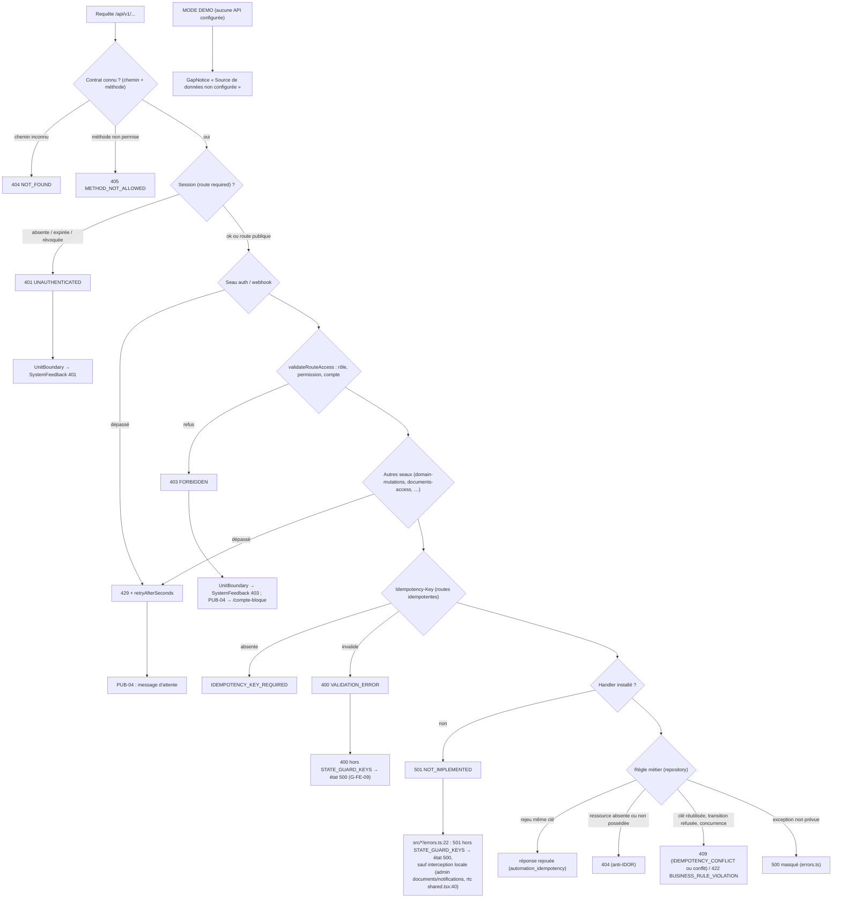

# F — Erreurs et cas limites

> Côté serveur, les codes viennent du pipeline (`src/backend/api/worker.ts:140-196`, C §2) et des handlers. Côté interface, chaque famille projette
> l'erreur avec `src/{employer,prestataire,admin,rtc}/errors.ts:17-24` (et `src/public/auth.ts:30`) : **le code HTTP devient la clé
> d'état StateGuard s'il figure dans `STATE_GUARD_KEYS`** (`stateGuardCatalog.ts:7` : loading, offline, 401, 403, 404, 409, 422,
> 429, 500, maintenance, 502, 503, 504, 425, limites), **sinon l'état `500`**. Rendu : `SystemFeedback` (`src/public/SystemFeedback.tsx`)
> — « Se reconnecter » pour 401, « Réessayer » pour offline/500/502/504, « Revenir » toujours.
>
> Le diagramme 10 résume les chemins d'erreur et points de blocage.

<!-- DIAGRAMME:10-erreurs-blocages -->
_Source : [`diagrammes/10-erreurs-blocages.mmd`](diagrammes/10-erreurs-blocages.mmd)_

<!-- /DIAGRAMME -->

## 1. Matrice transverse

| Cas | Origine serveur (code) | Traitement interface constaté | Statut |
|---|---|---|---|
| Session absente | étape 2 → 401 | état 401 + « Se reconnecter » → `/connexion` ; garde client `anonymous` → 401 (`src/employer/UnitBoundary.tsx:35`) | traité |
| Session expirée / révoquée | `sessions` (0001) ; `auth.logout` révoque en base (vérifié `verify:postgres`) → 401 | identique à « absente » ; aucune distinction expirée/révoquée | traité sans distinction (Q-F-01) |
| Mauvais rôle | étape 4 → 403 | état 403 ; garde client `forbidden` (`src/employer/UnitBoundary.tsx:36`) | traité |
| Compte bloqué | 403 (login) ; contrôle `status` dans les repositories (ex. `matchingRepository.ts:95`) | PUB-04 → lien `/compte-bloque` (`PublicPage.tsx:262`) ; ailleurs état 403 générique | partiel (motif jamais affiché, aucun contrat de motif — Q-F-02) |
| Ressource introuvable | handler → 404 ; route inconnue → 404 | état 404 ; route SPA inconnue → `SystemState 404` (`ShellRoute.tsx:275`) | traité |
| Permission refusée | étape 4 (permission absente) → 403 | état 403 ; écrans ADMIN : formulaire masqué sans permission (vérifié `verify:admin-ui`, ADM-34…38) | traité |
| Validation | handler `VALIDATION_ERROR` → **400** ; clé d'idempotence manquante → 400 | **400 absent de `STATE_GUARD_KEYS` → affiché comme état `500`** (`src/*/errors.ts:22`) ; les formulaires valident en amont (ex. motif 3–1000, ADM-38) | **défaut** (G-FE-09) |
| Conflit / doublon | 409 (`conflict`, `IDEMPOTENCY_CONFLICT`) | état 409 | traité |
| Répétition idempotente | même clé + même charge → résultat rejoué (`automation_idempotency`) | les clients génèrent une clé par commande (`apiClient.ts:68`) | traité ; politique de régénération de clé après échec réseau **À VÉRIFIER** par écran |
| Règle métier | 422 `BUSINESS_RULE_VIOLATION` | état 422 | traité |
| Rate limit | 429 + `retryAfterSeconds` | état 429 ; PUB-04 lit `retryAfterSeconds` (`src/public/auth.ts`) | traité ; limiteur par isolat (G-SEC-02) |
| Handler absent | **501** | **501 absent de `STATE_GUARD_KEYS` → état `500`**, sauf écrans qui l'interceptent (`src/admin/screens/documents.tsx:161`, `notifications.tsx:78`, `src/rtc/screens/shared.tsx:40`, textes PRE `applications.tsx:202-273`) | **défaut partiel** (G-FE-09) |
| Erreur serveur | 500 | état 500 + corrélation seule (vérifié `verify:admin-ui`) | traité |
| Persistance indisponible | `/healthz` 503 (`health.ts:112-114`) ; handlers → 503/500 | état 503 | traité ; aucune page « maintenance » alimentée (PUB-10 sans source) |
| Fournisseur indisponible | Google : échec de vérification → 401/500 ; paiement : aucun fournisseur → 401 au webhook ; push/email : `NOT_AVAILABLE` | login : message d'échec ; paiements : aucune UI fournisseur | partiel (Q-F-04) |
| Hors ligne | — | `status 0` → état `offline` + « Réessayer » | traité |
| Donnée manquante / état non supporté | 409/422 selon handler (ex. matching sans qualification → 409, `matchingRepository.ts:409-420`) | état 409/422 | traité ; statuts de schéma sans transition (E §2) **non traités** (Q-F-05) |
| Transaction partielle | `runInTransaction` dans les repositories ; outbox écrit dans la même transaction (ex. `contractRepository.ts:518-566`) ; jobs `RETRYABLE`/`DEAD_LETTER` | aucune vue de reprise côté utilisateur ; ADMIN Ops sans contrat | serveur traité ; **aucune supervision des dead letters** (G-OPS-01) |
| Upload document hors stockage | 501 si aucun `DOCUMENTS_BUCKET` | état 500 (501 non intercepté côté PRE) | défaut (G-FE-09) |

## 2. Spécificités par parcours

| Parcours | Cas spécifiques constatés | Questions ouvertes |
|---|---|---|
| 1 Public | session check avec timeout 1600 ms → `/accueil` (`PublicPage.tsx:100-110`) ; hors ligne → état offline | Q-F-06 : comportement attendu si la session est valide mais le compte `PENDING` ? |
| 2 Auth | 501 en composition fermée ; 403 bloqué ; 429 ; timeout 30 s (`:217-220`) | Q-F-07 : aucun parcours pour un compte `PENDING` (schéma `0001:10`) ; Q-F-08 : aucune vérification téléphone/consentement avant création via `intent=register` |
| 3 Employeur | `offers.status.update` sur offre `FILLED` refusé (`offerRepository.ts:359`) ; matching : 409 sans qualification / revue humaine, 422 si bloqué, 409 si bassin > 200 | Q-F-09 : que voit l'employeur quand le bassin dépasse 200 ? (409 générique) |
| 4 Candidat | `applications.read/mine.list` 501 ; withdraw possible sans relecture | Q-F-10 : comment un candidat retrouve-t-il une candidature sans liste ? |
| 5 Contrats/paiements | `terminate`/`end` refusés hors `ACTIVE` ; OTP salaire : seau 40/min ; webhook sans fournisseur → 401 | Q-F-11 : expiration et nombre d'essais OTP visibles par l'utilisateur ? |
| 6 Remplacement/réputation | décision `REPLACE` exige contrat `ACTIVE|SUSPENDED` (`claimRepository.ts:856`) | Q-F-12 : sortie d'un remplacement bloqué en `SOURCING_CANDIDATES` (assign/transfer/finalize 501) |
| 7 RTC | `create` refusé sans contrat `ACTIVE` ; session expirée (`EXPIRED`) ; aucune signalisation | Q-F-13 : conduite en cas d'échec ICE (aucun TURN) |
| 8 ADMIN | 403 sans permission (formulaires masqués) ; 501 intercepté sur documents/notifications | Q-F-14 : qui traite les `DEAD_LETTER` et jobs `FAILED` ? |
| 9 Système | 404, 401, 403, 500, offline rendus sur place | Q-F-15 : source d'état de maintenance (PUB-10) |

## 3. Cas non traités (questions)

* **Q-F-01** Distinguer « session expirée » et « session révoquée » dans le message ?
* **Q-F-02** Exposer un motif de blocage au titulaire du compte (aucun contrat) ?
* **Q-F-03** Projection des 400 et 501 : faut-il des états dédiés (le catalogue StateGuard n'en a pas) ?
* **Q-F-04** Comportement attendu quand Google, le fournisseur de paiement, push/email ou TURN sont indisponibles.
* **Q-F-05** Statuts présents dans le schéma sans transition : contrat `PENDING_EMPLOYER`, `PENDING_EMPLOYEE`, `INCIDENT`, `SUSPENDED` ;
  proposition `DRAFT`, `REVISION_REQUESTED` ; litige `CLOSED` ; utilisateur `PENDING`.
* **Q-F-06…15** ci-dessus.
