# H — Intégration Git et PR #47 → #71

> État constaté le 2026-10-13 par `git fetch --unshallow origin` + refs des PR, `gh pr list --state all --limit 100 --json …`,
> `git merge-base --is-ancestor`, `git diff --stat base tête`. **Aucune PR n'a été fusionnée ni modifiée par cet audit.**
> Distinction appliquée : *état Git réel* (ascendance) ≠ *contenu du checkpoint* ≠ *présence dans l'arbre analysé* ≠ *statut de la PR*.

<!-- DIAGRAMME:11-git-pr-checkpoints -->
_Source : [`diagrammes/11-git-pr-checkpoints.mmd`](diagrammes/11-git-pr-checkpoints.mmd)_

```mermaid
%% 11 — Graphe des PR #47–#71 et du checkpoint. Base de la PR N = branche de tête de la PR N−1 (gh, 2026-10-13). Toutes OUVERTES, aucune fusionnée.
flowchart LR
  DM["design-master-v1<br/>cf54c7d"] --> P47["#47 DESIGN-FOUNDATION<br/>43aa2a4 — base design-master-v1"]
  DM --> B551
  B551["b551445 P0-DESIGN-FOUNDATION<br/>(équivalent de #47 dans la lignée)"] --> P48["#48 P1 PUBLIC-AUTH (draft)<br/>c9c0670"]
  P47 -.->|"43aa2a4 ≠ b551445 : diff docs/P0-DESIGN-FOUNDATION.md — conflit probable"| P48
  P48 --> P49["#49 P2 EMP"] --> P50["#50 P3 PRE"] --> P51["#51 P4A"] --> P52["#52 P4B-1"] --> P53["#53 P4B-2"]
  P53 --> P54["#54 P4C"] --> P55["#55 P4D"] --> P56["#56 P4E-1"] --> P57["#57 P4E-2"] --> P58["#58 P4F"]
  P58 --> P59["#59 P4F-2"] --> P60["#60 P4G-1"] --> P61["#61 P4G-2"] --> P62["#62 P4G-3"] --> P63["#63 P4G-4"]
  P63 --> P64["#64 P4G-5A"] --> P65["#65 P4G-5B"] --> P66["#66 P4G-6"] --> P67["#67 P4G-7"] --> P68["#68 P4G-8"]
  P68 --> P69["#69 RTC-1"] --> P70["#70 PUB-AUTH-1"] --> P71["#71 PUB-AUTH-2<br/>c759c0f = checkpoint analysé"]
  P71 --> DOC["PR documentaire (cette cartographie)<br/>base arena/9682849e-le-labeur-pre-arena"]
  MAIN["main 8fd1126"] -.->|"non ancêtre de HEAD ; merge-base 9ee5029"| P71
```

<!-- /DIAGRAMME -->

## 1. Statut GitHub global

* PR #1 à #71 : **70 ouvertes, 0 fusionnée** (`mergedAt` nul pour toutes) ; **#45 fermée sans fusion**. Brouillons : #20, #28, #48.
* Aucune PR n'est fusionnée dans `main` : le code des PR #47–#71 est présent dans l'arbre analysé **uniquement parce que les branches
  sont empilées** (chaque base = tête précédente), pas parce qu'il a été intégré.
* `main` (`8fd1126`) **n'est pas un ancêtre** de HEAD : merge-base `9ee5029`. `main` porte 2 commits propres
  (« Add files via upload », ajout de `code/*`, 17 fichiers, +777) absents de la lignée analysée. **`main` n'est pas consolidée.**

## 2. Matrice des PR #47 → #71

Colonnes : branche source → cible (identifiants `arena/<id>-le-labeur-pre-arena` abrégés), tête et base (commits), *tête ancêtre de
HEAD* (`c759c0f`), *base ancêtre de la tête*, nombre de commits exclusifs (base..tête), diff (fichiers, +, −), répartition des
fichiers modifiés par dossier, statut GitHub.

| PR | Titre | Source → cible | Tête | Base | Tête ⊂ HEAD | Base ⊂ tête | Commits excl. | Diff | Contenu exclusif (dossiers) | Statut |
|---|---|---|---|---|---|---|---|---|---|---|
| #47 | P0-DESIGN-FOUNDATION — fondation technique Web du Design Final | `ca5d5604` → `design-master-v1` | `43aa2a474f` | `cf54c7d3bc` | **non** | oui | 1 | 39f, 6678, 4 | src/design-system(27) src/routing(6) tsconfig.json(1) src/main.tsx(1) scripts/design(1) scripts(1) package.json(1) docs(1) | OPEN, non fusionnée |
| #48 | P1-DESIGN-PUBLIC-AUTH — routes UI et auth existante (partiel, blocages | `6adc3a12` → `ca5d5604` | `c9c0670e62` | `43aa2a474f` | oui | **non** | 2 | 19f, 978, 22 | src/public(6) src/routing(4) src/design-system(2) scripts(2) docs(2) src/repositories(1) scripts/design(1) package.json(1) | OPEN (draft), non fusionnée |
| #49 | P2-DESIGN-EMPLOYER — espace employeur : 32 unités / 60 fiches, vocabul | `1bb2e793` → `6adc3a12` | `815a07bf76` | `c9c0670e62` | oui | oui | 1 | 33f, 10707, 15 | src/employer(24) src/routing(3) scripts(2) src/design-system(1) scripts/design(1) package.json(1) docs(1) | OPEN, non fusionnée |
| #50 | P3-DESIGN-PRESTATAIRE — espace candidat : 26 unités / 52 fiches PRE so | `b143e975` → `1bb2e793` | `c5b794931d` | `815a07bf76` | oui | oui | 1 | 33f, 9510, 9 | src/prestataire(24) src/routing(3) src/employer(1) src/design-system(1) scripts/design(1) scripts(1) package.json(1) docs(1) | OPEN, non fusionnée |
| #51 | P4A-DESIGN-ADMIN-CORE — espace supervision : 7 unités / 12 fiches ADM  | `3936dcbb` → `b143e975` | `2fc4221219` | `c5b794931d` | oui | oui | 1 | 28f, 4459, 13 | src/admin(18) src/routing(3) src/prestataire(1) src/employer(1) src/design-system(1) scripts/design(1) scripts(1) package.json(1) docs(1) | OPEN, non fusionnée |
| #52 | P4B-1-DESIGN-ADMIN-CONTRACTS — supervision ADMIN des contrats : 3 unit | `bbe2b800` → `3936dcbb` | `673a4e086e` | `2fc4221219` | oui | oui | 1 | 18f, 2008, 44 | src/admin(9) src/routing(2) scripts(2) src/employer(1) src/design-system(1) scripts/design(1) package.json(1) docs(1) | OPEN, non fusionnée |
| #53 | P4B-2-DESIGN-ADMIN-PAYMENTS — Paiements et rapprochement ADMIN | `acd89df5` → `bbe2b800` | `d1d98b869e` | `673a4e086e` | oui | oui | 1 | 15f, 2531, 60 | src/admin(8) src/routing(2) scripts(2) src/prestataire(1) src/employer(1) scripts/design(1) | OPEN, non fusionnée |
| #54 | P4C-DESIGN-ADMIN-SALARY-PROOFS — confirmations de Salaire et preuves O | `cb30f620` → `acd89df5` | `f4044e5b3a` | `d1d98b869e` | oui | oui | 1 | 14f, 810, 38 | src/admin(7) src/routing(2) scripts(2) src/prestataire(1) src/employer(1) scripts/design(1) | OPEN, non fusionnée |
| #55 | P4D — écrans ADMIN Claims | `71305819` → `cb30f620` | `9038faeb4b` | `f4044e5b3a` | oui | oui | 1 | 17f, 1821, 59 | src/admin(10) src/routing(2) scripts(2) src/prestataire(1) src/employer(1) scripts/design(1) | OPEN, non fusionnée |
| #56 | P4E-1-DESIGN-ADMIN-REPLACEMENTS — écrans ADMIN Remplacements (ADM-31/3 | `4326f273` → `71305819` | `0cf527150a` | `9038faeb4b` | oui | oui | 1 | 14f, 1761, 40 | src/admin(9) src/routing(2) scripts(2) scripts/design(1) | OPEN, non fusionnée |
| #57 | P4E-2-DESIGN-ADMIN-REPUTATION — écrans ADMIN Réputation (ADM-34/35/36) | `5ecb34fe` → `4326f273` | `7893c8dbee` | `0cf527150a` | oui | oui | 1 | 14f, 1829, 34 | src/admin(9) src/routing(2) scripts(2) scripts/design(1) | OPEN, non fusionnée |
| #58 | P4F-DESIGN-ADMIN-DOCUMENTS — Documents ADMIN (ADM-37…40) : registre, f | `929b1905` → `5ecb34fe` | `bac5b656ac` | `7893c8dbee` | oui | oui | 1 | 13f, 2414, 27 | src/admin(9) scripts(2) src/routing(1) scripts/design(1) | OPEN, non fusionnée |
| #59 | P4F-2-DESIGN-ADMIN-NOTIFICATIONS — écrans ADMIN notifications (ADM-41/ | `7327ff16` → `929b1905` | `c3da3201fe` | `bac5b656ac` | oui | oui | 1 | 13f, 939, 42 | src/admin(8) src/routing(2) scripts(2) scripts/design(1) | OPEN, non fusionnée |
| #60 | P4G-1 — Design ADMIN opérations (ADM-44/45/46) | `cf3fbecc` → `7327ff16` | `f61db55ec9` | `c3da3201fe` | oui | oui | 1 | 9f, 331, 22 | src/admin(6) src/routing(1) scripts/design(1) scripts(1) | OPEN, non fusionnée |
| #61 | P4G-2 — supervision SLO, dead-letter et incidents | `19b6d908` → `cf3fbecc` | `33810c2b4a` | `f61db55ec9` | oui | oui | 1 | 11f, 605, 36 | src/admin(7) scripts(2) src/routing(1) scripts/design(1) | OPEN, non fusionnée |
| #62 | P4G-3 — Diagnostic sécurité ADMIN (ADM-50/51) | `ad5bdc92` → `19b6d908` | `fd4878692c` | `33810c2b4a` | oui | oui | 1 | 10f, 310, 22 | src/admin(6) scripts(2) src/routing(1) scripts/design(1) | OPEN, non fusionnée |
| #63 | P4G-4 — Infrastructure ADMIN : topologie & Worker edge (ADM-57/58) | `4529fd91` → `ad5bdc92` | `222c08b13d` | `fd4878692c` | oui | oui | 1 | 11f, 481, 43 | src/admin(7) scripts(2) src/routing(1) scripts/design(1) | OPEN, non fusionnée |
| #64 | P4G-5A — Contrôles de sécurité ADMIN : rejeux, limitation de débit & w | `912185a7` → `4529fd91` | `0c84290c79` | `222c08b13d` | oui | oui | 1 | 10f, 719, 41 | src/admin(6) scripts(2) src/routing(1) scripts/design(1) | OPEN, non fusionnée |
| #65 | P4G-5B — Incidents & audit de sécurité ADMIN : ADM-55/56 (frontières d | `e4a9debf` → `912185a7` | `5ebc95e3ae` | `0c84290c79` | oui | oui | 1 | 11f, 758, 52 | src/admin(7) scripts(2) src/routing(1) scripts/design(1) | OPEN, non fusionnée |
| #66 | P4G-6 — Données d'infrastructure ADMIN : PostgreSQL/Hyperdrive & stock | `c93148d0` → `e4a9debf` | `d24c229365` | `5ebc95e3ae` | oui | oui | 1 | 9f, 683, 39 | src/admin(6) src/routing(1) scripts/design(1) scripts(1) | OPEN, non fusionnée |
| #67 | P4G-7 — Média, observabilité et statut ADMIN : WebRTC/TURN, observabil | `545a2513` → `c93148d0` | `e50dd8768e` | `d24c229365` | oui | oui | 1 | 10f, 985, 44 | src/admin(6) scripts(2) src/routing(1) scripts/design(1) | OPEN, non fusionnée |
| #68 | feat(admin): add salary disputes and corrections diagnostic view P4G-8 | `b26330d2` → `545a2513` | `1af676eff7` | `e50dd8768e` | oui | oui | 1 | 11f, 668, 53 | src/admin(7) scripts(2) src/routing(1) scripts/design(1) | OPEN, non fusionnée |
| #69 | RTC-1 : Sessions temps réel — 5 unités / 8 fiches (frontend-only) | `674f575f` → `b26330d2` | `29219e2f06` | `1af676eff7` | oui | oui | 1 | 30f, 4078, 18 | src/rtc(20) src/routing(3) src/prestataire(1) src/employer(1) src/design-system(1) src/admin(1) scripts/design(1) scripts(1) package.json(1) | OPEN, non fusionnée |
| #70 | PUB-AUTH-1 — expliciter les blocages backend des parcours Public/Auth | `df298795` → `674f575f` | `738ca989b5` | `29219e2f06` | oui | oui | 1 | 5f, 128, 10 | src/public(4) scripts(1) | OPEN, non fusionnée |
| #71 | PUB-AUTH-2 — écrans publics restants : finitions PUB-01/02, politique  | `9682849e` → `df298795` | `c759c0f845` | `738ca989b5` | oui | oui | 1 | 13f, 1278, 57 | src/public(5) src/design-system(4) docs(2) src/routing(1) scripts(1) | OPEN, non fusionnée |

Constats :
* **#48 → #71** : chaîne linéaire stricte, base(N) = tête(N−1), chaque tête est ancêtre de HEAD ; un commit exclusif par PR, sauf #48 (2).
* **#47** : base `cf54c7d` (`arena/design-master-v1`, ancêtre de HEAD, 25 commits avant HEAD), tête `43aa2a4` **non ancêtre** de HEAD.
  La lignée analysée contient à sa place `b551445` (même parent `cf54c7d`, même titre ; différence limitée à
  `docs/P0-DESIGN-FOUNDATION.md`, 6+/7−). #48 a pour **base déclarée** `43aa2a4` mais sa tête descend de `b551445` : sa base n'est pas
  ancêtre de sa tête (2 commits exclusifs : `b551445` + `c9c0670`).
* **Aucune PR #47–#71 ne modifie `src/backend/` ni `migrations/`** : le backend analysé précède la chaîne (présent dès `cf54c7d`).
* Domaines : #47 fondation design ; #48 Public/Auth (P1) ; #49 Employeur ; #50 Prestataire ; #51–#68 ADMIN ; #69 RTC ; #70–#71 Public/Auth.
* Checkpoint : la tête de #71 (`c759c0f…`) = tête distante de `arena/9682849e-le-labeur-pre-arena` = HEAD analysé.

## 3. Dépendances et conséquences d'une fusion dans le mauvais ordre

Fichiers partagés (nombre de PR #47–#71 qui les modifient, calculé par `git diff --name-only base tête`) :

| Fichier | PR |
|---|---|
| `src/routing/integration.ts` | 24 |
| `scripts/run-tests.ts` | 21 |
| `src/admin/admin.test.tsx` | 19 |
| `src/admin/registry.tsx`, `src/admin/gaps.ts`, `src/admin/catalog.ts`, `scripts/design/generate-admin-catalog.py` | 18 chacun |
| `package.json` | 7 |

Conséquences (déduites de l'empilement, non simulées par fusion) :
* Chaque PR est rédigée **contre la tête précédente** : la fusionner vers `main` (ou vers une autre base que sa base déclarée) avant ses
  prédécesseurs entraîne soit l'import implicite de tous les commits précédents, soit des conflits sur les fichiers ci-dessus.
* Fusionner #47 puis #48 : #48 ne contient pas `43aa2a4` ; conflit probable sur `docs/P0-DESIGN-FOUNDATION.md` (deux versions du même commit).
* Fusionner #70 ou #71 isolément : ils dépendent de #69 → … → #48 (catalogue public, `integration.ts`, `run-tests.ts`).
* Fusionner vers `main` : `main` contient 2 commits absents de la lignée (`code/*`) ; intégration à arbitrer (I-GIT-01).
* L'ordre sûr déduit de la topologie est #48 (ou #47 après arbitrage) → #49 → … → #71 ; **aucune fusion n'est effectuée ni recommandée ici**.

## 4. Branche de la présente documentation

| Élément | Valeur |
|---|---|
| Branche imposée par la session Arena | `arena/3da9ab2f-le-labeur-pre-arena` (la consigne mentionne `arena/3da9b2f-…` ; la branche réelle de session est `3da9ab2f`) |
| Point de départ | `c759c0f8453b9ff81a2a4cfde9bcf12a50e504a3` (ancêtre vérifié par `git merge-base --is-ancestor`) |
| Contenu | uniquement `docs/architecture/cartographie-globale/` |
| PR cible | `arena/9682849e-le-labeur-pre-arena` (tête de #71) |
| PR documentaire équivalente existante | **aucune** (`gh pr list --state all --search cartographie` : vide ; recherche des titres « cartograph/architecture/audit/doc ») — la PR #10 « docs: add exhaustive business scenario audit » (ouverte, base `main`, contient aussi du code backend/frontend, antérieure aux espaces Master Design) n'est pas équivalente |
