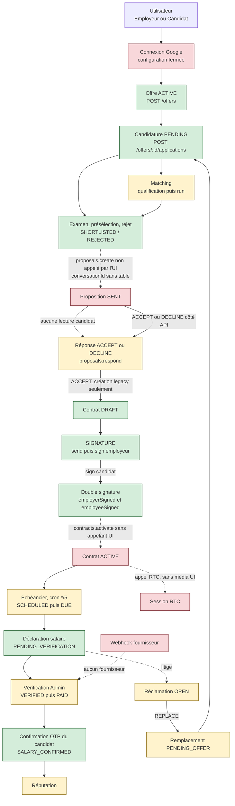
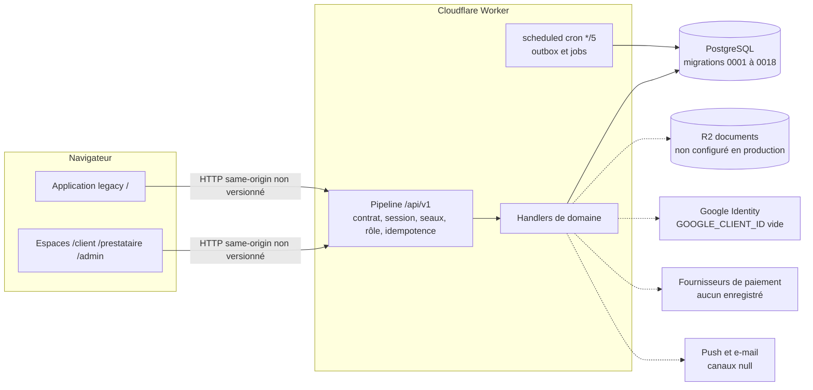

# LE LABEUR — Fonctionnement complet de l'application

> **Guide propriétaire — mission 3 (compréhension).** Document rédigé le 2026-10-14, à partir du code au commit `84dd0ba`
> (branche de session `arena/200bd542-le-labeur-pre-arena`, tête identique de `arena/265bd555-le-labeur-pre-arena` et de la PR #73 au moment de l'analyse).
> La cartographie existante (`docs/architecture/cartographie-globale/`, figée à `c759c0f`) a été relue et confrontée au code ; les écarts sont signalés (section 11).
>
> **Règle de lecture.** Un écran qui existe n'est pas, pour autant, un parcours opérationnel. Chaque fonction porte un statut :
>
> | Statut | Signification |
> |---|---|
> | `IMPLÉMENTÉ_ET_TESTÉ_LOCAL` | Code présent et couvert par des tests exécutés localement (suite `npm test`, PGlite, ou script `verify:*`). Ne signifie pas « validé en production ». |
> | `IMPLÉMENTÉ_PARTIELLEMENT` | Une partie du parcours existe ; une étape manque, est désactivée ou n'est pas reliée. |
> | `UI_SANS_RACCORDEMENT_COMPLET` | L'écran ou le contrat existe, mais l'enchaînement complet n'est pas appelé par l'interface. |
> | `API_OU_HANDLER_MANQUANT` | Contrat déclaré sans handler, ou aucune route, ou aucune table. |
> | `501_INDISPONIBLE` | La route répond `501 NOT_IMPLEMENTED` dans la composition. |
> | `SERVICE_DISTANT_NON_VALIDÉ` | Dépend d'un service ou d'une ressource Cloudflare/tiers non configuré ou non testé en conditions réelles. |
> | `DÉCISION_PROPRIÉTAIRE_REQUISE` | La règle ou le choix métier n'est pas tranché ; le code ne peut pas trancher. |
> | `NON_VÉRIFIÉ` | Non établi. **Jamais traité comme fonctionnel.** |

---

## Partie A — Vision générale

### A.1 Ce que fait LE LABEUR

LE LABEUR est une plateforme qui met en relation des **Employeurs** (particuliers ou structures qui recherchent quelqu'un pour un travail) et des **Candidats** (personnes qui cherchent un travail). Le code la décrit comme un cycle complet : publier une **Offre**, recevoir des **Candidatures**, sélectionner, faire une **Proposition**, puis conclure un **Contrat**, suivre l'exécution et les **salaires**, et traiter les **réclamations** éventuelles.

Le dépôt contient une application complète sur le papier, mais **le cycle n'est pas aujourd'hui exécutable de bout en bout depuis l'interface** (voir partie G).

### A.2 Termes métier utilisés

| Terme | Sens dans ce guide | Note de vocabulaire |
|---|---|---|
| **Employeur** | Personne ou structure qui publie une offre et engage | L'interface peut afficher « Client » (espace `/client`). Décision de vocabulaire non tranchée (I-DEC-01). |
| **Candidat** | Personne qui postule et exécute le travail | L'interface peut afficher « Prestataire » (espace `/prestataire`). Même réserve. |
| **Offre** | Annonce de mission publiée par un Employeur | Statut créé : `ACTIVE`. |
| **Candidature** | Acte d'un Candidat sur une Offre | Idempotente par couple (Offre, Candidat). |
| **Proposition** | Proposition de l'Employeur à un Candidat sélectionné | Rattachée à un `proposalId`. Le lien avec une conversation n'est pas vérifié (I-DEC-05). |
| **Contrat** | Engagement entre Employeur et Candidat | Activé seulement après double signature. |

### A.3 À qui s'adresse la plateforme

Trois profils serveur existent : `EMPLOYER`, `CANDIDATE` et `ADMIN` (`migrations/0001_identity_and_core.sql`, `0002_role_permissions_seed.sql`). L'Admin dispose de 24 permissions, toutes attribuées au seul rôle ADMIN (`0002`).

### A.4 Espaces et leur niveau réel

| Espace | Chemin | Ce qu'il est réellement aujourd'hui | Statut global |
|---|---|---|---|
| **Public / Auth** | `/ouverture`, `/accueil`, `/connexion`, `/inscription`… | Accueil et connexion Google ; inscription, OTP, récupération et consentement désactivés | `IMPLÉMENTÉ_PARTIELLEMENT` |
| **Application legacy** | `/` et tout chemin hors espace | Application historique en mode DEMO par défaut ; c'est là qu'atterrit la connexion | `IMPLÉMENTÉ_PARTIELLEMENT` |
| **Employeur** | `/client` | Tableau de bord, offres, candidatures, paiements, litiges ; chaîne d'embauche interrompue | `IMPLÉMENTÉ_PARTIELLEMENT` |
| **Candidat** | `/prestataire` | Missions, candidatures, contrats, salaires, réputation ; propositions non lisibles | `IMPLÉMENTÉ_PARTIELLEMENT` |
| **ADMIN** | `/admin` et écrans legacy `src/screens/admin/*` | Supervision de plusieurs domaines ; domaines Ops/Sécurité/Infra diagnostiques | `IMPLÉMENTÉ_PARTIELLEMENT` |
| **Temps réel (RTC)** | `/appel`, `/appels` | Sessions créées et rejointes ; signalisation média non câblée | `UI_SANS_RACCORDEMENT_COMPLET` |
| **Système** | `/etat/*` | Écrans d'état (erreur, accès refusé…) | `IMPLÉMENTÉ_ET_TESTÉ_LOCAL` (affichage) |
| **Finance transversale** | aucune route | Domaine FIN, bloqué | `DÉCISION_PROPRIÉTAIRE_REQUISE` |

**Constat important.** Les espaces `/client`, `/prestataire`, `/admin` sont atteignables seulement par saisie d'URL : aucun lien de l'application legacy n'y mène (vérifié : la recherche des littéraux `'/client'`, `'/prestataire'`, `'/admin'` dans `src/App.tsx`, `src/screens`, `src/context`, `src/components` ne trouve que deux garde-fous de chemin dans `src/screens/admin/AdminLoginGate.tsx:41` et `AdminAccessDenied.tsx:14`). C'est l'écart G-FE-01 de la cartographie, toujours présent.

---

## Partie B — Parcours de chaque utilisateur

Pour chaque étape : **ce que fait l'utilisateur**, **ce que fait l'interface**, **l'API, la règle ou la donnée utilisée**, **ce qui se passe si l'opération échoue ou n'existe pas**, puis le statut.

**Précondition commune aux parcours connectés.** Les écrans des espaces ne parlent au serveur qu'en *mode API* : `VITE_DEMO_MODE=false` **et** `VITE_API_BASE_PATH` chemin same-origin (`src/repositories/mode.ts:25-35`, vérifié). Sinon, l'écran affiche « Source de données non configurée » (`UnitBoundary.tsx`, cartographie B). Le mode DEMO est donc le comportement par défaut du dépôt.

**Précondition serveur.** Dans `wrangler.toml` versionné, `GOOGLE_CLIENT_ID = ""` (lignes 58 et 110, vérifié). En l'état, la composition du Worker est **fermée** : les routes authentifiées répondent 401 et les routes publiques 501 (cartographie, G-INF-01).

### B.1 Arrivée d'un visiteur

| Étape | Utilisateur | Interface | API / règle / donnée | Si échec ou absence | Statut |
|---|---|---|---|---|---|
| Ouverture du site | arrive sur `/ouverture` | écran splash `PublicPage` ; tente `GET /auth/session` (timeout 1600 ms) | `auth.session` (identityWorker) | pas de session → `/accueil` ; hors ligne → état hors ligne | `IMPLÉMENTÉ_ET_TESTÉ_LOCAL` (`verify:public-ui`, 29 PASS sur fixtures, cartographie §7) |
| Page d'accueil | lit la présentation | contenu statique | aucune API publique (`/public/story`, `/public/stats` absents) | contenu codé en dur | `IMPLÉMENTÉ_PARTIELLEMENT` |
| Exemple de prix | voit un exemple « 250 000 F + 25 000 F de frais SaaS » | texte codé en dur (`src/public/PublicPage.tsx:149-153`, cité par la cartographie) | aucune règle serveur ; domaine FIN | — | `DÉCISION_PROPRIÉTAIRE_REQUISE` (I-FIN-02) |

### B.2 Inscription et authentification

| Étape | Utilisateur | Interface | API / règle / donnée | Si échec ou absence | Statut |
|---|---|---|---|---|---|
| Choix du profil | choisit Client ou Prestataire | enregistré **localement** dans le navigateur | aucune (`POST /onboarding/role` absent) | le rôle n'est pas enregistré côté serveur | `API_OU_HANDLER_MANQUANT` |
| Création de compte | « Créer mon compte » | **bouton désactivé** (`PublicPage.tsx:274`) | `register` absent côté UI ; `intent=register` existe dans `identityWorker.ts:76` mais la cartographie signale qu'il peut créer un compte actif sans vérification téléphone ni consentement (G-SEC-04, **à revérifier**) | **arrêt** : création impossible depuis l'interface | `API_OU_HANDLER_MANQUANT` (UI) + `DÉCISION_PROPRIÉTAIRE_REQUISE` (I-DEC-02/03) |
| Vérification OTP | saisie du code | bouton désactivé (`:282`) | aucun contrat d'OTP d'authentification (l'OTP existant est réservé à la confirmation de salaire) | arrêt | `API_OU_HANDLER_MANQUANT` |
| Connexion Google | « Continuer avec Google » | charge Google Identity puis `POST /auth/google/credential` (`intent=login`), puis `GET /auth/session` (`src/public/auth.ts`) | vérification du jeton GSI si `GOOGLE_CLIENT_ID` non vide (`identityWorker.ts`) | **501** avec `GOOGLE_CLIENT_ID` vide : connexion indisponible ; **403** compte non actif → `/compte-bloque` ; **429** → message d'attente | `SERVICE_DISTANT_NON_VALIDÉ` (le code existe, la configuration est fermée) |
| Mot de passe oublié | « Envoyer le lien » | bouton désactivé (`:288`) | aucun contrat de récupération | arrêt | `API_OU_HANDLER_MANQUANT` |
| Consentement / CGU | « Accepter la version en vigueur » | bouton désactivé (`:295`) | aucun `POST /legal/consent` ; signature de contrat sans consentement structuré | arrêt | `API_OU_HANDLER_MANQUANT` + `DÉCISION_PROPRIÉTAIRE_REQUISE` (I-LEG-02) |
| Déconnexion | « Se déconnecter » | `POST /auth/logout` | révocation de session (vérifié en PostgreSQL, `verify:postgres` 28/28, cartographie §7) | — | `IMPLÉMENTÉ_ET_TESTÉ_LOCAL` |

### B.3 Navigation après connexion

| Étape | Utilisateur | Interface | API / règle / donnée | Si échec ou absence | Statut |
|---|---|---|---|---|---|
| Arrivée après connexion | arrive sur `/` | application **legacy** (`src/App.tsx`, `AppContext`) — `PublicPage.tsx:227` | `GET /auth/session` ; hydratation des ressources de session | voir ci-dessous | `IMPLÉMENTÉ_PARTIELLEMENT` |
| Hydratation de session (P2) | voit ses données | `AppContext` appelle `hydrateSessionResources` (`src/context/sessionHydration.ts`) | chaque ressource secondaire est isolée ; un 501 sur une ressource n'annule plus la session (commit `f2ec4a9`, tests H1–H6 `sessionHydration.test.ts`) | ressource indisponible → statut explicite, **pas** de données inventées | `IMPLÉMENTÉ_ET_TESTÉ_LOCAL` (P2 corrigée) |
| Passage vers `/client`, `/prestataire`, `/admin` | cherche le bon espace | **aucun lien** dans le legacy | — | l'utilisateur doit saisir l'URL | `DÉCISION_PROPRIÉTAIRE_REQUISE` (I-DEC-04) + `UI_SANS_RACCORDEMENT_COMPLET` |

### B.4 Parcours de l'Employeur

| Étape | Utilisateur | Interface | API / règle / donnée | Si échec ou absence | Statut |
|---|---|---|---|---|---|
| **Profil** (EMP-03/04) | consulte son profil | lecture ; paramètres sans appel API | `users.me.update` = **501** : profil non modifiable (cartographie G-FE-10, `src/employer/gaps.ts`) | modification impossible | `501_INDISPONIBLE` |
| **Tableau de bord** (EMP-01) | voit ses offres, contrats, paiements, litiges | listes chargées au montage | `offers.mine.list`, `contracts.mine.list`, `payments.mine.list`, `claims.mine.list` | liste en erreur ; paiements et litiges exigent PostgreSQL | `IMPLÉMENTÉ_PARTIELLEMENT` |
| **Création d'offre** (wizard EMP-06…09) | saisit titre, type de contrat, rémunération, lieu… | `src/employer/screens/offers.tsx` ; soumission `POST /offers` | `offers.create` : champs obligatoires `title`, `contractType`, `remuneration` (≥ 0), `location` ; refusés `role`, `permissions`, `source`, `status`, `id` ; statut créé `ACTIVE` | erreur de validation affichée par champ ; 5xx/réseau = issue inconnue, clé conservée | `IMPLÉMENTÉ_ET_TESTÉ_LOCAL` (route wizard ; `routeContracts.ts`, handler `offerRepository`) |
| **Création d'offre — application legacy** | même action depuis `/` | modale `EmployerOffersScreen` refaite (P3, commit `bb4b00a`) ; `useOfferPublisher` ; `buildOfferPayload` | `createOffer(data, idempotencyKey)` → `POST /offers` ; confirmation **seulement** sur succès backend ; clé stable par tentative | erreurs de validation et serveur affichées ; fenêtre fermée sans confirmation si échec ; tests O1–O11 (`src/screens/offerCreation.test.ts`) | `IMPLÉMENTÉ_ET_TESTÉ_LOCAL` |
| **Qualification** (EMP-10) | décrit la mission pour le matching | `matching.qualification.submit` | décision `ELIGIBLE_FOR_INDEPENDENT` / revue humaine / `BLOCKED` (`qualification.ts`) | résultat `BLOCKED` ou `HUMAN_REVIEW_REQUIRED` bloque le matching | `IMPLÉMENTÉ_ET_TESTÉ_LOCAL` (cartographie : pg ✔) |
| **Matching** (EMP-18) | lance la recherche de candidats | « Lancer » → `matching.runs.create` | exige offre `ACTIVE` et qualification non bloquée ; pondérations **compétences 60** et **zone administrative 30** (`src/backend/matching/matchingEngine.ts`, vérifié) ; **plafond 200 profils** (`MAX_MATCHING_CANDIDATES = 200`, `matchingRepository.ts:35`, vérifié) | au-delà de 200, réponse 409 | `IMPLÉMENTÉ_PARTIELLEMENT` (voir §B.6) |
| **Candidatures reçues** (EMP-16) | examine, présélectionne, écarte | `applications.offer.list`, `applications.examine`, `applications.shortlist`, `applications.reject` | `PENDING → REVIEW → SHORTLISTED`, `→ REJECTED` (tests `applicationDecisions.test.ts`) | 404 si candidature non possédée (anti-IDOR) | `IMPLÉMENTÉ_ET_TESTÉ_LOCAL` |
| **Sélection → proposition** (EMP-21) | propose à un candidat sélectionné | **aucun appel** `proposals.create` depuis l'écran | `proposals.create` exige un `conversationId` non vide, **jamais vérifié** (aucune table de conversations ; `0004_proposals.sql:23`) | **arrêt** : l'écran déclare le manque | `UI_SANS_RACCORDEMENT_COMPLET` + `API_OU_HANDLER_MANQUANT` (messagerie) |
| **Suivi des propositions** (EMP-23…28) | suit l'état de la proposition | pas de route de lecture employeur des propositions (`src/employer/gaps.ts`) | — | **arrêt** | `API_OU_HANDLER_MANQUANT` |
| **Création du contrat** | transforme une proposition acceptée en contrat | `contracts.create` n'est appelé **par aucun écran de famille** ; seul le legacy l'appelle (`legacyApiAdapter.ts:155`) | `contractRepository.ts:734` fixe `commissionPercentage: 25` | — | `UI_SANS_RACCORDEMENT_COMPLET` |
| **Envoi du contrat** (EMP-29) | envoie au candidat | « Envoyer » → `contracts.send` | `DRAFT → SIGNATURE` | erreur affichée | `IMPLÉMENTÉ_ET_TESTÉ_LOCAL` |
| **Signature employeur** (EMP-31) | signe | `contracts.sign` | pose `employerSigned` (`contractTransitions.ts`) | erreur de transition → 409/422 | `IMPLÉMENTÉ_ET_TESTÉ_LOCAL` |
| **Activation** | le contrat devient actif | **aucun écran n'appelle `contracts.activate`** (vérifié : aucun appelant hors gaps) | handler présent ; exige `employerSigned && employeeSigned` ; réservé à l'employeur propriétaire (`contractTransitions.ts:149,167-172`) | **le contrat reste en `SIGNATURE`** | `UI_SANS_RACCORDEMENT_COMPLET` + `DÉCISION_PROPRIÉTAIRE_REQUISE` (I-DEC-06) |
| **Paiements** (EMP-41…43) | voit les échéances, déclare un salaire ou une commission | `payments.mine.list`, `payments.salary.declare`, `payments.commission.declare` | `DUE \| REJECTED → PENDING_VERIFICATION` (tests de cycle, `verify:postgres`) | erreur affichée ; aucun mouvement de fonds (partie F) | `IMPLÉMENTÉ_ET_TESTÉ_LOCAL` pour le statut ; **aucun fonds** |
| **Clôture de mission** (EMP-42) | clôt la mission | `payments.close-mission` | clôture des échéances de fin | — | `IMPLÉMENTÉ_PARTIELLEMENT` |
| **Litige** (EMP-39, EMP-49…55) | ouvre une réclamation, dépose une preuve | `claims.create`, `claims.evidence.submit` | `OPEN → EVIDENCE_REQUESTED → UNDER_REVIEW → …` ; `CONTRACT_INCIDENT` exige contrat `ACTIVE` ou `SUSPENDED` | lien `/client/litiges` mène à un écran de repli (G-FE-02) | `IMPLÉMENTÉ_PARTIELLEMENT` |
| **Remplacement** (EMP-56…60) | publie une offre de remplacement | `replacements.offer.create` | `SOURCING_CANDIDATES` ; la suite (proposition, contrat) n'est pas câblée côté écran | arrêt après présélection | `IMPLÉMENTÉ_PARTIELLEMENT` |

### B.5 Parcours du Candidat

| Étape | Utilisateur | Interface | API / règle / donnée | Si échec ou absence | Statut |
|---|---|---|---|---|---|
| **Profil de matching** (PRE-03/04) | renseigne ses compétences, sa zone, sa disponibilité | `matching.profile.read/update` | `AVAILABLE / LIMITED / UNAVAILABLE` ; **la création du profil suffit à entrer dans le bassin de matching** (aucun consentement explicite, cartographie B §4.2 ; `matching` ne contient aucune notion de consentement) | erreur affichée | `IMPLÉMENTÉ_PARTIELLEMENT` (consentement non défini) |
| **Consultation des offres** (PRE-05/07) | cherche une offre | `offers.public.list`, `offers.public.read` | seules les offres `ACTIVE` | liste vide si aucune offre | `IMPLÉMENTÉ_ET_TESTÉ_LOCAL` |
| **Candidature** (PRE-08) | postule | `POST /offers/:id/applications` (`applications.create`, idempotent) | 201 candidature `PENDING` ; offre `ACTIVE` obligatoire (409 sinon) ; compte candidat `ACTIVE` ; **une seule candidature par couple** (P4, tests) | **confirmation seulement** sur réponse identifiée ; 501/réseau/4xx affichés explicitement ; clé d'idempotence conservée sur issue inconnue | `IMPLÉMENTÉ_ET_TESTÉ_LOCAL` (backend ; `applicationSubmission.test.ts` A1–A8) |
| **Mes candidatures** (PRE-01/11) | voit ses candidatures | `GET /my/applications` (`applications.mine.list`) | **P4 : handler installé** ; candidat `ACTIVE` uniquement ; sans curseur ; `hasMore` sur `limit+1` (`applicationRepository.ts`, `applications.test.ts`) | 400 si curseur fourni ; l'écran affiche l'erreur | `IMPLÉMENTÉ_ET_TESTÉ_LOCAL` côté serveur ; **écran non vérifié en navigateur** → `NON_VÉRIFIÉ` côté UI |
| **Relecture d'une candidature** (PRE-09) | rouvre une candidature | `GET /applications/:id` (`applications.read`) | **P4 : handler installé** ; titulaire ou employeur propriétaire ; sinon 404 identique à « inexistant » | 404 | `IMPLÉMENTÉ_ET_TESTÉ_LOCAL` côté serveur |
| **Retrait** (PRE-10/12/14) | retire sa candidature | `applications.withdraw` | `→ WITHDRAWN` | erreur affichée | `IMPLÉMENTÉ_ET_TESTÉ_LOCAL` |
| **Propositions reçues** (PRE-16…20) | lit une proposition, accepte ou refuse | `contracts.mine.list` seulement ; `proposals.respond` (ACCEPT/DECLINE) n'est appelé par aucun écran de famille ; aucune route de lecture de la proposition | **arrêt** : montant, conditions et échéancier non lisibles ; l'écran dit explicitement que rien n'est simulé (`src/prestataire/screens/proposals.tsx`) | route `/prestataire/contrats` → écran de repli | `API_OU_HANDLER_MANQUANT` (lecture) + `UI_SANS_RACCORDEMENT_COMPLET` (réponse) |
| **Signature du contrat** (PRE-21/24) | signe | `contracts.sign` (pose `employeeSigned`) | aucun corps ni consentement structuré (G-LEG-02) | erreur affichée | `IMPLÉMENTÉ_PARTIELLEMENT` |
| **Confirmation d'exécution** (PRE-21) | confirme avoir exécuté | `contracts.confirm-execution` | — | erreur affichée | `IMPLÉMENTÉ_PARTIELLEMENT` |
| **Preuves d'exécution** (PRE-28…31) | dépose des preuves | aucun écran de dépôt de preuve d'exécution (`src/prestataire/gaps.ts`) | — | **arrêt** | `UI_SANS_RACCORDEMENT_COMPLET` |
| **Salaire attendu** (PRE-32/33) | voit ses prochains paiements | `payments.mine.list` (pg) ; `schedules.mine.list` = 501 | liste d'échéances seulement | calendrier non disponible | `501_INDISPONIBLE` (planning) |
| **Confirmation du salaire** (PRE-38) | saisit un code reçu | `payments.salary.confirmation.confirm` (pg, seau `salary-otp`) | `SALARY_CONFIRMED` → réputation | code erroné refusé ; **canal d'envoi du code non établi** (push et e-mail non configurés, G-INF-05) | `IMPLÉMENTÉ_PARTIELLEMENT` |
| **Contestation de salaire** (PRE-36/37) | conteste un retard | `claims.create` (pg) | `OPEN` | erreur affichée | `IMPLÉMENTÉ_PARTIELLEMENT` |
| **Documents** (PRE-48…52) | dépose ou consulte un document | `documents.upload-grant`, `documents.versions.*` | **uniquement** si stockage objet configuré ; sinon 501 | 501 | `SERVICE_DISTANT_NON_VALIDÉ` (R2) |
| **Remplacement** (PRE-40…44) | consulte son dossier | `replacements.mine.list/read` (pg) | lecture | — | `IMPLÉMENTÉ_ET_TESTÉ_LOCAL` (lecture) |
| **Réputation** (PRE-45…47) | voit son historique, conteste | `reputation.mine.read`, `reputation.mine.entries.list`, `claims.create` (OTHER_REVIEW_REQUIRED) | ledger append-only | — | `IMPLÉMENTÉ_ET_TESTÉ_LOCAL` (serveur) |

### B.6 Matching et étapes de sélection réellement mises en œuvre

Le matching est **la partie la plus aboutie du moteur** côté serveur :

1. L'Employeur qualifie la mission (`matching.qualification.submit`). Trois issues : `ELIGIBLE_FOR_INDEPENDENT`, revue humaine, `BLOCKED`.
2. L'Employeur lance un run (`matching.runs.create`). Conditions : offre `ACTIVE`, qualification non bloquée.
3. Le moteur calcule un score : compétences (poids 60, `matchingEngine.ts`), zone administrative (poids 30, `matchingEngine.ts`). La cartographie (C §6) mentionne aussi une composante à 10 points que je n'ai pas re-vérifiée.
4. Le bassin est limité à 200 profils `ACTIVE` ; au-delà, 409.
5. Les candidats trouvés sont visibles par l'Employeur (EMP-18 → EMP-20) puis peuvent être présélectionnés.

**Ce qui n'existe pas :** consentement du candidat au matching, filtre sur la réputation, filtre sur la qualification du candidat (G-BE-06, I-DEC-12). Les règles de matching sont donc **implémentées telles quelles, sans validation métier**.

**Étapes de sélection réellement câblées :** qualification → run de matching → examen → présélection (`SHORTLISTED`) → rejet. La **suite (proposition) n'est pas câblée** côté écran.

**Statut :** `IMPLÉMENTÉ_PARTIELLEMENT` (algorithme et tests présents ; règles de consentement et de sélection à décider).

### B.7 Proposition

| Étape | Utilisateur | Interface | API / règle | Si échec ou absence | Statut |
|---|---|---|---|---|---|
| Création | l'Employeur propose à un candidat présélectionné | **aucun écran de famille** ; le legacy appelle `proposals.create` (`legacyApiAdapter.ts:193`) avec un `conversationId` | `0004_proposals.sql:23` : `conversation_id TEXT NOT NULL`, sans clé étrangère ; **aucune table de messagerie** | le legacy envoie la proposition à un identifiant de conversation non vérifié | `IMPLÉMENTÉ_PARTIELLEMENT` (backend) + `API_OU_HANDLER_MANQUANT` (messagerie) |
| Lecture | le candidat lit montant, conditions, échéancier | **aucune route de lecture** | — | l'écran dit « rien n'est simulé » | `API_OU_HANDLER_MANQUANT` |
| Réponse | accepte ou refuse | `POST /proposals/:proposalId/respond` (ACCEPT / DECLINE) ; REVISE renvoie 501 | transitions `SENT → ACCEPTED / DECLINED / EXPIRED` | REVISE : 501 « demande de révision non ouverte » | `IMPLÉMENTÉ_PARTIELLEMENT` |
| Alignement legacy sur `proposalId` (P5) | — | **non réalisé** : le legacy `respondToProposal` utilise déjà `proposalId`, mais la création reste liée à `conversationId` | — | — | `NON_VÉRIFIÉ` (lot P5 ouvert) |

### B.8 Contrat

| Étape | Qui | Ce qui se passe | API / règle | Si échec | Statut |
|---|---|---|---|---|---|
| Création | Employeur (legacy seulement) | contrat en `DRAFT` à partir d'une proposition acceptée | `contracts.create` ; `commissionPercentage: 25` (`contractRepository.ts:734`) | — | `UI_SANS_RACCORDEMENT_COMPLET` |
| Envoi | Employeur | `DRAFT → SIGNATURE` | `contracts.send` | erreur | `IMPLÉMENTÉ_ET_TESTÉ_LOCAL` |
| Signature 1 | Employeur | pose `employerSigned` | `contracts.sign` | erreur | `IMPLÉMENTÉ_ET_TESTÉ_LOCAL` |
| Signature 2 | Candidat | pose `employeeSigned` (aucun consentement structuré) | `contracts.sign` | erreur | `IMPLÉMENTÉ_PARTIELLEMENT` |
| Activation | Employeur propriétaire | `SIGNATURE → ACTIVE` si les deux drapeaux sont posés ; déclenche l'outbox `CONTRACT_ACTIVATED` puis `contractActivation.ts` (échéancier) | `contracts.activate` (**aucun appelant UI**) | **le contrat reste en `SIGNATURE`** : aucun échéancier, aucun salaire | `UI_SANS_RACCORDEMENT_COMPLET` + `DÉCISION_PROPRIÉTAIRE_REQUISE` (I-DEC-06) |
| Vie du contrat | — | `ACTIVE → COMPLETED` (`END`) ; `ACTIVE → TERMINATED` (`TERMINATE`) | `contracts.end` (sans appelant UI), `contracts.terminate` (exige `ACTIVE`) | inatteignable tant que l'activation n'est pas câblée | `UI_SANS_RACCORDEMENT_COMPLET` |

**États déclarés mais jamais écrits :** `PENDING_EMPLOYER`, `PENDING_EMPLOYEE`, `INCIDENT`, `SUSPENDED` (G-BE-04). À conserver, implémenter ou retirer : décision propriétaire (I-DEC-13).

### B.9 Exécution du travail, preuves, salaires et confirmations

| Étape | Qui | Interface et API | Si échec ou absence | Statut |
|---|---|---|---|---|
| Suivi de l'exécution | Candidat, Employeur | liste des contrats (`contracts.mine.list`), écrans EMP-37/38, PRE-28…31 | — | `IMPLÉMENTÉ_PARTIELLEMENT` |
| Preuves d'exécution | Candidat | **aucun dépôt de preuve** côté écran | arrêt | `UI_SANS_RACCORDEMENT_COMPLET` |
| Échéancier (MARK_DUE) | Système (cron `*/5`) | jobs `automation_jobs` ; `SCHEDULED → DUE` ; rappels | rappels pré-échéance **désactivés sans configuration** (`PAYMENT_PRE_DUE_LEAD_TIME_MS`) | `IMPLÉMENTÉ_PARTIELLEMENT` |
| Déclaration de salaire | Employeur | `payments.salary.declare` : `DUE \| REJECTED → PENDING_VERIFICATION` | erreur | `IMPLÉMENTÉ_ET_TESTÉ_LOCAL` (statut) |
| Vérification | Admin | `admin.payments.approve` / `reject` : `→ VERIFIED` / `→ REJECTED` | — | `IMPLÉMENTÉ_ET_TESTÉ_LOCAL` |
| « Payé » | Admin ou webhook fournisseur | `admin.payments.confirm` : `VERIFIED → PAID` ; webhook `webhooks.payment-provider` | **aucun fournisseur enregistré** : le webhook répond 401 (`paymentRepository.ts`) | `IMPLÉMENTÉ_PARTIELLEMENT` (statut seulement ; voir partie F) |
| Confirmation de réception | Candidat | OTP saisi (`payments.salary.confirmation.confirm`) → `SALARY_CONFIRMED` → réputation | canal d'envoi du code non établi | `IMPLÉMENTÉ_PARTIELLEMENT` |

### B.10 Documents, notifications, réclamations, remplacements et fonctions secondaires

| Fonction | Ce que fait l'utilisateur | Interface et API | Si échec ou absence | Statut |
|---|---|---|---|---|
| **Documents** | dépôt et consultation de documents | `documents.*` (`0016_documents.sql`) | 501 sans stockage objet ; R2 absent en production (`wrangler.toml:176-177`, commenté) ; rétention `PENDING_LEGAL_VALIDATION` | `SERVICE_DISTANT_NON_VALIDÉ` + `DÉCISION_PROPRIÉTAIRE_REQUISE` (I-LEG-01) |
| **Notifications** | reçoit des alertes | ledger `notifications` (`0012`) ; `notifications.list` côté ADMIN | canaux push et e-mail **null** : aucune notification externe | `IMPLÉMENTÉ_PARTIELLEMENT` |
| **Réclamations** | ouvre, complète, suit un litige | `claims.*` (`0011`) | `CLOSED` déclaré sans transition ; restrictions sans écran | `IMPLÉMENTÉ_PARTIELLEMENT` |
| **Remplacements** | un candidat remplace un autre après un litige | `REPLACE` → `PENDING_OFFER` ; offre, présélection ; suite proposition/contrat non câblée | ADMIN assign / transfer / finalize = 501 | `IMPLÉMENTÉ_PARTIELLEMENT` |
| **Réputation** | ledger d'évaluations | `SALARY_CONFIRMED`, `CLAIM_RESOLVED` → `reputation_entries` ; correction ADMIN `REVERSE / RESTORE` | la contestation passe par un litige | `IMPLÉMENTÉ_ET_TESTÉ_LOCAL` (serveur) |
| **Profil** | modifie ses données | `users.me.update` = 501 | modification impossible | `501_INDISPONIBLE` |
| **Messagerie** | échange avec l'autre partie | `conversations`/`messages` : **aucune table** ; 501 | — | `API_OU_HANDLER_MANQUANT` + `DÉCISION_PROPRIÉTAIRE_REQUISE` (I-DEC-05) |
| **Incidents, plannings, favoris, ressources** | — | 501, aucune table | — | `API_OU_HANDLER_MANQUANT` |

### B.11 Parcours ADMIN

| Responsabilité | Ce que l'Admin peut faire réellement | Limites | Statut |
|---|---|---|---|
| Utilisateurs | lister, bloquer (`admin.users.block`) | déblocage = 501 ; pas de lecture unitaire | `IMPLÉMENTÉ_PARTIELLEMENT` |
| Qualification | revoir la qualification (`matching.qualification.review`) | — | `IMPLÉMENTÉ_ET_TESTÉ_LOCAL` |
| Contrats | consulter (`admin.contracts.list`) | **aucune action** sur signature ni activation (ADM-14/16) | `IMPLÉMENTÉ_PARTIELLEMENT` |
| Paiements | vérifier, rejeter, confirmer `PAID`, rapprochement | aucun fournisseur ; « payé » est une décision enregistrée | `IMPLÉMENTÉ_PARTIELLEMENT` |
| Litiges | revoir, demander une pièce, décider (`REPLACE` possible) | restrictions sans écran | `IMPLÉMENTÉ_PARTIELLEMENT` |
| Remplacements | lecture | assign, transfer, finalize = 501 | `501_INDISPONIBLE` (actions) |
| Réputation | corriger une entrée (`REVERSE`/`RESTORE`, auditée) | — | `IMPLÉMENTÉ_ET_TESTÉ_LOCAL` |
| Documents, notifications | consultation | dépend du stockage objet et des canaux | `SERVICE_DISTANT_NON_VALIDÉ` |
| Ops, Sécurité, Infra (ADM-44…63) | — | **aucun contrat** : 20 écrans diagnostiques | `API_OU_HANDLER_MANQUANT` |

**Limites de permissions.** Les 24 permissions sont toutes attribuées à ADMIN, sans séparation par profil (`0002`) ; `incidents:arbitrate` couvre dix contrats hétérogènes (G-SEC-01, I-DEC-07). Côté client, l'espace ADMIN ne filtre pas par permission (`src/admin/hooks.ts:128`). Le serveur reste la garde réelle.

### B.12 Appels audio et vidéo (RTC)

| Étape | Ce qui est réellement implémenté | Statut |
|---|---|---|
| Créer une session | `webrtc.sessions.create` : exige contrat `ACTIVE` et deux parties actives (`webrtcRepository.ts:548`) | `IMPLÉMENTÉ_ET_TESTÉ_LOCAL` (serveur, `webrtc.test.ts`) mais **inatteignable tant que l'activation du contrat n'est pas câblée** |
| Rejoindre | `webrtc.sessions.join` : `CREATED → CONNECTING` | `IMPLÉMENTÉ_ET_TESTÉ_LOCAL` (serveur) |
| Configuration ICE | `webrtc.sessions.ice-configuration` : diagnostic, aucun TURN configuré | `SERVICE_DISTANT_NON_VALIDÉ` (TURN) |
| Échange média | `signaling.send/poll`, `credentials.create`, `transport-connected` **jamais appelés** par l'UI ; `ACTIVE` exige deux `transport-connected` (`webrtcRepository.ts:824`) | `UI_SANS_RACCORDEMENT_COMPLET` |
| Raccrocher | `webrtc.sessions.close` → `CLOSED` | `IMPLÉMENTÉ_PARTIELLEMENT` |
| Accès depuis les espaces | **aucun lien** depuis EMP ou PRE | `UI_SANS_RACCORDEMENT_COMPLET` |
| Consentement d'appel | aucune API ; écran diagnostique | `DÉCISION_PROPRIÉTAIRE_REQUISE` (I-DEC-14) |

**Conclusion RTC :** les appels audio/vidéo **ne fonctionnent pas** de bout en bout. Il n'existe pas aujourd'hui de média établi depuis l'interface.

---

## Partie C — Diagramme du parcours métier

Le diagramme ci-dessous représente le **fonctionnement réel identifié dans le code**. Les lignes pleines sont les étapes **reliées** ; les lignes pointillées et les nœuds rouges sont les **étapes interrompues** ou non câblées ; le nœud vert représente la cible décrite par le design.



**Lecture.**
- Le chemin **réellement relié de bout en bout** s'arrête à la **double signature**, puisque l'activation n'est appelée par aucun écran.
- Le chemin « Proposition → Contrat » n'est pas câblé dans les espaces ; il n'existe que dans le legacy, non vérifié en mode API.
- Le paiement est un **suivi de statuts**. Aucun nœud de ce diagramme ne représente un mouvement de fonds (voir partie F).

---

## Partie D — Architecture technique expliquée simplement

### D.1 Frontend React / Vite et routes

- **Point d'entrée** : `src/main.tsx` appelle `bootstrapRepositoryMode()`, puis `AppRouter` (`src/routing/AppRouter.tsx`).
- **Deux applications cohabitent** : l'application **legacy** sur `/` (`src/App.tsx`, `AppContext`) et les **espaces Master Design** (`/accueil`, `/client`, `/prestataire`, `/admin`, `/appel`, `/etat`…) chargés par `ShellRoute` (`src/design-system/shells/ShellRoute.tsx`).
- **Chaîne d'un écran** : `screenMap.ts` → `registry.tsx` → `UnitBoundary.tsx` → composant `screens/*.tsx` → `hooks.ts` → `api.ts` → `HttpApiClient`.
- **Garde de mode** : `UnitBoundary` affiche « Source de données non configurée » tant que le mode API n'est pas actif.
- **Ce qui manque** : pas de lien entre legacy et espaces (G-FE-01) ; plusieurs routes de design pointent vers des chemins absents qui affichent un écran de repli (G-FE-02).

### D.2 Client API et requêtes `/api/v1/*`

- `HttpApiClient` (`src/repositories/apiClient.ts`) : base `/api/v1`, en-tête `Idempotency-Key` pour les commandes, erreur typée `ApiClientError` (`status`, `code`).
- Les erreurs réseau remontent avec `status 0` et `code NETWORK_ERROR` ; le module `src/repositories/idempotency.ts` les traite comme **issue inconnue** (la clé est conservée pour une reprise sans doublon).
- Le client legacy passe par `src/repositories/legacyApiAdapter.ts` ; l'adaptateur `applyToOffer` transmet désormais la clé stable par offre (P4).
- **Ce qui manque** : le frontend n'est pas servi par le Worker (aucun `assets` dans `wrangler.toml`), donc le proxy same-origin `/api/v1` n'est pas versionné (G-INF-03).

### D.3 Cloudflare Worker et ses responsabilités

- Fichier de sortie : `src/backend/worker/cloudflareEntry.ts` (`fetch` et `scheduled`) ; composition : `composeWorker()` dans `src/backend/api/entry.ts`.
- **Pipeline d'une requête** (`src/backend/api/worker.ts`, cartographie B §9) : contrat connu (404/405) → session (401) → seau auth/webhook (429) → rôle et permission (403) → autres seaux (429) → `Idempotency-Key` (400) → **handler (501 si absent)** → règle métier.
- **Cron** : `crons = ["*/5 * * * *"]` (`wrangler.toml:146`, vérifié). Il draine l'outbox et les jobs.
- **Ce qui manque** : `GOOGLE_CLIENT_ID` vide (composition fermée) ; Hyperdrive commenté en production (`wrangler.toml:161`, cartographie) ; R2 commenté en production (`:176-177`, cartographie).

### D.4 Services métier, repositories et permissions

- **Domaines** : identité/session, offres, candidatures, propositions, contrats et post-contrat, qualification et matching, paiements, confirmation de salaire, litiges, remplacements, réputation, documents, notifications, WebRTC, automatisation.
- **Repositories** : chaque domaine a un repository (`src/backend/repositories/*.ts`) qui porte les règles métier et les transitions (`src/domain/*Transitions.ts`).
- **Permissions** : rôle + permission + portée (`self`, `owner`, `admin`) déclarés dans `src/backend/api/routeContracts.ts` (160 contrats selon la cartographie C2 ; ce total n'a pas été recompté dans cette mission). Les contrôles anti-IDOR renvoient 404 pour les ressources non possédées.
- **Ce qui manque** : permissions grossières côté ADMIN (G-SEC-01).

### D.5 PostgreSQL et migrations

- **18 migrations** dans `migrations/` (`0001_identity_and_core.sql` à `0018_webrtc_sessions.sql`, vérifié).
- **40 tables** selon la cartographie E §1 (liste par migration dans cette section de E).
- Les tests de persistance utilisent **PGlite** (`verify:postgres`, 28/28 PASS selon la cartographie ; la suite `npm test` du dépôt inclut les tests `*Repository` et d'API).
- **Ce qui manque** : base de production (Hyperdrive) ; la cartographie signale « Cloudflare réel : NON testé ».
- **Mode mémoire** : `PERSISTENCE=memory` couvre offres, candidatures, propositions, contrats et identité ; les domaines de paiement, litiges, matching, réputation, documents et WebRTC exigent PostgreSQL (E §5).

### D.6 R2 et gestion documentaire

- Binding `DOCUMENTS_BUCKET` : simulateur local seulement (`wrangler.toml:83-85`) ; **absent du profil production** (`:176-177`).
- Sans stockage objet, toutes les routes `documents.*` renvoient 501.
- La rétention est `PENDING_LEGAL_VALIDATION` (`0016_documents.sql:90`) : **décision juridique non prise**.
- **Ce qui manque** : bucket R2 de production, politique de rétention validée.

### D.7 Outbox, Cron, tâches automatiques et webhooks

- **Outbox** : tables `automation_outbox`, `automation_jobs`, `automation_idempotency`, `automation_audit_ledger` (`0006`), `automation_deadlines` (`0007`).
- **Événements** : `CONTRACT_ACTIVATED`, `SALARY_CONFIRMATION_REQUESTED`, `REPLACEMENT_CREATED`, `WEBRTC_SESSION_INVITED`, etc.
- **Cron** : le `scheduled()` du Worker traite la file (`*/5`). Les tâches sont des états en base, pas une Queue Cloudflare (aucune Queue dans le dépôt).
- **Webhooks** : `webhooks.payment-provider` (routes publiques, signature HMAC). Sans fournisseur enregistré, le handler répond 401.
- **Ce qui manque** : supervision des `DEAD_LETTER` et des jobs `FAILED` (G-OPS-01) ; rappels pré-échéance désactivés sans `PAYMENT_PRE_DUE_LEAD_TIME_MS`.

### D.8 Google et autres fournisseurs externes

| Fournisseur | Rôle prévu | État |
|---|---|---|
| **Google Identity** | connexion (jeton GSI vérifié côté serveur) | code présent ; `GOOGLE_CLIENT_ID` vide dans la configuration versionnée (`SERVICE_DISTANT_NON_VALIDÉ`) |
| **Fournisseur de paiement** | webhooks et rapprochement externe | port présent (`paymentProviderRegistry.ts`, registre vide par défaut) ; **aucun fournisseur** (`SERVICE_DISTANT_NON_VALIDÉ` + `DÉCISION_PROPRIÉTAIRE_REQUISE`) |
| **Push / e-mail / SMS / WhatsApp** | notifications externes | ports dans `channels.ts` ; canaux **null** ; `push_status` et `email_status` = `NOT_AVAILABLE` |
| **TURN / ICE** | média WebRTC derrière un NAT | override seulement ; aucun serveur TURN |
| **Cloudflare (Hyperdrive, R2, Worker)** | hébergement et données | configuration de production incomplète (voir D.3, D.5, D.6) |

### D.9 Relation entre code, configuration, tests locaux et ressources distantes

| Couche | Ce qu'elle prouve | Ce qu'elle ne prouve pas |
|---|---|---|
| **Code** (`src/`, `migrations/`) | la logique existe | qu'elle est appelée par l'interface |
| **Configuration** (`wrangler.toml`, `package.json`) | ce qui est déclaré | qu'une ressource existe réellement |
| **Tests locaux** (`npm test` : **1895/1895 PASS** au commit `84dd0ba`, vérifié ; `verify:*`) | le comportement dans l'environnement de test | le comportement sur Cloudflare réel |
| **Ressources distantes** (Hyperdrive, R2, Google, fournisseurs) | rien de vérifié dans ce dépôt | — |

---

## Partie E — Cartographie des écrans, API et données

Statuts au commit `84dd0ba`. Les colonnes « Écrans » et « Contrats » suivent la cartographie et ont été recoupées sur les points marqués.

| Module | Fonction métier | Écrans / routes frontend | Contrats API | Handlers / fichiers | Tables principales | État d'intégration | Tests disponibles | Blocages et dépendances |
|---|---|---|---|---|---|---|---|---|
| **Authentification et session** | connexion, session, déconnexion | `/ouverture`, `/connexion`, `/compte-bloque` ; legacy `/` | `auth.session`, `auth.google`, `auth.logout` | `identityWorker.ts` | `users`, `external_identities`, `sessions` | `SERVICE_DISTANT_NON_VALIDÉ` (Google) | `verify:public-ui`, `verify:postgres` (révocation) | `GOOGLE_CLIENT_ID` vide ; pas d'inscription ni de récupération |
| **Inscription et consentements** | créer un compte, accepter les CGU | `/onboarding/profil`, `/inscription`, `/legal` | absents | — | aucune table de consentement | `API_OU_HANDLER_MANQUANT` | — | textes légaux (I-LEG-02) |
| **Offres** | publier et gérer une mission | `/client/missions/*` ; legacy `EmployerOffersScreen` | `offers.create`, `offers.mine.list`, `offers.status.update`, `offers.public.list/read` | `offerRepository.ts` | `offers` | `IMPLÉMENTÉ_ET_TESTÉ_LOCAL` (création, P3) | `offerCreation.test.ts` (O1–O11) ; suites offres | production : ressource PostgreSQL |
| **Candidatures** | postuler, suivre, examiner | `/prestataire/candidatures/*`, `/client/missions/:id/candidatures`, legacy `DiscoverScreen`, `OfferDetailScreen` | `applications.create` ✔, `applications.mine.list` ✔ (P4), `applications.read` ✔ (P4), `applications.offer.list` ✔, `applications.examine/shortlist/reject/withdraw` ✔ | `applicationRepository.ts` | `applications` | `IMPLÉMENTÉ_ET_TESTÉ_LOCAL` côté serveur (P4) ; UI prestataire à vérifier | `applications.test.ts` (27 + contrôles croisés), `applicationDecisions.test.ts`, `applicationSubmission.test.ts` (A1–A8) | `applications.employer.list` reste 501 |
| **Matching** | qualifier, classer les candidats | `/client/missions/:id/qualification`, `…/matching` ; `/prestataire/profil` | `matching.qualification.*`, `matching.runs.*`, `matching.profile.*`, `matching.qualification.review` | `src/backend/matching/*` | `candidate_matching_profiles`, `mission_qualifications`, `matching_runs` | `IMPLÉMENTÉ_PARTIELLEMENT` | `matching.test.ts` | consentement non défini ; réputation non prise en compte |
| **Propositions** | proposer, lire, répondre | `/client/…/propositions` (sans lecture), `/prestataire/contrats` (repli) | `proposals.create` (legacy), `proposals.respond` (non appelé par les espaces), `proposals.expire` (sans appelant) | `proposalRepository.ts` | `proposals` (`conversation_id` sans FK) | `IMPLÉMENTÉ_PARTIELLEMENT` | `proposals.test.ts` | P5 ouvert ; messagerie absente ; lecture absente |
| **Contrats** | créer, envoyer, signer, activer, terminer | `/client/contrats/:id`, `/prestataire/contrats/:id` | `contracts.create` (legacy), `send`, `sign`, `confirm-execution` ✔ ; `activate`, `end` sans appelant ; `monthly-action` 501 | `contractRepository.ts`, `contractTransitions.ts`, `contractActivation.ts` | `contracts` | `UI_SANS_RACCORDEMENT_COMPLET` (activation) | `contractTransitions.test.ts`, `postContractTransitions.test.ts` | `contracts.activate` non appelé ; signature candidat sans consentement |
| **Salaires et paiements** | échéances, déclaration, vérification, paiement | `/client/paiements/*`, `/prestataire/salaire/*`, `/admin/paiements` | `payments.mine.list`, `payments.salary.declare`, `payments.commission.declare`, `admin.payments.*`, `payments.salary.confirmation.*` | `paymentRepository.ts`, `paymentLifecycle.ts` | `payments`, `payment_declarations`, `salary_confirmations` | `IMPLÉMENTÉ_PARTIELLEMENT` (statuts) | suites cycle paiement ; `verify:postgres` | **aucun fournisseur** ; FIN bloqué |
| **Documents** | déposer, versionner, consulter | `/prestataire/documents/*`, `/admin/documents` | `documents.*`, `admin.documents.*` | `documents` (R2) | `documents`, `document_versions`, `document_entity_links`, `document_retention_policies` | `SERVICE_DISTANT_NON_VALIDÉ` | `documents.test.ts` | R2 absent en production ; rétention non validée |
| **Notifications** | alerter les utilisateurs | in-app (`/…/notifications`), `/admin/notifications` | `admin.notifications.list` | `notifications` | `notifications` | `IMPLÉMENTÉ_PARTIELLEMENT` | `notifications.test.ts` | push et e-mail null |
| **Administration** | supervision et décisions | `/admin/*` ; legacy `src/screens/admin/*` | `admin.users.*`, `admin.contracts.list`, `admin.claims.*`, `admin.reputation.*` | `adminSecurityHandlers`, handlers de domaine | voir domaines | `IMPLÉMENTÉ_PARTIELLEMENT` | `verify:admin-ui` (56/56 après une exécution instable, G-TST-01) | Ops/Sécurité/Infra sans contrat ; `admin.users.unblock` 501 |
| **Réclamations** | ouvrir, preuves, arbitrage | `/client/litiges/*`, `/prestataire/…/contestation`, `/admin/litiges` | `claims.create`, `claims.evidence.submit`, `admin.claims.review/evidence.request/decision` | `claimRepository.ts` | `claims`, `claim_evidence_requests`, `claim_restrictions` | `IMPLÉMENTÉ_PARTIELLEMENT` | `claims.test.ts` | `CLOSED` sans transition ; restrictions sans écran ; lien `/client/litiges` en repli |
| **Remplacements** | remplacer un candidat après litige | `/client/missions/:id/remplacement`, `/prestataire/remplacements`, `/admin/remplacements` | `replacements.mine.list/read`, `replacements.offer.create` ; `admin.replacements.assign/transfer/finalize` 501 | `replacementRepository.ts` | `replacements` | `IMPLÉMENTÉ_PARTIELLEMENT` | `replacements.test.ts` | suite proposition/contrat non câblée |
| **Réputation** | ledger et corrections | `/prestataire/reputation/*`, `/admin/reputation` | `reputation.mine.*`, `admin.reputation.entries.correct` | `reputationRepository.ts`, `reputationAutomation.ts` | `reputation_entries` | `IMPLÉMENTÉ_ET_TESTÉ_LOCAL` (serveur) | `reputation.test.ts` | — |
| **Temps réel (RTC)** | appel audio/vidéo lié à un contrat | `/appels`, `/appel/:id/*` | `webrtc.sessions.*` ✔ ; `signaling.*`, `credentials.create`, `transport-connected` jamais appelés ; `calls.*` 501 | `webrtcRepository.ts` | `webrtc_sessions`, `…_participants`, `…_signaling_messages`, `…_credentials` | `UI_SANS_RACCORDEMENT_COMPLET` | `webrtc.test.ts` | pas de média UI ; pas de TURN ; pas de lien depuis EMP/PRE ; contrat `ACTIVE` requis |
| **Messagerie** | échanger autour d'une proposition | aucun écran espace | `messages.*` (legacy `api.messages`) ; 501 | aucun handler | **aucune table** | `API_OU_HANDLER_MANQUANT` | — | décision I-DEC-05 |
| **Profil** | modifier ses données | `/client/profil`, `/prestataire/profil` | `users.me.update` 501 | — | `users` | `501_INDISPONIBLE` | — | — |
| **Finance transversale (FIN)** | règles de prix et commission | aucune route | FIN-01…03 sans route | — | — | `DÉCISION_PROPRIÉTAIRE_REQUISE` | — | voir partie F |
| **Infrastructure de production** | Worker, base, stockage | `wrangler.toml` | — | `cloudflareEntry.ts` | — | `SERVICE_DISTANT_NON_VALIDÉ` | `verify:cloudflare` et `verify:workerd` **non exécutés** (ressources absentes) | Hyperdrive, R2, Google, hébergement frontend |
| **APK Android** | application mobile | — | — | aucun projet Android ou Capacitor dans le dépôt | — | `NON_VÉRIFIÉ` | — | rien à vérifier : le projet n'existe pas |

**Totaux de référence.** Contrats d'API : 160 (cartographie C2). Handlers installés à `c759c0f` : 121 en PostgreSQL + stockage objet. **Depuis P4 (`028eca4`), deux contrats supplémentaires ont un handler** (`applications.mine.list`, `applications.read`). Je n'ai pas relancé la sonde `outils/cartographie.py` pour recalculer ce total exact : la valeur 123 n'est donc **pas établie** (`NON_VÉRIFIÉ`).

---

## Partie F — Le rôle de l'argent

### F.1 Votre intention, telle que vous l'avez décrite

La plateforme n'a pas vocation à **encaisser ni à conserver les fonds** des utilisateurs.

### F.2 Ce que le code fait réellement

| Élément | Constat dans le code | Ce que cela implique |
|---|---|---|
| **Suivi des salaires** | les échéances sont des **enregistrements de statut** (`SCHEDULED → DUE → PENDING_VERIFICATION → VERIFIED → PAID`, `paymentLifecycle.ts`) | le système suit l'état d'un paiement déclaré ; il ne le réalise pas |
| **Déclarations** | l'Employeur **déclare** un salaire ou une commission versés (`payments.salary.declare`, `payments.commission.declare`) | c'est une déclaration, pas un virement |
| **Vérification et « payé »** | l'Admin **vérifie** puis **confirme** (`admin.payments.confirm` : `VERIFIED → PAID`) | « PAID » est un **statut enregistré par un humain**, pas la constatation d'un mouvement |
| **Confirmation du candidat** | OTP saisi par le Candidat → `SALARY_CONFIRMED` → réputation | preuve de réception déclarée, indépendante d'un flux financier |
| **Commission** | `commissionPercentage: 25` (`contractRepository.ts:734`) ; `commissionStatus` (`0003`) ; règle `businessRules.ts` : 25 % au premier mois, 0 % ensuite | c'est un **montant calculé et suivi**, dont le débiteur et l'assiette sont **une décision propriétaire** (I-FIN-03) |
| **Fournisseur externe** | registre `paymentProviderRegistry.ts` vide par défaut ; webhook répond 401 sans fournisseur | **aucun appel** à un prestataire de paiement n'est configuré |
| **Mouvement de fonds** | **aucun code** d'encaissement, de décaissement, de virement ou de payout n'a été trouvé dans `src/` (les occurrences de « wave » concernent `waveform`, un champ audio) | **aucun mouvement de fonds n'est possible dans l'implémentation actuelle** |

### F.3 Contradictions et points à trancher

1. **Commission affichée sans règle unique.** La modale EMP affiche « 25 % de commission sur le 1er salaire, payée par l'employeur, puis 0 % » (`EmployerOffersScreen.tsx`). Ce texte correspond à `businessRules.ts` (25 % au premier mois). Le débiteur et l'assiette sont pourtant une décision ouverte (I-FIN-03).
2. **Frais ajoutés au prix.** Le composant Master `PriceBreakdown` et l'exemple public (PUB-02) ajoutent des **frais SaaS au prix** (exemple 250 000 F + 25 000 F). Le backend retient une **commission de 25 %**. Trois modèles incompatibles coexistent (cartographie E §6).
3. **Acompte et solde** (30 % / 70 %) : présents dans le design, absents du backend (I-FIN-04).
4. **Décision de fond.** Votre intention (ne pas détenir les fonds) n'est **contredite par aucun code de mouvement de fonds** ; elle n'est en revanche **pas formalisée** : le modèle retenu pour la commission et les frais n'est pas tranché.

### F.4 Ce qu'il faut retenir

- Le produit **suit** des salaires, des déclarations et des confirmations.
- Il **calcule** une commission de 25 % au premier mois, sans la percevoir.
- Il **ne connecte** aucun fournisseur de paiement et **ne déplace** aucun fonds.
- Il n'est **pas établi** par le code que la plateforme soit un intermédiaire détenant des fonds. Je ne la qualifie pas ainsi.

**Aucune règle financière n'a été modifiée pour rédiger ce guide. FIN demeure `BLOQUÉ_EN_ATTENTE_DÉCISION`.**

---

## Partie G — Défauts et blocages

Le HEAD vérifié est `84dd0ba`. Un défaut n'est listé comme « ouvert » que si le code actuel le confirme.

### G.1 Défauts corrigés dans les missions 2 et 2.1

| Domaine | Défaut reproduit | Correction | Commit | Preuve |
|---|---|---|---|---|
| Dépendances | `npm install` échoue (ERESOLVE) : Vite 8 exige esbuild `^0.27 ∥ ^0.28`, racine épinglée à `^0.25` | esbuild `^0.28.2` et lockfile versionné | `186d28c` | `package.json:60` vérifié ; build exit 0 (mission 2) |
| Lint | `code/particles.ts` contenait du GLSL brut, non valide en TypeScript | fichier réécrit en module valide | `f3035b9` | commit |
| Hydratation | une lecture secondaire en 501 annulait la session entière (`Promise.all` non isolé) | ressources isolées, statut explicite par ressource | `f2ec4a9` | `sessionHydration.test.ts` (H1–H6) |
| Création d'offre | champs envoyés sans saisie ; valeurs métier fabriquées ; repli `employerId: 'user-emp-1'` ; clé régénérée à chaque appel ; erreurs serveur non affichées ; fenêtre fermée sans confirmation ; coupure réseau traitée comme refus | formulaire réel, DTO conforme, erreurs visibles, clé stable | `bb4b00a` | `offerCreation.test.ts` (O1–O11) |
| Lecture candidat | `applications.mine.list` et `applications.read` en 501 : liste vide, relecture impossible | handlers avec contrôle d'ownership | `028eca4` | `applications.test.ts` |
| Candidature | « Postulé » dépendait d'un état local persistant entre offres ; coupure réseau traitée comme refus ; clé non stable | confirmation serveur seule ; clé stable par offre ; état dérivé de la liste serveur | `84dd0ba` | `applicationSubmission.test.ts` (A1–A8) |

### G.2 Défauts toujours ouverts (vérifiés à `84dd0ba`)

| Domaine | Défaut | Preuve dans le code | Statut |
|---|---|---|---|
| Lint | `npm run lint` (`tsc --noEmit`) échoue : 20 erreurs, **toutes dans `code/`** (modules RN/Expo absents, `./gyro` absent) | exécution du 2026-10-14 | `DÉCISION_PROPRIÉTAIRE_REQUISE` |
| Navigation | aucun lien legacy → `/client`, `/prestataire`, `/admin` | recherche des littéraux (partie A.4) | `DÉCISION_PROPRIÉTAIRE_REQUISE` |
| Inscription | boutons désactivés ; aucune route `register` côté UI | `PublicPage.tsx:274,282,288,295` | `API_OU_HANDLER_MANQUANT` |
| Connexion | configuration fermée (`GOOGLE_CLIENT_ID` vide) | `wrangler.toml:58,110` | `SERVICE_DISTANT_NON_VALIDÉ` |
| Mode | mode DEMO par défaut | `mode.ts:25-35` | `DÉCISION_PROPRIÉTAIRE_REQUISE` (I-DEC-08) |
| Création d'offre (famille EMP) | la route wizard est conforme, mais aucun test UI navigateur n'est fourni pour ce parcours | cartographie §7 | `NON_VÉRIFIÉ` côté navigateur |
| Matching | pas de consentement candidat ; pas de réputation ; plafond 200 | `matchingRepository.ts:35` ; partie B.6 | `DÉCISION_PROPRIÉTAIRE_REQUISE` |
| Proposition | création liée à un `conversationId` non vérifié ; aucune lecture ; P5 non traité | `0004_proposals.sql:23` ; `legacyApiAdapter.ts:191-195` | `IMPLÉMENTÉ_PARTIELLEMENT` / P5 ouvert |
| Contrat (DTO) | création uniquement dans le legacy ; signature candidat sans consentement structuré | `legacyApiAdapter.ts:155` ; G-LEG-02 | `UI_SANS_RACCORDEMENT_COMPLET` |
| Double signature et activation | `contracts.activate` sans appelant ; contrat bloqué en `SIGNATURE` | recherche d'appelants (partie B.4) | `UI_SANS_RACCORDEMENT_COMPLET` |
| Erreurs HTTP | 400 et 501 absents de `STATE_GUARD_KEYS` : affichés comme 500 | `src/*/errors.ts:22`, `stateGuardCatalog.ts:7` (cartographie G-FE-09) | `IMPLÉMENTÉ_PARTIELLEMENT` |
| Routes 501 | 39 contrats sans handler (messagerie, incidents, plannings, favoris, ressources…) ; `users.me.update`, `admin.users.unblock`, remplacements ADMIN | cartographie C §3 et G-BE-02 | `501_INDISPONIBLE` |
| Services externes | Google, Hyperdrive, R2, paiement, push, e-mail, TURN | partie D.8 | `SERVICE_DISTANT_NON_VALIDÉ` |
| Rate limit | en mémoire par isolat, non partagé | `security.ts:189-198` (cartographie) | `NON_VÉRIFIÉ` en charge |
| Build | avertissement de taille de bundle (≈ 809 kB) | cartographie G-INF-08 | `NON_VÉRIFIÉ` à nouveau (non relancé dans cette mission) |
| Vérifications navigateur | `verify:admin-ui` a échoué une fois sur ADM-38 puis passé | cartographie G-TST-01 | `NON_VÉRIFIÉ` (non déterministe) |

---

## Partie H — Où se trouve la vérité

| Niveau | Ce que cela signifie | Exemple dans LE LABEUR | Statut type |
|---|---|---|---|
| 1. **Fonction dans le design** | une fiche ou un écran est prévu dans le Master Design | 211 fiches (cartographie) | ne prouve rien sur le code |
| 2. **Écran dans le frontend** | un composant existe et s'affiche | `PublicPage` : bouton « Créer mon compte » | peut être désactivé |
| 3. **Contrat API déclaré** | une route est listée dans `routeContracts.ts` | `applications.read` existait comme contrat avant P4 | peut ne pas avoir de handler |
| 4. **Handler backend réellement implémenté** | une fonction répond autre que 501 | `applications.read` depuis P4 (`028eca4`) | prouve l'installation, pas le parcours |
| 5. **Parcours complet relié et testé localement** | l'interface appelle le handler et les tests passent | création d'offre (O1–O11) ; candidature (A1–A8) | `IMPLÉMENTÉ_ET_TESTÉ_LOCAL` |
| 6. **Ressource externe configurée** | un service réel est déclaré et accessible | Google : `GOOGLE_CLIENT_ID` vide | `SERVICE_DISTANT_NON_VALIDÉ` |
| 7. **Parcours validé en préproduction** | le parcours a été exécuté sur une infrastructure proche de la production | **aucun parcours** | `NON_VÉRIFIÉ` |

**À retenir.** La plupart des fonctions du tableau E sont aux niveaux 2 à 4. Quelques parcours sont au niveau 5 (création d'offre, candidature, signature, cycle de paiement en statuts). **Aucun n'est au niveau 7.**

---

## Partie 1 — Résumé de l'application en une page

**LE LABEUR** met en relation **Employeurs** et **Candidats**. Un Employeur publie une **Offre** ; des Candidats postulent (**Candidature**) ; l'Employeur examine et présélectionne, puis fait une **Proposition** ; une fois la proposition acceptée, un **Contrat** est créé, signé par les deux parties, puis **activé**. Le contrat déclenche un **échéancier** de salaires : l'Employeur **déclare** les versements, un Admin **vérifie**, et le Candidat **confirme** la réception par un code. Des **réclamations**, des **remplacements** et une **réputation** complètent le dispositif. Un **Admin** supervise l'ensemble.

**État réel au commit `84dd0ba`.**
- Solide côté serveur : offres, candidatures (y compris lectures candidat depuis P4), qualification et matching, signatures et transitions de contrat, cycle de statuts des paiements, réclamations, réputation. Une partie de ces points est couverte par les tests locaux (1895 PASS au total, dont les suites citées dans les parties B et G).
- Interrompu côté interface : la **proposition** (ni création ni lecture ni réponse depuis les espaces), l'**activation du contrat**, la **messagerie** (aucune table), les **preuves d'exécution**, la **signalisation** des appels.
- Non configuré : connexion Google, base Hyperdrive de production, R2, fournisseurs de paiement, push/e-mail, TURN.
- Non tranché : le modèle de commission et de frais, l'inscription, les consentements, la séparation des rôles Admin.
- **Aucun fonds n'est manipulé par le code.**

---

## Partie 2 — Parcours de l'Employeur, du début à la fin

1. **Connexion** : il se connecte avec Google. Aujourd'hui, en configuration versionnée, la connexion est **indisponible** (`GOOGLE_CLIENT_ID` vide). Il n'a pas de moyen de créer son compte depuis l'accueil (`SERVICE_DISTANT_NON_VALIDÉ` + `API_OU_HANDLER_MANQUANT`).
2. **Atterrissage** : il arrive sur l'application legacy `/`. Aucun lien ne le mène vers `/client` ; il doit connaître l'adresse (`DÉCISION_PROPRIÉTAIRE_REQUISE`).
3. **Profil** : il consulte son profil, mais ne peut pas le modifier (`501`).
4. **Publication d'une offre** : il remplit le formulaire. Les champs obligatoires sont titre, type de contrat, rémunération et lieu. Si le serveur refuse, l'erreur est affichée et la fenêtre reste ouverte. Si la réponse n'arrive pas, l'issue est déclarée inconnue et la même demande pourra être reprise sans doublon (`IMPLÉMENTÉ_ET_TESTÉ_LOCAL`).
5. **Qualification puis matching** : il qualifie la mission, puis lance le matching. Le classement compte 60 points pour les compétences et 30 pour la zone, sur 200 profils au plus. Aucun candidat n'a donné son consentement explicite à ce stade (`DÉCISION_PROPRIÉTAIRE_REQUISE`).
6. **Candidatures** : il voit les candidatures, les examine, les présélectionne ou les écarte (`IMPLÉMENTÉ_ET_TESTÉ_LOCAL`).
7. **Proposition** : **il ne peut pas proposer depuis l'interface**. Le serveur accepte une proposition, mais l'écran n'en émet pas, et il ne peut pas la relire (`UI_SANS_RACCORDEMENT_COMPLET`).
8. **Contrat** : la création n'est pas accessible depuis `/client`. Quand le contrat existe, il peut l'envoyer et le signer (`IMPLÉMENTÉ_ET_TESTÉ_LOCAL`).
9. **Activation** : **aucun bouton n'active le contrat**. Il reste en `SIGNATURE`, et l'échéancier ne démarre jamais (`UI_SANS_RACCORDEMENT_COMPLET`).
10. **Paiements** : il voit les échéances, déclare les salaires et commissions. Un Admin vérifie. Le statut « payé » est une décision enregistrée. **Aucun fonds ne transite par la plateforme** (partie F).
11. **Litige** : il peut ouvrir une réclamation et déposer une preuve. Le lien de la liste mène parfois à un écran de repli (`IMPLÉMENTÉ_PARTIELLEMENT`).
12. **Remplacement** : il peut publier une offre de remplacement, mais la suite n'est pas câblée.

---

## Partie 3 — Parcours du Candidat, du début à la fin

1. **Connexion** : même barrière que l'Employeur (Google, configuration fermée).
2. **Profil de matching** : il renseigne compétences, zone et disponibilité. Créer le profil le place dans le bassin de matching sans consentement explicite (`DÉCISION_PROPRIÉTAIRE_REQUISE`).
3. **Recherche** : il consulte les offres `ACTIVE`.
4. **Candidature** : il postule. Le serveur confirme seulement si la réponse contient une candidature identifiée. Un échec est signalé comme échec, et une reprise n'en crée pas une seconde (`IMPLÉMENTÉ_ET_TESTÉ_LOCAL`).
5. **Suivi** : il voit la liste de ses candidatures et peut relire chacune d'elles. Les routes sont ouvertes depuis P4 ; l'affichage dans l'espace n'a pas été vérifié dans un navigateur (`NON_VÉRIFIÉ` côté UI).
6. **Proposition** : **il ne peut ni lire la proposition ni y répondre depuis l'interface** (`API_OU_HANDLER_MANQUANT`). L'écran l'indique explicitement et ne simule rien.
7. **Contrat** : il signe. Sa signature ne comporte pas encore de consentement structuré (`IMPLÉMENTÉ_PARTIELLEMENT`).
8. **Exécution** : il confirme l'exécution. **Il ne peut pas encore déposer de preuve** (`UI_SANS_RACCORDEMENT_COMPLET`).
9. **Salaire** : il voit ses prochains paiements, puis saisit le code de confirmation. Le canal d'envoi du code n'est pas établi (`IMPLÉMENTÉ_PARTIELLEMENT`).
10. **Litige et réputation** : il peut contester un retard de salaire, et consulter son historique de réputation.

---

## Partie 4 — L'administration

- **Accès** : espace `/admin` et écrans legacy. Le serveur contrôle les permissions ; l'interface ne filtre pas.
- **Ce que l'Admin fait réellement** : bloquer un utilisateur ; revoir une qualification ; consulter les contrats ; vérifier, rejeter ou confirmer un paiement ; traiter un litige (y compris une décision de remplacement) ; corriger une entrée de réputation ; consulter les notifications.
- **Ce qu'il ne fait pas** : débloquer un utilisateur (501) ; signer ou activer un contrat (réservé aux parties) ; assigner, transférer ou finaliser un remplacement (501) ; piloter les domaines Ops, Sécurité et Infra (écrans diagnostiques sans contrat).
- **Limite de conception** : les 24 permissions sont toutes données à un seul rôle ADMIN (`0002`). La séparation des responsabilités n'existe pas encore (I-DEC-07).

---

## Partie 5 — Schéma de l'architecture serveur et des données



**Lecture.** Les lignes pleines sont vérifiées dans le code ; les lignes pointillées ne fonctionnent pas en configuration versionnée. Le lien entre frontend et Worker n'est pas déclaré dans `wrangler.toml` (G-INF-03).

---

## Partie 6 — Fonctions terminées, partielles et manquantes

| Fonction | Statut | Commentaire |
|---|---|---|
| Création d'offre (Employeur) | `IMPLÉMENTÉ_ET_TESTÉ_LOCAL` | P3 corrigé |
| Candidature (création, lecture, liste, retrait) | `IMPLÉMENTÉ_ET_TESTÉ_LOCAL` (serveur) | P4 ; affichage côté espace à vérifier |
| Examen et présélection des candidatures | `IMPLÉMENTÉ_ET_TESTÉ_LOCAL` | — |
| Hydratation de session | `IMPLÉMENTÉ_ET_TESTÉ_LOCAL` | P2 corrigé |
| Qualification et matching | `IMPLÉMENTÉ_PARTIELLEMENT` | consentement et réputation non définis |
| Double signature du contrat | `IMPLÉMENTÉ_ET_TESTÉ_LOCAL` (serveur) | — |
| Activation du contrat | `UI_SANS_RACCORDEMENT_COMPLET` | aucun appelant |
| Création de contrat | `UI_SANS_RACCORDEMENT_COMPLET` | legacy seulement |
| Proposition (création, lecture, réponse) | `IMPLÉMENTÉ_PARTIELLEMENT` / `API_OU_HANDLER_MANQUANT` | P5 ouvert |
| Statuts de paiement et vérification | `IMPLÉMENTÉ_ET_TESTÉ_LOCAL` | aucun fonds |
| Confirmation de salaire (OTP) | `IMPLÉMENTÉ_PARTIELLEMENT` | canal d'envoi non établi |
| Réclamations | `IMPLÉMENTÉ_PARTIELLEMENT` | — |
| Remplacements | `IMPLÉMENTÉ_PARTIELLEMENT` | suite non câblée |
| Réputation | `IMPLÉMENTÉ_ET_TESTÉ_LOCAL` (serveur) | — |
| Documents | `SERVICE_DISTANT_NON_VALIDÉ` | R2 |
| Notifications in-app | `IMPLÉMENTÉ_PARTIELLEMENT` | push et e-mail absents |
| Inscription, OTP, récupération, consentements | `API_OU_HANDLER_MANQUANT` | — |
| Messagerie, incidents, plannings, favoris | `API_OU_HANDLER_MANQUANT` | aucune table |
| Profil (modification) | `501_INDISPONIBLE` | — |
| Appels audio/vidéo | `UI_SANS_RACCORDEMENT_COMPLET` | aucun média UI |
| Paiement réel, fonds | `DÉCISION_PROPRIÉTAIRE_REQUISE` | FIN bloqué |
| APK Android | `NON_VÉRIFIÉ` | aucun projet dans le dépôt |

---

## Partie 7 — Les dix blocages les plus importants

Classés par priorité et dépendance : chaque blocage en débloque d'autres.

1. **Décision sur le lint et `code/`.** Sans elle, aucune validation de build complète n'est propre. (`DÉCISION_PROPRIÉTAIRE_REQUISE`)
2. **Configuration de connexion (Google, `GOOGLE_CLIENT_ID`).** Sans elle, aucun utilisateur ne peut se connecter. Bloque tout le reste. (`SERVICE_DISTANT_NON_VALIDÉ`)
3. **Navigation legacy → espaces.** Sans lien ni décision sur l'application cible, les espaces restent inaccessibles. (`DÉCISION_PROPRIÉTAIRE_REQUISE`)
4. **Mode DEMO par défaut et mode API non configuré.** Aucun écran n'appelle le serveur sans configuration. (`DÉCISION_PROPRIÉTAIRE_REQUISE` + `SERVICE_DISTANT_NON_VALIDÉ`)
5. **Proposition : création, lecture et réponse depuis l'interface (P5).** C'est la jointure entre candidature et contrat. (`IMPLÉMENTÉ_PARTIELLEMENT`)
6. **Activation du contrat.** Sans elle, pas d'échéancier, pas de salaire, pas de RTC. Décision à prendre : qui déclenche (I-DEC-06). (`UI_SANS_RACCORDEMENT_COMPLET`)
7. **Messagerie.** Décision sur l'existence et le rattachement des propositions à une conversation (I-DEC-05). (`API_OU_HANDLER_MANQUANT`)
8. **Inscription et consentements.** Sans création de compte encadrée, pas de base d'utilisateurs légitime. (`API_OU_HANDLER_MANQUANT` + `DÉCISION_PROPRIÉTAIRE_REQUISE`)
9. **Modèle financier (FIN) et fournisseur de paiement.** Trois modèles coexistent ; aucun fournisseur. (`DÉCISION_PROPRIÉTAIRE_REQUISE`)
10. **Ressources de production : Hyperdrive, R2, hébergement frontend et proxy same-origin.** Sans elles, aucune préproduction réelle. (`SERVICE_DISTANT_NON_VALIDÉ`)

---

## Partie 8 — Plan de correction dans l'ordre logique

1. **Décisions propriétaire** : lint `code/` (blocage 1), navigation (3), mode (4), modèle financier (9), inscription et consentements (8), messagerie (7), activation (6).
2. **Configuration de préproduction** : Google, Hyperdrive, R2, hébergement frontend et proxy same-origin (2, 10). Pas de déploiement avant accord.
3. **Raccordement des parcours** dans cet ordre : proposition (5) → création du contrat dans les espaces → activation (6) → échéancier → preuves d'exécution.
4. **Lectures manquantes** : `applications.employer.list` (toujours 501) ; lecture des propositions.
5. **Validation navigateur** : `verify:employer-ui`, `verify:public-ui` puis parcours complet, sur la base de préproduction.
6. **Traitement des routes 501 restantes** selon les décisions de la phase 1.
7. **Mise à jour de la cartographie** (`docs/architecture/cartographie-globale/`) : elle est figée à `c759c0f` et doit être régénérée.

Chaque étape demande un lot séparé, avec tests, commit, push sur la branche de session, et vérification GitHub.

---

## Partie 9 — Prérequis réels de préproduction

| Prérequis | Pourquoi | État |
|---|---|---|
| Client ID Google configuré | connexion | absent |
| Base PostgreSQL Hyperdrive de préproduction, migrations 0001–0018 appliquées | toutes les données | absent (ID placeholder en local) |
| Bucket R2 de préproduction | documents | absent |
| Hébergement du frontend et proxy `/api/v1` same-origin | mode API | absent du dépôt |
| `VITE_DEMO_MODE=false` et `VITE_API_BASE_PATH` renseignés | sortie du mode DEMO | non configuré |
| Décisions propriétaire sur les points de la partie 8 phase 1 | règles métier | en attente |
| Lint vert (`code/`) | qualité | rouge |
| Vérifications `verify:cloudflare` et `verify:workerd` exécutées | conditions réelles | non exécutées |
| Aucun paiement réel, aucun fournisseur | règle de la mission | à décider |

---

## Partie 10 — Prérequis de l'APK Android final

| Prérequis | État |
|---|---|
| Projet Android ou Capacitor dans le dépôt | **absent** (aucun dossier `android`, `ios`, ni `capacitor.config`) |
| Frontend en mode API pointant vers la préproduction | non configuré |
| Parcours validés en préproduction | aucun (`NON_VÉRIFIÉ`) |
| Signature de l'application et identité de publication | non traitées |
| Décision sur l'application cible (legacy ou espaces) | en attente |
| Navigation mobile et états hors ligne | non vérifiés |

**L'APK ne doit pas être généré avant la validation des parcours en préproduction.**

---

## Annexe 1 — Divergences entre la cartographie et le code (`84dd0ba`)

| # | Cartographie (`c759c0f`) | Code à `84dd0ba` | Fichiers | Statut de l'écart |
|---|---|---|---|---|
| 1 | Lecture candidat absente : `applications.read` et `applications.mine.list` en 501 (G-BE-01, B §4.6, PRE-01/09/11) | Handlers installés depuis P4 ; le client prestataire appelle `/my/applications` et `/applications/:id` | `src/backend/repositories/applicationRepository.ts:683,687`, `src/prestataire/api.ts:188-189`, `src/prestataire/screens/applications.tsx:208,402,475` | **Divergence : la cartographie est périmée.** `src/prestataire/gaps.ts:48` mentionne encore 501 (texte obsolète). |
| 2 | 121 handlers installés (C2) | 2 handlers ajoutés depuis P4 ; total non relancé | `outils/cartographie.py` non exécuté | `NON_VÉRIFIÉ` |
| 3 | Tests : 1863 PASS (cartographie §8) | **1895 PASS** au HEAD | `npm test` | Divergence attendue : tests ajoutés par P2, P3, P4 |
| 4 | `npm run lint` (`tsc --noEmit`) exit 0 (cartographie §8) | **exit 1**, 20 erreurs, toutes dans `code/` | `tsconfig` ; `code/*.tsx` | **Divergence : régression visible**, déjà signalée en mission 2 |
| 5 | `npm install` exige `--legacy-peer-deps` (G-INF-07) | esbuild `^0.28.2` dans `package.json:60` et lockfile versionné | `package.json`, `186d28c` | **Corrigé**. Non réinstallé dans cette mission (`NON_VÉRIFIÉ` à nouveau) |
| 6 | Application legacy non analysée en profondeur (§9) | Les modules legacy ont été modifiés en P2–P4 : hydratation, création d'offre, candidature | `src/context/AppContext.tsx`, `src/screens/OfferDetailScreen.tsx`, `src/screens/DiscoverScreen.tsx` | **Angle mort de la cartographie** : rendu et comportement en mode API non vérifiés dans un navigateur |
| 7 | Branche analysée : `arena/9682849e…` (PR #71), `main` non consolidée (H) | Branche de session `arena/200bd542…` à `84dd0ba` ; PR #73 sur `arena/265bd555…` à `84dd0ba` | `git ls-remote`, `gh pr view 73` | **Divergence de référence** ; la cartographie H est antérieure à la pile 72–73 |
| 8 | Message de proposition : création « non appelée par les écrans » (B §3.8, §6.4) | Confirmé : aucun écran de famille n'appelle `proposals.create` ; le legacy l'appelle (`legacyApiAdapter.ts:193`) | `src/employer/screens/selection.tsx`, `src/repositories/legacyApiAdapter.ts` | **Confirmé** |
| 9 | Commission 25 % `contractRepository.ts:734` (E §6) | Confirmé | `src/backend/repositories/contractRepository.ts:734` | **Confirmé** |
| 10 | Aucun fournisseur de paiement (G-INF-04) | Confirmé : registre vide par défaut ; aucune occurrence de fonds ou de payout dans `src/` | `src/backend/payments/paymentProviderRegistry.ts` | **Confirmé** |
| 11 | Matching : pas de consentement (G-BE-06) | Confirmé : aucune occurrence de « consent » dans `src/backend/matching/` | `src/backend/matching/*.ts` | **Confirmé** |
| 12 | Plafond matching 200 (G-BE-06) | Confirmé : `MAX_MATCHING_CANDIDATES = 200` | `src/backend/matching/matchingRepository.ts:35` | **Confirmé** |
| 13 | Pondérations 60 / 30 / 10 (C §6) | 60 et 30 confirmés ; 10 non re-vérifié | `src/backend/matching/matchingEngine.ts` | Partiellement confirmé |

**Chemin de matching.** La cartographie cite `src/backend/repositories/matchingRepository.ts`. Le fichier réel est `src/backend/matching/matchingRepository.ts` (vérifié). Ce n'est pas un écart fonctionnel, mais une référence à corriger.

---

## Annexe 2 — Éléments non vérifiés

| Élément | Raison |
|---|---|
| Affichage réel des candidatures côté Candidat, en navigateur | non exécuté dans cette mission |
| Création d'offre, candidature et hydratation en mode API, en navigateur | non exécuté |
| Comportement du legacy en mode API | non exécuté |
| Ressources Cloudflare (Hyperdrive, R2, Google, cron réel) | aucune ressource distante sollicitée |
| Recalcul des handlers installés (sonde) | non relancée |
| Réinstallation des dépendances à partir de zéro | non relancée dans cette mission |
| Taille de bundle et avertissement Vite | non relancé dans cette mission |
| Consentements et textes légaux | aucun texte fourni par le propriétaire |
| Règle exacte de la commission (débiteur, assiette, exigibilité) | décision propriétaire (I-FIN-03) |
| Canal de remise du code de confirmation de salaire | non établi (canaux null) |
| Répartition des rôles ADMIN | décision propriétaire (I-DEC-07) |

---

## Annexe 3 — Résultats des vérifications documentaires

| Contrôle | Méthode | Résultat |
|---|---|---|
| HEAD local | `git rev-parse HEAD` | `84dd0ba` |
| HEAD distant de la branche de session | `git ls-remote` | `84dd0ba` |
| HEAD distant de `arena/265bd555` | `git ls-remote` | `84dd0ba` |
| PR #73 | `gh pr view 73` | OPEN, brouillon, `headRefOid` = `84dd0ba` |
| Tests | `npm test` au HEAD | 1895/1895 PASS |
| Lint | `npm run lint` au HEAD | exit 1 (20 erreurs, toutes dans `code/`) |
| Références citées | contrôle manuel des fichiers et lignes cités dans ce guide | fichiers présents ; lignes vérifiées pour les références marquées « vérifié » |
| Fichiers de test cités | existence | 9 fichiers présents |
| Migrations | `ls migrations` | 18 fichiers (0001 à 0018) |
| Mode par défaut | lecture de `src/repositories/mode.ts` | DEMO si `VITE_DEMO_MODE` n'est pas `false` |
| Configuration Google | lecture de `wrangler.toml` | `GOOGLE_CLIENT_ID = ""` aux lignes 58 et 110 |
| Cron | lecture de `wrangler.toml` | `*/5 * * * *` ligne 146 |
| Appelants d'activation | recherche dans `src/` | aucun appel UI |
| Fournisseurs de paiement | recherche de `stripe`, `wave`, `payout`, `mobile_money` | aucun fournisseur ; seule occurrence : `waveform` (audio) |

---

## Annexe 4 — Commandes pour régénérer les contrôles

```bash
npm test                 # suite complète (1895 attendus au HEAD 84dd0ba)
npm run lint             # tsc --noEmit : rouge tant que code/ n'est pas tranché
npm run build            # bundle Vite
npm run verify:public-ui # parcours public sur fixtures
npm run verify:employer-ui
npm run verify:postgres  # Worker et PostgreSQL (PGlite)
```

Ces commandes **ne prouvent pas** le fonctionnement en préproduction : elles décrivent l'état local.
